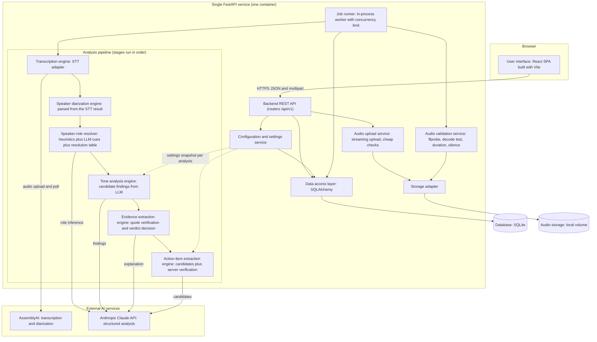
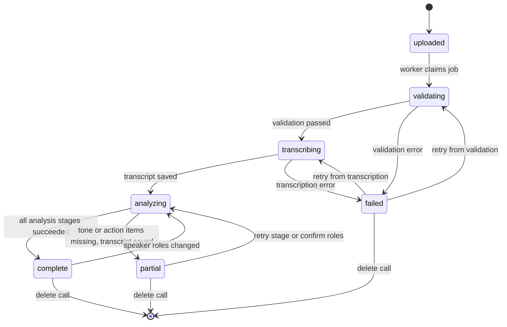
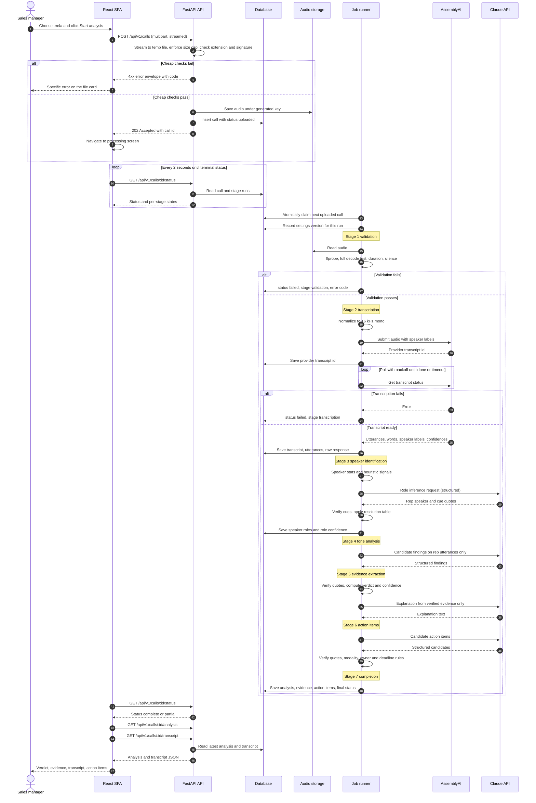
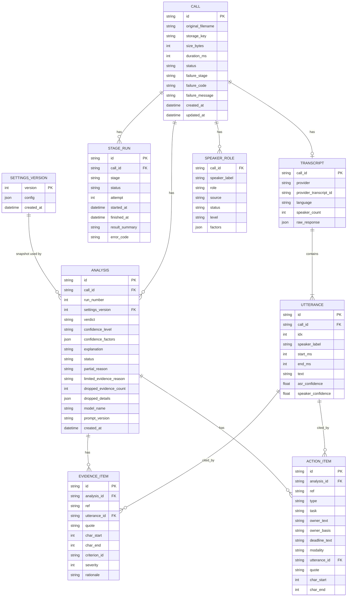

# ARCHITECTURE.md: Technical Architecture

**Product:** Sales Call Quality Analysis Agent
**Source documents:** `PRD.md` v1.0 and `DESIGN.md` v1.0 (both treated as source of truth)
**Status:** Draft v1.0. No application code is specified here, only architecture, contracts, algorithms and configuration.
**Timebox this design targets:** 24-48 hours, one engineer.

---

## 0. How to Read This Document

### 0.1 Evidence Standard for Tool Capabilities
The brief says not to claim a tool provides a capability unless the selected implementation supports it. Every external capability below is tagged:

| Tag | Meaning |
|---|---|
| **[Verified]** | Confirmed against the provider's public documentation while writing this document |
| **[Assumed, verify Day 0]** | Believed correct but not confirmed. Listed in Appendix A as a smoke-test checklist item |
| **[Ours]** | Implemented by our own code, so it does not depend on a provider claim |

Anything that matters for correctness (evidence grounding, verdict computation, owner/deadline rules) is **[Ours]** by design, so reliability never depends on a provider promise.

### 0.2 Defaults Chosen Because Questions Were Unanswered
PRD section 10.4 asked which providers and API keys you have, whether auth is needed, and how the demo is delivered. These were not answered, so this document makes the following defaults. Each is isolated behind a config value or adapter so it can be changed cheaply:

| Open question (PRD) | Default used here |
|---|---|
| Q1 providers | AssemblyAI (transcription + diarization) and Anthropic Claude (analysis). Two API keys needed |
| Q2 authentication | No application login. Optional HTTP Basic gate for a hosted demo (see 10.3) |
| Q3 delivery | One Docker container (API + built frontend) hosted on a platform with a persistent volume; local run documented |
| Q4 test calls | Scripted two-voice synthetic calls, with scripts and expected verdicts committed |
| Q5 low confidence | Always return RED or GREEN; show the confidence level and limited-evidence banner (per DESIGN 6D) |

---

## 1. Technology Stack Selection

### 1.1 Summary

| Layer | Selected | One-line reason |
|---|---|---|
| Frontend | **React 18 + TypeScript + Vite**, Tailwind CSS (tokens from DESIGN.md), Radix UI primitives, TanStack Query, React Router, lucide-react | DESIGN.md is a custom token system with many stateful accessible components; Tailwind + headless primitives implement it exactly without fighting a theme |
| Charting | **No chart library.** One hand-built stacked bar (HTML/SVG) | DESIGN.md specifies a single stacked bar with patterns and a table toggle; a library would add weight and fight the pattern/a11y requirements |
| Backend | **Python 3.12 + FastAPI** (Uvicorn), Pydantic v2, SQLAlchemy 2.0 | Async upload streaming, automatic OpenAPI, Pydantic validation reused for LLM output schemas |
| Background work | **In-process job runner backed by the database** | Simplest reliable option for one service; no Redis or Celery |
| Database | **SQLite (WAL mode)** for the MVP, Postgres-ready via `DATABASE_URL` | Zero setup, single file, enough for a single-user demo |
| Audio tooling | **FFmpeg / ffprobe** | Integrity check, duration, silence detection, normalization |
| Transcription + diarization | **AssemblyAI** via its official Python SDK (one call returns utterances, word timestamps, speaker labels) | Provides per-word confidence and optional per-speaker confidence, which the PRD's "confidence where available" needs |
| LLM analysis | **Anthropic Claude** via the official SDK, schema-constrained output or strict tool use, always re-validated with Pydantic | One vendor for role inference, tone findings, explanation and action items |
| Storage | **Local disk behind a `Storage` interface**; S3-compatible adapter is an optional post-MVP implementation | Meets "local for development, S3 for production" without building both for the demo |
| Deployment | **Single Docker container** on a host with a persistent volume (Fly.io, Render or Railway class platforms) | One deployable, no CORS, SQLite and audio on one volume |
| Tests | pytest (+ fake providers), Vitest + Testing Library, optional Playwright smoke | Fast feedback on the safeguards that matter |

### 1.2 Frontend

| Option | Assessment |
|---|---|
| **React + Vite + TS + Tailwind + Radix (selected)** | Token-driven styling maps 1:1 to the CSS variables in DESIGN.md 13.1. Radix provides accessible Dialog, Tabs, Switch, RadioGroup, Popover, Tooltip, DropdownMenu, ToggleGroup, Toast with correct keyboard and ARIA behavior, which DESIGN.md section 9 demands. TanStack Query gives polling, caching and retry states that match the DESIGN loading/error patterns |
| Plain HTML/CSS/JS | Fastest to start, but the Results screen (linked highlighting, search, tabs, polling, role modal) becomes hand-rolled state management. Higher bug risk |
| Bootstrap or a full component library (MUI, Ant) | Its visual identity and token model conflict with DESIGN.md "do not introduce arbitrary colors or typography"; overriding costs more than building on primitives |
| Next.js | SSR is unnecessary for an authenticated-less single-user tool and adds a second runtime |

Libraries (all common, pinned in lockfile): `react`, `react-dom`, `react-router-dom`, `@tanstack/react-query`, `@radix-ui/react-*` (dialog, tabs, switch, radio-group, popover, tooltip, dropdown-menu, toggle-group, toast, accordion), `lucide-react`, `react-hook-form` + `zod` (settings validation), `openapi-typescript` (generates API types from the FastAPI OpenAPI schema so frontend and backend contracts cannot drift), `@tanstack/react-virtual` (only if transcripts exceed performance limits), Vitest, Testing Library.

### 1.3 Backend

| Option | Assessment |
|---|---|
| **FastAPI (selected)** | Native async for streaming uploads and provider I/O, Pydantic models shared by API contracts and LLM output validation, auto-generated OpenAPI feeds the TypeScript types, tiny footprint |
| Django (+ DRF) | Strong admin/ORM/auth we do not need; heavier setup, slower to a clean typed API, async story is weaker for streamed uploads |

**API style:** REST + JSON under `/api/v1`. Long work is asynchronous: `POST` returns `202` immediately and the client polls a status resource (DESIGN.md 6C permits polling).

### 1.4 Database

| Criterion | SQLite (selected for MVP) | PostgreSQL |
|---|---|---|
| Setup time | None (a file) | Needs a managed instance or container |
| Demo hosting | Works on one container + volume | Extra service to provision and pay for |
| Concurrency | Single writer; fine for one user and 2 concurrent jobs with WAL + busy timeout | Strong multi-writer concurrency |
| Search | `LIKE` on filename is adequate at demo scale | `pg_trgm` / full text available |
| Migration risk | Low if we stay portable | n/a |
| Production readiness | Limited (single host) | High |

**Decision:** SQLite in WAL mode, with portable SQLAlchemy types only (generic `JSON`, no SQLite-specific SQL, UUID stored as string). Moving to Postgres is a `DATABASE_URL` change plus running Alembic migrations. Trade-off accepted: no horizontal scaling and one app process, which also matches the in-process job runner (section 6.4).

### 1.5 AI and Audio Processing

Two principles drive the design, both from the brief:
1. A transcription model alone cannot reliably identify the sales representative or judge tone. Those are separate, verifiable steps.
2. The language model proposes; **our deterministic code verifies and decides.** The LLM never directly sets the verdict, the owner, the deadline or a timestamp.

#### 1.5.1 Pipeline Components

| Capability | Selected approach | Capability status |
|---|---|---|
| Audio processing, `.m4a` validation and decoding | FFmpeg/ffprobe: container and stream inspection, full decode test, duration, silence detection. Normalization to 16 kHz mono before sending to STT | **[Ours]** orchestration; FFmpeg decode and probe behavior is standard. FLAC acceptance by the STT provider is **[Assumed, verify Day 0]**; fallback is to send the validated original `.m4a` |
| Speech-to-text | AssemblyAI async transcription | Per-word timestamps and confidence **[Verified]**; submission of files up to 5 GB **[Verified]** (we cap at 50 MB / 30 min by PRD) |
| Speaker diarization | Same AssemblyAI request with `speaker_labels` enabled; speaker-count range via `speaker_options` | `speaker_labels`, utterances with speaker labels, `speakers_expected` and `speaker_options.min/max_speakers_expected` **[Verified]**. Optional `include_speaker_confidence` per word and per utterance **[Verified]** (field availability on the chosen model: **[verify Day 0]**) |
| Sales-rep identification | Hybrid: deterministic features + one LLM role-inference call whose cues must be verbatim quotes, then a deterministic resolution table, then user confirmation if not confident | **[Ours]** (section 3, Stage 4) |
| Tone classification | LLM extracts candidate **findings** (rep utterance ID + verbatim quote + criterion + severity); the **server** verifies and computes RED/GREEN | **[Ours]** decision logic; schema-constrained output is a provider feature **[Verified]** for Claude, but we validate with Pydantic regardless |
| Evidence extraction | Server-side quote verification (exists verbatim in the cited utterance, utterance belongs to the rep) and offsets for UI highlighting | **[Ours]** |
| Action-item extraction | LLM extracts candidates; the server verifies quote, modality, owner and deadline rules | **[Ours]** |

#### 1.5.2 Speech-to-Text and Diarization Options Considered

| Option | Pros | Cons | Verdict |
|---|---|---|---|
| **AssemblyAI (selected)** | Utterances with speaker labels, word timestamps, word confidence, optional speaker confidence, speaker-count hints, one API call, no GPU | Third-party data processing; account and key required | **Selected** |
| OpenAI `gpt-4o-transcribe-diarize` | One vendor key if OpenAI were also the LLM; accepts m4a; returns `diarized_json` segments with `speaker`, `start`, `end` **[Verified]** | Requires `chunking_strategy` for audio over 30 s, does not support prompts, and per the docs does not offer word timestamps or logprobs for this model **[Verified]**; no diarization confidence field in the documented response | **Documented fallback adapter** (needs more of our own chunking and gives less confidence data) |
| Whisper (local or API) + pyannote.audio | Open-source, can run offline | Two systems to integrate; pyannote needs a Hugging Face token and model-terms acceptance and is slow on CPU; alignment of Whisper words to diarization turns is our code to build and debug | Rejected for the 48-hour window; revisit for privacy-sensitive deployments |
| Gemini audio transcription | Diarization and word timestamps in one call **[Verified in docs]** | Documents that attribution for 3 or more speakers is experimental; adds a third vendor | Not selected |
| Deepgram | Common call-analytics choice | Not verified in this session | Not evaluated; the adapter interface permits adding it |

#### 1.5.3 LLM Provider
Anthropic Claude via the official Python SDK. Model is configured (`LLM_MODEL`), defaulting to a mid-tier model for cost and latency; the model string is an env value and must be confirmed against the account at Day 0. Claude supports two structured-output mechanisms, JSON outputs and strict tool use **[Verified]**, with JSON-schema limits (for example `additionalProperties: false` is required and numeric/string-length constraints are not supported **[Verified]**). Consequence for design: **length and range limits are enforced by our Pydantic validation after the response, not by the provider schema.** Whether the direct API requires a beta flag for the chosen model is **[verify Day 0]**; the fallback is a plain tool-use call with `input_schema` plus Pydantic validation and one repair retry, which works regardless of the structured-output feature.

### 1.6 Storage

| Concern | MVP design |
|---|---|
| Interface | `Storage` with `save(key, stream)`, `open(key)`, `delete(key)`, `exists(key)` |
| Local (implemented) | Directory from `STORAGE_LOCAL_PATH` (default `./data/audio`), outside any static/web root, files named `{call_id}.m4a`. Directory mode `0700`, files `0600` |
| S3-compatible (optional post-MVP) | Adapter using the same interface with private bucket, server-side encryption, no public ACLs, and short-lived pre-signed URLs only if a feature ever needs to stream audio. Not required for any MVP screen |
| Access control | **Audio is never served back to the browser in the MVP** (DESIGN.md has no player; synchronized playback is V2). No audio download route exists |
| Keys | Server-generated UUIDs only; user filenames are stored as display metadata, never used as paths |
| Normalized derivative | Written to a temp directory for the STT upload and deleted at the end of the stage |
| Analysis data | Stored in the database, not on disk (transcript, utterances, analyses, evidence, action items) |
| Raw provider response | Stored compressed in the database (`transcripts.raw_response`) so analysis stages can be re-run without re-transcribing |

### 1.7 Deployment Options

| Option | Description | Pros | Cons | Verdict |
|---|---|---|---|---|
| **A. Single container (selected)** | FastAPI serves `/api/*` and the built SPA. SQLite file and audio directory on one persistent volume. Hosted on a container platform with volumes | One deployable, same origin (no CORS), simplest HTTPS and Basic Auth, cheap | Single instance, restart interrupts in-flight jobs (handled by recovery, 6.4) | **Selected** |
| B. Split | Frontend on a static host (Vercel/Netlify class), backend on a container host, managed Postgres, S3 bucket | Closer to a production topology | Four moving parts, CORS, secrets in two places; poor use of 48 hours | Documented upgrade path |
| C. Local only | `docker compose up` or two terminals (uvicorn + Vite) | No hosting | Reviewer cannot try it without setup | Always supported (README), but a hosted demo is preferred |

Platform notes (verify plan features at deploy time): choose a plan where the instance does not sleep during a demo and a persistent volume is available; ephemeral disks would lose SQLite and audio on redeploy. The Docker image must install FFmpeg.

---

## 2. High-Level System Architecture

### 2.1 Architecture Diagram



### 2.2 Component Responsibilities

| Component | Responsibility | Must not |
|---|---|---|
| **User interface (React SPA)** | Renders every screen per DESIGN.md; uploads with real byte progress; polls status; renders transcript, evidence, action items; edits settings | Hold secrets, call AI providers, or compute verdicts |
| **Backend REST API** | Routing, request/response validation, centralized error mapping, serves the built SPA, exposes read models (call, status, transcript, analysis, dashboard, export) | Run long work inside a request |
| **Audio upload service** | Streams the multipart body to a temp file while enforcing the size cap; checks extension, declared content type (advisory), and MP4 `ftyp` signature; stores the file under a generated key; creates the call row; enqueues it | Trust the filename or `Content-Type` alone; buffer the whole file in memory |
| **Audio validation service** | Stage 1 deep checks: container/stream probe, full decode test, duration range, silence detection. Produces a typed result with an error code | Make any paid API call (FR-U5) |
| **Transcription engine** | Normalizes audio, submits to the STT provider, polls, stores `provider_transcript_id` immediately, converts the response into internal `Utterance` objects, stores raw response and metadata | Fabricate text on failure |
| **Speaker diarization engine** | Maps provider speaker labels (A, B, ...) to stable internal labels; records speaker confidence where present; computes per-speaker stats (talk time, turns) | Decide which speaker is the sales rep |
| **Speaker-role resolver** | Produces `speaker_roles` with a source (auto/user), a confidence level and the factors behind it. Never assumes the first speaker is the rep | Silently pick a rep when evidence is weak |
| **Tone analysis engine** | Builds the prompt from the settings snapshot; sends only rep utterances as the evaluation target (customer lines as labelled read-only context); returns candidate findings | Output the verdict as authoritative |
| **Evidence extraction engine** | Verifies each finding against the transcript, derives character offsets, computes the verdict from verified findings and the sensitivity rule, computes the confidence level, drops and records unverifiable items, requests the explanation grounded only in verified evidence | Accept an unverifiable quote or a customer utterance as evidence |
| **Action-item extraction engine** | Requests candidates, then verifies quote, modality, enabled types, owner basis and deadline text; sets unsupported fields to null | Infer owners or deadlines; keep hypothetical items (unless the setting allows tentative) |
| **Configuration/settings service** | Validates and persists settings as immutable versions; supplies the current version to new analyses; builds prompt fragments from settings | Edit historical snapshots |
| **Job runner** | Claims queued calls atomically, runs the pipeline in a bounded worker pool, records stage events, recovers interrupted jobs at startup | Block API requests |
| **Storage adapter** | Saves, reads, deletes audio behind an interface | Serve files to clients |
| **Data access layer** | All persistence through SQLAlchemy models and repository-style functions | Contain business rules |
| **Database** | System of record: calls, stage runs, transcripts, utterances, roles, settings versions, analyses, evidence, action items | n/a |
| **External AI services** | AssemblyAI for transcription and diarization; Claude for role cues, findings, explanation, action-item candidates | Be trusted for correctness; every output is validated |

---

## 3. Audio Analysis Pipeline

### 3.1 Stage Map (aligned with DESIGN.md 6C)

| UI stage (DESIGN) | Internal stage key | Work performed |
|---|---|---|
| 1 Audio validation | `validation` | Deep validation (upload-time cheap checks have already run) |
| 2 Audio transcription | `transcription` | Normalize, submit to STT, poll, persist utterances (diarization labels arrive in the same response) |
| 3 Speaker identification | `speaker_identification` | Compute speaker stats, resolve which speaker is the sales rep, set role confidence |
| 4 Tone analysis | `tone_analysis` | LLM Call A: candidate findings on rep utterances |
| 5 Evidence extraction | `evidence_extraction` | Verify findings, compute verdict and confidence, LLM Call B: grounded explanation |
| 6 Action-item extraction | `action_items` | LLM Call C: candidates, then verification |
| 7 Analysis completion | `completion` | Persist analysis, set final status, clean up temp files |

The worker emits a database stage event at the start and end of each stage. The UI's stepper reads these events, so a stage is shown Completed only after it truly finished (DESIGN.md 6C honesty rules).

### 3.2 Call Status State Machine



Clarification of DESIGN.md 13.2: **`failed` means no usable transcript exists** (validation or transcription failed, or the job was interrupted beyond retry). If the transcript is saved and an analysis stage fails, the status is **`partial`** (PRD FR-E5; DESIGN 6D.7). The Failed chip and the Partial chip therefore never overlap.

### 3.3 Stage 1: Upload and Validation

**Synchronous at upload time (cheap, cannot be offloaded safely):**

| Check | Rule | Failure response |
|---|---|---|
| Size | Stream the body to a temp file; abort as soon as bytes exceed `MAX_UPLOAD_SIZE_MB` (default 50); also reject by `Content-Length` when declared | `413 FILE_TOO_LARGE` |
| Empty file | Zero bytes | `422 FILE_EMPTY` |
| Extension | Case-insensitive `.m4a` only | `415 INVALID_FILE_TYPE` |
| Declared type | `audio/mp4`, `audio/x-m4a`, `audio/m4a` accepted; `application/octet-stream` tolerated; other types rejected. Advisory only | `415 INVALID_FILE_TYPE` |
| Container signature | Bytes 4-8 equal `ftyp`; major brand in an allow list (`M4A `, `mp42`, `isom`, `M4B `, `mp41`, `iso2`). Defeats a renamed `.mp3` | `415 INVALID_FILE_TYPE` |
| Single file | More than one file part | `422 TOO_MANY_FILES` |

On success: move the temp file to storage under `{call_id}.m4a`, insert the call (`uploaded`), enqueue, return `202`.

**Asynchronous in the worker (stage `validation`):**

| Check | Method | Error code |
|---|---|---|
| Probe | `ffprobe` on the stored file with a timeout and no shell; must report an audio stream with an AAC or ALAC codec | `AUDIO_UNREADABLE` |
| Integrity | Full decode to null (`ffmpeg -v error -i in -f null -`); any decode error output means corruption; 120 s timeout | `AUDIO_CORRUPTED` |
| Duration | `MIN_DURATION_SEC` (10) to `MAX_DURATION_SEC` (1800); duration taken from the decoded stream, not only container metadata | `DURATION_OUT_OF_RANGE` |
| Silence | Measure mean/peak level; if effectively silent for the whole file | `AUDIO_SILENT` |
| DRM/encrypted | Probe reports no decodable stream | `AUDIO_UNREADABLE` |

Any failure sets `status=failed`, `failure_stage=validation`, stores the specific message, and **makes no paid API call**. Duration is saved on the call for the UI file card.

### 3.4 Stage 2: Audio Processing and Transcription

1. **Normalize:** FFmpeg transcodes to 16 kHz, mono, lossless (FLAC) into a temp directory. Mono downmix is deliberate: it avoids assuming the channel layout carries one speaker per channel. (If a recording is genuinely dual-channel, per-channel transcription could improve attribution; that is not claimed or implemented in the MVP.)
2. **Chunking.**
   - *Audio:* none required with the selected provider, because the PRD caps recordings at 30 minutes and AssemblyAI accepts far larger files **[Verified]**. Chunking is needed only if the OpenAI fallback adapter is enabled, because that model requires a `chunking_strategy` for audio over 30 seconds **[Verified]**; that adapter would use the provider's own chunking option rather than our splitting.
   - *Text for the LLM:* a 30-minute call is roughly 4,000-6,000 words, which fits in one request. A guard (`LLM_MAX_INPUT_TOKENS`) switches to **utterance-aligned windows with overlap** only if a transcript exceeds the budget; findings and action items from each window are merged and de-duplicated by `utterance_id`.
3. **Submit** with speaker labels enabled, speaker-count range (`STT_MIN_SPEAKERS`, `STT_MAX_SPEAKERS`; start with 1 and 3 and tune on test calls, because the provider warns that an over-high maximum causes over-splitting **[Verified]**), and speaker confidence if available.
4. **Persist the provider job ID immediately** after submission (`transcripts.provider_transcript_id`). If the process restarts mid-job, recovery resumes polling by ID instead of paying for a second submission.
5. **Poll** with a bounded interval and an overall timeout (`STT_TIMEOUT_SEC`, default `max(300, 3 x duration)`); transient errors are retried with exponential backoff and jitter (6.5).
6. **Normalize the response** into internal utterances: `idx`, `speaker_label`, `start_ms`, `end_ms`, `text`, `asr_confidence` (mean of word confidences, nullable), `speaker_confidence` (nullable), plus word-level data kept in the stored raw response.
7. **Store metadata:** provider, model/config used, language, speaker count, audio seconds billed or processed, request/response timing.
8. **Failure handling:** any non-recoverable provider error sets `failed` with `failure_stage=transcription`, a mapped error code (`STT_PROVIDER_ERROR`, `STT_TIMEOUT`, `STT_EMPTY_TRANSCRIPT`, `STT_UNSUPPORTED_AUDIO`), and a retry button. **No transcript text is ever synthesized.** An empty or near-empty transcript (for example fewer than 5 words) is treated as `STT_EMPTY_TRANSCRIPT`.

### 3.5 Stage 3: Speaker Diarization Handling and Role Resolution

Diarization output is treated as **evidence about voices, not about roles.** Labels such as "A" and "B" carry no meaning. Speaker order is never used as the deciding signal.

**Diarization sanity checks (deterministic, [Ours]):**
- Speaker count 1: attribution impossible -> role status `unresolved`.
- Speaker count 2: expected case.
- Speaker count 3 or more: allowed, but role status cannot be `confident` (customer plus third voice such as a transferred colleague); the user is asked to confirm.
- Micro-speaker: any speaker with under 5% of talk time and under 10 seconds is flagged as a likely diarization artifact and its utterances are marked `low_attribution`.
- Rapid label flips: many alternating one-word utterances lower the role confidence factor ("cross-talk").

**Role resolution algorithm:**

| Step | Description |
|---|---|
| A. Speaker stats | Talk time, turn count, first-speaker flag, average utterance length, question-mark rate per speaker |
| B. Heuristic signals (weak prior) | Phrase patterns: company/self introduction ("my name is... from..."), product/pricing offers, closing with next steps, discovery questions (rep indicators); problem statements and inquiries about the product (customer indicators). Returns a lean toward A, B or neutral. First-speaker is a very weak feature and never decisive |
| C. LLM role inference (Call 0) | Input: speaker stats, the first 12 and last 6 utterances, and a sample of mid-call utterances, all with their `utterance_id` and speaker label. Output (schema-validated): `rep_speaker` (label or null), `cues` (up to 4 items each with `utterance_id` and a verbatim `quote`), `rationale`. **Cues are verified with the same quote matcher used for evidence;** unverified cues are discarded. The LLM's self-stated certainty is ignored |
| D. Resolution table | See below |
| E. User confirmation | If not `confident`, the UI shows the warning banner and the roles modal (DESIGN 6D.2, 7.8). A user choice sets `source=user` and overrides everything |

**Resolution table (applied by code):**

| Condition | Role status | Level | Behavior |
|---|---|---|---|
| Exactly 2 speakers, LLM pick has at least 1 verified cue, heuristic agrees, each speaker has at least 15 s or 15% talk time | `confident` | High | Proceed |
| 2 speakers, LLM pick has at least 1 verified cue, heuristic neutral or unavailable | `confident` | Medium | Proceed; confidence capped at Medium |
| 2 speakers, LLM and heuristic disagree, or LLM has no verified cue | `uncertain` | Low | Proceed **provisionally** using the LLM's pick if present; banner "We aren't certain which speaker is the sales rep"; confidence forced to Low |
| 3 or more speakers | `uncertain` | Low | Provisional pick if LLM names one; banner; user asked to confirm |
| 1 speaker, or LLM returns null and no heuristic lean | `unresolved` | n/a | Tone is **not** run (never guess); action items still extracted; final status `partial` with reason `ROLES_UNRESOLVED`; UI offers "Assign sales rep lines" (DESIGN 6G.6) |
| User confirmed roles | `confirmed` | High | Overrides, `source=user` |

Design note (resolves a DESIGN.md ambiguity): DESIGN 6G.6 describes a "Continue without tone result" choice. To avoid a paused-job state, the pipeline **does not wait**: it finishes the remaining stages that do not require roles and ends `partial`. "Continue without tone result" is then simply dismissing the banner; "Assign sales rep lines" starts a re-run (below). Both user-visible behaviors in DESIGN are preserved.

**Role correction and re-run.** `PUT /calls/:id/speaker-roles` stores `source=user` roles and creates a **new analysis version** by re-running stages 4-7 on the stored transcript (no re-upload, no re-transcribe), using the **current** saved settings, as stated in the modal (DESIGN DD-06). Previous analyses are kept for audit; the API returns the latest.

### 3.6 Stage 4: Tone Analysis (LLM Call A)

**Inputs (built by code from the settings snapshot and role mapping):**
- `<evaluation_target>`: **only** the rep's utterances, each as `[u17] text`.
- `<read_only_context>`: customer utterances, each as `[u16] text`, explicitly marked "NOT EVALUATED, for context only".
- Enabled criteria (ids, labels, descriptions) including custom criteria; sensitivity text; optional custom guidance inside `<team_guidance>` with a fixed preamble stating it cannot change output format, evidence rules or the target speaker.
- A fixed severity rubric: 1 = mild (curt, impatient), 2 = clear (dismissive, disrespectful, talking over a concern), 3 = severe (hostile, insulting, threatening). Includes a rule to weigh context so professional firmness is not mislabeled (FR-T9).
- Temperature 0, bounded output tokens.

**Output schema (Pydantic-validated; also given to the provider as the structured-output schema):**

```
ToneFindings {
  findings: [ {
    utterance_id: string        // must be one of the rep utterance ids
    quote: string               // verbatim excerpt from that utterance
    criterion_id: enum          // restricted to enabled criteria
    severity: 1 | 2 | 3
    rationale: string           // short, why this quote matches the criterion
  } ]
  insufficient_evidence: boolean   // model's note that rep speech was too short to judge
}
```

The model is **not** asked for the verdict. `insufficient_evidence` is advisory input to the limited-evidence banner and is cross-checked against measured rep speech seconds.

### 3.7 Stage 5: Evidence Verification, Verdict and Confidence

All steps in this stage are **[Ours]**.

**5.1 Quote verification (per finding):**

| Check | Rule | Drop reason code |
|---|---|---|
| Utterance exists | `utterance_id` is in this call | `UNKNOWN_UTTERANCE` |
| Speaker is the rep | The utterance's speaker maps to the `sales_rep` role | `NOT_REP_UTTERANCE` |
| Quote is verbatim | After normalization (Unicode NFKC, casefold, collapse whitespace, strip surrounding quotes, ignore punctuation differences) the quote is a contiguous substring of the utterance text | `QUOTE_NOT_FOUND` |
| Quote is meaningful | 3 to 60 words and at most 400 characters | `QUOTE_TOO_SHORT` / `QUOTE_TOO_LONG` |
| Criterion allowed | `criterion_id` is enabled in the snapshot | `CRITERION_DISABLED` |
| De-duplicated | Same utterance and overlapping span merged (keep higher severity) | `DUPLICATE` |

The matcher returns character offsets into the **original** utterance text (using an index map from the normalized string), so the UI can underline the exact span (DESIGN 7.12). The timestamp for each item is the utterance `start_ms` from the stored transcript, **never** a model-supplied value.

**5.2 Retry on weak output.** If the response fails schema validation, or more than half of the findings were dropped for `QUOTE_NOT_FOUND`/`NOT_REP_UTTERANCE`, the stage makes **one** repair call that quotes the specific rejections back to the model. A second failure marks the tone stage failed (no fallback to guessing).

**5.3 Verdict decision (sensitivity rule, mirrors PRD FR-T5):** computed from verified findings only.

| Sensitivity | RED when |
|---|---|
| Low | at least one verified finding with severity 3 |
| Medium (default) | at least one verified finding with severity 2 or 3, **or** two or more verified findings of any severity (repeated milder behavior) |
| High | at least one verified finding of any severity |

Otherwise GREEN. If findings were dropped and the verdict would have differed with them, the dropped count is stored and the "quotes could not be verified" banner is shown (DESIGN 6D.2). The verdict is never raised because of an unverified item.

**5.4 Confidence level (rule-based, not a probability).** The level is the **minimum** of independent factor levels; the factors are stored and shown in the "Why?" popover (DESIGN 6D.1):

| Factor | High | Medium | Low |
|---|---|---|---|
| Role confidence | `confirmed` or `confident-High` | `confident-Medium` | `uncertain` |
| Rep speech analyzed | at least 45 s | 15-45 s | under 15 s |
| Evidence strength (RED) | 2 or more verified findings | exactly 1 | n/a |
| Review coverage (GREEN) | at least 60 s rep speech and no verified sub-threshold findings | 20-60 s, or sub-threshold findings exist | under 20 s |
| Transcription quality on rep words (if word confidences available) | at most 10% of rep words below 0.7 confidence | at most 25% | above 25% |
| Dropped evidence | none | 1 dropped | 2 or more dropped |

Thresholds are named constants in one module, are initial values, and are tuned and documented in the reliability notes after testing. If a factor's data is unavailable it is listed as "not available" and does not limit the level. The API never returns a percentage. When the level is Low, or rep speech is under 15 s, or roles are uncertain, the API sets `limited_evidence_reason` (specific text) for the DESIGN banner.

**5.5 Explanation (LLM Call B).** A second, small call receives only the verified findings (or, for GREEN, the enabled criteria plus counts) and returns a 2-4 sentence explanation. Rules in the prompt: reference only provided evidence IDs; describe behavior, not character; **no claims of positive quality or "professionalism"**; for GREEN say only that no behavior matching the enabled criteria was found at the stated sensitivity. A schema-level guard rejects explanations that cite evidence IDs not in the verified set; one retry; on repeated failure the stage stores the verdict with explanation `null` and marks the analysis partial (never invent text).

### 3.8 Stage 6: Action-Item Extraction (LLM Call C)

**Inputs:** the full transcript with `[uN] Role: text` lines (all speakers, since customer commitments are allowed when the setting is on), enabled action-item types, owner rule, deadline rule, tentative-statement setting, custom guidance in the same fenced `<team_guidance>` block.

**Output schema (validated):**

```
ActionCandidates {
  items: [ {
    type: enum                 // commitment | follow_up | information_promised | customer_task (restricted to enabled)
    task: string               // short wording that stays close to the quote
    utterance_id: string
    quote: string              // verbatim excerpt supporting the item
    modality: enum             // definite | tentative | conditional | hypothetical | question
    owner_text: string | null  // exactly as stated in the transcript, else null
    owner_basis: enum          // explicit_name | explicit_role | committing_speaker | none
    deadline_text: string | null // exactly as stated in the quote, else null
  } ]
}
```

**Server verification ([Ours]) for each candidate:**

| Rule | Enforcement |
|---|---|
| Quote exists verbatim in the cited utterance | Same matcher as evidence; else drop (`QUOTE_NOT_FOUND`) |
| Not hypothetical | Keep only `definite`; keep `tentative` only if "Include tentative statements" is on (then tagged tentative); drop `conditional`, `hypothetical`, `question` always |
| Type enabled | Drop types disabled in the settings snapshot |
| Owner | `explicit_name` / `explicit_role`: `owner_text` must appear (normalized) in the quote or the same utterance, else owner becomes null. `committing_speaker` (only when the owner rule is "Explicit or the committing speaker"): the **server** sets the owner to the Role label of the utterance's speaker, and only if role status is `confirmed` or `confident`; otherwise null. The model never supplies a role label |
| Deadline | `deadline_text` must appear verbatim (normalized) in the quote; else null. Displayed exactly as stated; never converted to a calendar date. If "Capture relative deadlines as stated" is off, only deadlines containing an explicit calendar date pattern are kept (month-name plus day, or numeric date), via a regex whitelist |
| De-duplicate | Items on the same utterance or overlapping spans are merged |
| Timestamp | From the utterance `start_ms` |

Unsupported owners and deadlines are stored as `NULL` and rendered "Not specified" (DESIGN 7.14). The PRD's optional "extraction confidence" is **not stored as a number**: a model-reported score is unverified. Instead the record keeps `modality` and `owner_basis`, which are inspectable facts. This is recorded as ADR-14.

Known limitation: the `task` wording is AI-written and cannot be fully verified; the UI mitigates by always showing the verbatim quote next to it and labelling the task "AI summary" (DESIGN 7.14).

### 3.9 Stage 7: Results

In one transaction: write the `analyses` row, `evidence_items`, `action_items`, final `calls.status` (`complete` when tone and action items both succeeded, otherwise `partial` with a reason), `stage_runs` closure, then delete temp files. The API exposes the stored result through read endpoints (section 6.2). If `AUDIO_RETENTION_DAYS=0`, the original audio is deleted at this point as well (see 10.5).

---

## 4. Data Flow

### 4.1 Data Flow by Component

| From | To | Data | Notes |
|---|---|---|---|
| Frontend | Backend | Multipart upload (file); JSON for settings, roles, retry, delete; polling GETs | Upload via `XMLHttpRequest` for real progress and abort |
| Backend | Audio storage | Streamed file bytes under a generated key | Temp file first, then atomic move |
| Backend | Database | Call, stage runs, transcript, utterances, roles, analyses, evidence, items, settings versions | Single transaction per stage result |
| Worker | Audio storage | Read stored audio for validation and normalization | Temp files in a private scratch dir |
| Worker | Transcription service (AssemblyAI) | Normalized audio; config (speaker labels, speaker range); poll by ID | HTTPS only; provider ID stored immediately |
| Worker | Diarization | Same response as transcription; parsed into utterances with speaker labels and optional confidences | Not a separate service in the MVP |
| Worker | LLM service (Claude) | Prompt text and schema; transcript text only (never audio) | Temperature 0; each call logged with token counts |
| Worker | Database | Results of each stage | |
| Backend | Frontend | JSON read models and error envelopes | Gzip enabled |

### 4.2 Sequence Diagram: Complete Call Analysis Request



### 4.3 Data Model (Entity-Relationship)



Notes: the append-only `SETTINGS_VERSION` table makes "Settings v{n}" (DESIGN 6F, 6D.6) and the "differs from current settings" chip trivial (compare version numbers, then diff on demand). The latest analysis for a call is the highest `run_number`.

---

## 5. Project Folder Structure

### 5.1 Tree

```
sales-call-quality-agent/
├── README.md                          # setup, tools, assumptions (deliverable)
├── PRD.md
├── DESIGN.md
├── ARCHITECTURE.md
├── .env.example                       # placeholders only, never real keys
├── .gitignore                         # includes .env, data/, *.db
├── Dockerfile                         # multi-stage: build frontend, run backend
├── docker-compose.yml                 # local convenience (volume for ./data)
├── Makefile                           # dev, test, lint, build shortcuts
│
├── docs/
│   ├── DESIGN_DECISIONS.md            # design decisions and trade-offs (deliverable)
│   ├── KNOWN_LIMITATIONS.md           # (deliverable)
│   ├── RELIABILITY_TESTING.md         # how reliability was tested, results (deliverable)
│   └── prompts.md                     # human-readable prompt rationale and versions
│
├── samples/                           # consented/synthetic test calls (deliverable)
│   ├── red_call_01.m4a
│   ├── red_call_01.script.md          # script, speaker roles, expected verdict and evidence
│   ├── green_call_01.m4a
│   ├── green_call_01.script.md
│   └── README.md                      # how the recordings were produced
│
├── scripts/
│   ├── generate_sample_calls.py       # optional: TTS two-voice generator from scripts
│   └── eval_golden_set.py             # runs golden transcripts through the real LLM (opt-in)
│
├── backend/
│   ├── pyproject.toml                 # pinned dependencies
│   ├── alembic.ini
│   ├── alembic/
│   │   ├── env.py
│   │   └── versions/
│   │       └── 0001_initial.py
│   ├── app/
│   │   ├── __init__.py
│   │   ├── main.py                    # app factory, middleware, router mounting, SPA static
│   │   ├── config.py                  # Pydantic Settings: all env vars, validated at startup
│   │   ├── logging_config.py          # structured JSON logging, request/call id context
│   │   ├── errors.py                  # AppError hierarchy + error-code catalog
│   │   ├── error_handlers.py          # exception -> error envelope mapping
│   │   ├── dependencies.py            # FastAPI dependencies (db session, services)
│   │   │
│   │   ├── api/
│   │   │   └── v1/
│   │   │       ├── router.py          # includes all routers
│   │   │       ├── calls.py           # upload, list, detail, status, transcript, analysis, retry, roles, delete
│   │   │       ├── exports.py         # json and markdown export
│   │   │       ├── settings.py        # get, put, reset
│   │   │       ├── dashboard.py       # summary
│   │   │       └── health.py          # liveness and readiness
│   │   │
│   │   ├── db/
│   │   │   ├── base.py                # declarative base, naming conventions
│   │   │   ├── session.py             # engine, session factory, SQLite pragmas (WAL, busy_timeout)
│   │   │   └── models/
│   │   │       ├── call.py            # Call, StageRun
│   │   │       ├── transcript.py      # Transcript, Utterance
│   │   │       ├── speaker_role.py    # SpeakerRole
│   │   │       ├── settings.py        # SettingsVersion
│   │   │       └── analysis.py        # Analysis, EvidenceItem, ActionItem
│   │   │
│   │   ├── schemas/                   # Pydantic: API contracts
│   │   │   ├── common.py              # error envelope, pagination
│   │   │   ├── call.py
│   │   │   ├── transcript.py
│   │   │   ├── analysis.py
│   │   │   ├── settings.py            # settings document + validation rules
│   │   │   └── dashboard.py
│   │   │
│   │   ├── services/                  # business logic used by routers
│   │   │   ├── call_service.py        # create, list, delete, retry, role change
│   │   │   ├── settings_service.py    # versioned settings, defaults, snapshot lookup
│   │   │   ├── dashboard_service.py
│   │   │   ├── export_service.py
│   │   │   └── retention_service.py   # purge expired audio
│   │   │
│   │   ├── audio/                     # audio processing
│   │   │   ├── upload_checks.py       # size stream guard, extension, ftyp signature
│   │   │   ├── ffmpeg.py              # safe subprocess wrapper (no shell, timeouts)
│   │   │   ├── validation.py          # probe, decode test, duration, silence
│   │   │   └── normalize.py           # 16 kHz mono conversion
│   │   │
│   │   ├── storage/
│   │   │   ├── base.py                # Storage interface
│   │   │   ├── local.py               # local disk implementation
│   │   │   └── s3.py                  # optional post-MVP adapter (same interface)
│   │   │
│   │   ├── pipeline/                  # AI analysis pipeline
│   │   │   ├── orchestrator.py        # runs stages, records stage events, error mapping
│   │   │   ├── context.py             # PipelineContext (call, settings snapshot, transcript)
│   │   │   ├── stages/
│   │   │   │   ├── validation.py
│   │   │   │   ├── transcription.py
│   │   │   │   ├── speaker_identification.py
│   │   │   │   ├── tone_analysis.py
│   │   │   │   ├── evidence_extraction.py
│   │   │   │   ├── action_items.py
│   │   │   │   └── completion.py
│   │   │   ├── safeguards/            # pure, unit-tested functions
│   │   │   │   ├── quote_matcher.py   # normalization, substring match, offsets
│   │   │   │   ├── role_resolution.py # resolution table, diarization sanity checks
│   │   │   │   ├── tone_decision.py   # sensitivity rule -> RED/GREEN
│   │   │   │   ├── confidence.py      # factor levels -> overall level
│   │   │   │   └── action_rules.py    # modality, owner and deadline rules
│   │   │   ├── providers/
│   │   │   │   ├── stt/
│   │   │   │   │   ├── base.py        # SttProvider interface + normalized types
│   │   │   │   │   └── assemblyai.py
│   │   │   │   └── llm/
│   │   │   │       ├── base.py        # LlmClient interface (structured call + repair)
│   │   │   │       └── anthropic_client.py
│   │   │   ├── prompts/
│   │   │   │   ├── role_inference.v1.md
│   │   │   │   ├── tone_findings.v1.md
│   │   │   │   ├── tone_explanation.v1.md
│   │   │   │   ├── action_items.v1.md
│   │   │   │   └── builder.py         # fills templates from the settings snapshot
│   │   │   └── llm_schemas.py         # Pydantic models for every LLM output
│   │   │
│   │   ├── jobs/
│   │   │   ├── worker.py              # claim loop, semaphore, graceful shutdown
│   │   │   └── recovery.py            # startup: requeue or fail interrupted calls
│   │   │
│   │   └── utils/
│   │       ├── ids.py                 # uuid generation
│   │       ├── time.py
│   │       └── text.py                # unicode normalization helpers
│   │
│   └── tests/
│       ├── conftest.py                # fake STT/LLM providers, temp DB and storage
│       ├── fixtures/
│       │   ├── transcripts/           # golden transcripts as JSON
│       │   ├── llm_responses/         # recorded and handcrafted model outputs (good and bad)
│       │   └── audio/                 # tiny valid and invalid files for validation tests
│       ├── unit/
│       │   ├── test_quote_matcher.py
│       │   ├── test_tone_decision.py
│       │   ├── test_confidence.py
│       │   ├── test_role_resolution.py
│       │   ├── test_action_rules.py
│       │   ├── test_audio_validation.py
│       │   └── test_settings_validation.py
│       ├── integration/
│       │   ├── test_upload_api.py
│       │   ├── test_pipeline_happy_path.py
│       │   ├── test_pipeline_failures.py
│       │   ├── test_settings_changes_output.py
│       │   └── test_delete_and_retention.py
│       └── live/                      # opt-in (marker), hits real providers
│           └── test_golden_set_live.py
│
└── frontend/
    ├── package.json
    ├── vite.config.ts                 # dev proxy to the backend
    ├── tsconfig.json
    ├── tailwind.config.ts             # maps utilities to DESIGN token variables
    ├── index.html
    └── src/
        ├── main.tsx
        ├── App.tsx                    # providers: Query, Router, Theme, Toast
        ├── routes.tsx
        ├── styles/
        │   ├── tokens.css             # DESIGN.md 13.1 tokens, verbatim
        │   └── globals.css            # base, focus ring, reduced-motion, forced-colors
        ├── api/
        │   ├── client.ts              # fetch wrapper, error envelope parsing
        │   ├── upload.ts              # XHR upload with progress and abort
        │   ├── schema.d.ts            # generated from OpenAPI (openapi-typescript)
        │   ├── queryKeys.ts
        │   ├── calls.ts               # hooks: list, detail, status (polling), analysis, transcript
        │   ├── settings.ts
        │   └── dashboard.ts
        ├── components/
        │   ├── ui/                    # Button, Input, Select, Switch, RadioGroup, Segmented, Card,
        │   │                          # Chip, StatusChip, Banner, Toast, Modal, Tabs, Table,
        │   │                          # Tooltip, Popover, Skeleton, EmptyState, ProgressBar
        │   ├── layout/                # AppShell, Sidebar, TopBar, PageHeader, SkipLink
        │   ├── tone/                  # ToneBadge, VerdictCard, ConfidenceMeter, SettingsUsedPanel
        │   ├── evidence/              # EvidencePanel, EvidenceCard
        │   ├── transcript/            # TranscriptPanel, TranscriptSegment, TranscriptSearch, RolesModal
        │   ├── actions/               # ActionItemsPanel, ActionItemCard
        │   ├── upload/                # DropZone, FileCard, UploadInstructions
        │   ├── processing/            # Stepper, StageRow
        │   ├── charts/                # ToneDistributionBar (with table toggle)
        │   ├── settings/              # ToneSection, ActionItemsSection, SafeguardsCard, SaveBar
        │   └── feedback/              # RegionError, NetworkBanner, state components for DESIGN 6G
        ├── pages/
        │   ├── DashboardPage.tsx
        │   ├── UploadPage.tsx
        │   ├── ProcessingPage.tsx
        │   ├── CallResultsPage.tsx
        │   ├── CallHistoryPage.tsx
        │   ├── SettingsPage.tsx
        │   ├── HelpPage.tsx
        │   └── NotFoundPage.tsx
        ├── hooks/                     # useTheme, useToast, useDebounce, useUnsavedChangesGuard
        ├── lib/                       # format (dates, durations, sizes), errorMessages, highlight
        └── test/                      # Vitest + Testing Library setup, component and hook tests
```

### 5.2 Naming Conventions

| Area | Convention |
|---|---|
| Python modules and functions | `snake_case.py`; classes `PascalCase`; constants `UPPER_SNAKE` |
| Python layering | `api` calls `services`; `services` call `db` and `pipeline`; `pipeline/safeguards` has **no** I/O and imports nothing from `db` or `api` (keeps it testable) |
| Prompts | `{purpose}.v{n}.md`; the version string is stored on each analysis |
| Error codes | `UPPER_SNAKE` strings, centralized in `errors.py` (catalog in 6.6) |
| REST | Plural nouns, kebab-case multiword segments (`/speaker-roles`), JSON fields `snake_case` |
| React components | `PascalCase.tsx`, one exported component per file, colocated `.test.tsx` |
| Hooks and utilities | `useThing.ts`, `camelCase` functions |
| CSS | Tailwind utilities mapped to DESIGN tokens; no raw hex values anywhere in components |
| Tests | `test_{unit}.py`; `Thing.test.tsx`; markers `unit`, `integration`, `live` |
| Git | Conventional commit prefixes (`feat:`, `fix:`, `docs:`, `test:`) |

Abstractions kept on purpose: `Storage`, `SttProvider`, `LlmClient`. They exist because the PRD and brief explicitly require swappable storage and provider-agnostic keys, and because fakes of the latter two make the reliability tests possible. There is no service mesh, message bus, repository framework or dependency-injection container.

---

## 6. Backend Architecture

### 6.1 Layering

```
Router (HTTP only: parse, validate, call service, map result)
   -> Service (business rules, transactions, orchestration of reads and writes)
        -> DB models (SQLAlchemy)   -> Storage adapter
        -> Job enqueue (set status uploaded; worker picks it up)
Worker (background)
   -> pipeline.orchestrator -> stages -> safeguards (pure) + providers (I/O)
```

Routers contain no business logic. Pipeline safeguards are pure functions. Providers are the only code that talks to external AI services.

### 6.2 REST API (all under `/api/v1`)

| Method and path | Purpose | Success | Notable errors |
|---|---|---|---|
| `POST /calls` | Upload `.m4a` (multipart field `file`) | `202` `{id, status}` | `413 FILE_TOO_LARGE`, `415 INVALID_FILE_TYPE`, `422 FILE_EMPTY`, `429 RATE_LIMITED`, `503 DAILY_LIMIT_REACHED` |
| `GET /calls` | List with `q` (name search), `tone` (`red|green|none`), `status` (`in_progress|complete|partial|failed`), `sort` (`newest|oldest`), `page`, `page_size` (default 20, max 100) | `200` `{items,total,page,page_size}` | |
| `GET /calls/:id` | Call metadata and latest status | `200` | `404 CALL_NOT_FOUND` |
| `GET /calls/:id/status` | Lightweight polling resource: call status, seven stage states with real messages and elapsed times, failure info | `200` | `404` |
| `GET /calls/:id/transcript` | Utterances with speaker labels, roles, timestamps, speaker-uncertainty flags | `200` | `404`, `409 TRANSCRIPT_NOT_READY` |
| `GET /calls/:id/analysis` | Latest analysis: verdict, confidence level and factors, explanation, evidence items (with offsets), action items, settings snapshot and version, dropped-evidence info, limited-evidence reason | `200` | `404`, `409 ANALYSIS_NOT_READY` |
| `POST /calls/:id/retry` | Body `{stage}`; retries from the named stage using stored artifacts | `202` | `409 NOT_RETRYABLE` |
| `PUT /calls/:id/speaker-roles` | Body `{roles: {"A":"sales_rep","B":"customer"}}`; stores user roles and starts a re-run of stages 4-7 with current settings | `202` | `422 INVALID_ROLES` |
| `GET /calls/:id/export?format=json|markdown` | Download export (verdict, explanation, evidence, transcript, action items, settings snapshot, generated-at) | `200` file | `404`, `409` |
| `DELETE /calls/:id` | Delete audio, transcript, analyses and the call row (and request provider-side deletion where supported, see 10.5) | `204` | `404`, `409 CALL_IN_PROGRESS` |
| `GET /dashboard/summary` | KPI counts (total analyzed, RED, GREEN, awaiting analysis, needs attention), tone distribution, 5 recent calls, 5 recent action items | `200` | |
| `GET /settings` | Current settings, version, last-saved time | `200` | |
| `PUT /settings` | Validate and save as a **new version** | `200` | `422 SETTINGS_INVALID` with per-field errors |
| `POST /settings/reset` | Save defaults as a new version | `200` | |
| `GET /health` | Liveness; readiness checks DB and `ffmpeg` presence | `200` | |

No audio route, no endpoint that accepts a URL, and no endpoint that returns provider keys or raw provider payloads.

### 6.3 Request and Response Validation
- All request bodies, query strings and responses use Pydantic v2 models; unknown fields are rejected on write requests.
- The settings schema encodes DESIGN 6F rules: at least one tone criterion enabled; at most 5 custom criteria, each 1-140 characters; guidance fields at most 500 characters; at least one of the four action-item types enabled; control characters stripped; duplicate custom criteria rejected. Field-level error paths are returned so the UI can show inline errors.
- The same Pydantic models are exported through OpenAPI and converted to TypeScript types.
- **LLM outputs are untrusted input**: parsed and validated against `llm_schemas.py` before any use, regardless of provider-side schema enforcement.

### 6.4 Background Processing Strategy (MVP: simplest reliable approach)

**Chosen design: a database-backed job table (the `calls` row itself) and one in-process worker loop.**

| Aspect | Design |
|---|---|
| Enqueue | Upload sets `status=uploaded`; the worker is notified through an in-memory event and also polls every few seconds as a safety net |
| Claim | Atomic update `uploaded -> validating` with a `locked_at` timestamp so a call is never processed twice |
| Concurrency | `MAX_CONCURRENT_JOBS` (default 2) via a semaphore; the pipeline runs in worker threads because provider SDK calls are synchronous. Uvicorn runs **one process** so SQLite and the in-process worker stay consistent |
| API isolation | Request handlers never run pipeline work; they only write rows, so long processing cannot block normal requests |
| Progress | Each stage writes a `stage_runs` row (start, end, summary, error) |
| Restart recovery | `recovery.py` runs at startup: calls stuck in an in-progress state with `locked_at` older than a threshold are requeued if the stage is safe to repeat (resumes STT polling by stored provider ID), otherwise failed with `JOB_INTERRUPTED` and a retry option. Attempts are capped (`JOB_MAX_ATTEMPTS`) |
| Retries | Stage-level, driven by the user's Retry button (`POST /calls/:id/retry`) plus automatic bounded retries for transient provider errors (6.5) |
| Shutdown | Graceful: stop claiming, let running stages finish up to a timeout |

Alternatives rejected for the MVP: FastAPI `BackgroundTasks` (jobs lost on restart, no concurrency limit or recovery), Celery/RQ with Redis (extra infrastructure and ops for a single-user demo), serverless queues (platform-specific). The upgrade path is moving `worker.py` into a separate process that polls the same table, then to a managed queue.

### 6.5 Timeouts, Retries and Backoff
| Call | Timeout | Retry policy |
|---|---|---|
| STT submit | 60 s | No blind retry (not idempotent); store provider ID first; on network ambiguity, check for an existing job before resubmitting |
| STT poll | 30 s per request; overall `STT_TIMEOUT_SEC` | Up to 5 retries on 429/5xx/network with exponential backoff (1, 2, 4, 8, 16 s) plus jitter |
| LLM calls | `LLM_TIMEOUT_SEC` (default 90) | Up to 3 attempts on 429/5xx/overloaded/network with backoff and jitter; plus the single **repair** retry for invalid or weak output (3.7). Honor `Retry-After` when provided |
| FFmpeg/ffprobe | 120 s / 30 s | No retry; timeout means `AUDIO_UNREADABLE` |
| Incomplete LLM output (truncated at max tokens) | n/a | One retry with a higher token cap or a smaller window; otherwise stage fails |

### 6.6 Centralized Error Handling
- One `AppError` base (`code`, `http_status`, `message`, `details`, `retryable`). Services and stages raise typed errors; **one** handler maps every exception (including unexpected ones, as `INTERNAL_ERROR` with no internals leaked) to a stable envelope:

```
{ "error": { "code": "AUDIO_CORRUPTED", "message": "...", "retryable": false,
             "details": { }, "request_id": "..." } }
```

- Pipeline stage errors are also persisted on the call/stage so the UI shows them on the Processing and Results screens (DESIGN 6G).
- Error-code catalog (messages map to DESIGN 6G copy in the frontend `errorMessages.ts`; the backend supplies the specific reason):

| Code | Used for | DESIGN state |
|---|---|---|
| `FILE_TOO_LARGE`, `FILE_EMPTY`, `INVALID_FILE_TYPE`, `TOO_MANY_FILES` | Upload checks | 6B messages, 6G.3 |
| `AUDIO_UNREADABLE`, `AUDIO_CORRUPTED`, `AUDIO_SILENT`, `DURATION_OUT_OF_RANGE` | Stage 1 | 6G.4 |
| `STT_PROVIDER_ERROR`, `STT_TIMEOUT`, `STT_EMPTY_TRANSCRIPT`, `STT_UNSUPPORTED_AUDIO` | Stage 2 | 6G.5 |
| `ROLES_UNRESOLVED`, `DIARIZATION_UNAVAILABLE` | Stage 3 | 6G.6 |
| `LLM_UNAVAILABLE`, `LLM_INVALID_OUTPUT`, `LLM_RATE_LIMITED`, `ANALYSIS_EVIDENCE_UNVERIFIED` | Stages 4-6 | 6G.7, 6G.8 |
| `JOB_INTERRUPTED` | Restart recovery | 6G.8 |
| `RATE_LIMITED`, `DAILY_LIMIT_REACHED` | Cost and abuse controls | Banner on Upload |
| `CALL_NOT_FOUND`, `TRANSCRIPT_NOT_READY`, `ANALYSIS_NOT_READY`, `NOT_RETRYABLE`, `CALL_IN_PROGRESS`, `INVALID_ROLES`, `SETTINGS_INVALID` | API state errors | Inline or toast |
| `INTERNAL_ERROR` | Anything unexpected | 6G.9 generic error with retry |

### 6.7 Logging
- Structured JSON logs to stdout; level from `LOG_LEVEL`.
- Context fields on every line: `request_id`, `call_id`, `stage`, `attempt`, `duration_ms`, `provider`, `model`, `error_code`.
- Per LLM/STT call: input and output **token or seconds counts and latency** (for cost tracking), never prompt or transcript text.
- Never logged: API keys, transcript or audio content, settings free-text. Log filters redact `Authorization` headers and anything that matches key patterns.
- Optional `LOG_PROMPTS=true` for local debugging only; documented as off by default and forbidden in hosted demos.

### 6.8 Environment Configuration
Loaded once by Pydantic Settings in `config.py`; startup fails fast with a clear message if a required variable is missing or invalid; secrets use `SecretStr` so they cannot be printed. Variable list in section 9.

---

## 7. Frontend Architecture

**DESIGN.md is binding.** This section only defines the structure that implements it.

### 7.1 Routing

| Route | Page | Sidebar active | Notes |
|---|---|---|---|
| `/` | DashboardPage | Dashboard | |
| `/upload` | UploadPage | Upload Call | On upload success navigates to processing |
| `/calls` | CallHistoryPage | Call History | Filters, search, sort, page in the **URL query string** |
| `/calls/:id` | CallResultsPage | Call History | If status is not `complete`/`partial` with data, redirect to `/calls/:id/processing` for in-progress calls; for `failed` show the failure state (6G.4/6G.5) |
| `/calls/:id/processing` | ProcessingPage | Call History | Auto-navigates to results after completion per DESIGN 6C |
| `/settings` | SettingsPage | Analysis Settings | Unsaved-changes guard |
| `/help` | HelpPage | About / Help | Anchors: `#how`, `#results`, `#evidence`, `#upload`, `#settings`, `#privacy`, `#limitations` |
| `*` | NotFoundPage | none | Uses the EmptyState pattern |

React Router with lazy-loaded route chunks; the AppShell (sidebar, top bar, skip link, `<main id="main">`) wraps all routes.

### 7.2 Component Structure
Exactly the components named in DESIGN.md section 7 and the layout in section 6, organized as in the folder tree (5.1). Rules:
- `components/ui/*` implements each base component once with all seven states; pages and domain components compose them. No page-level style forks.
- Domain components (`VerdictCard`, `EvidenceCard`, `TranscriptSegment`, `ActionItemCard`, `Stepper`, `ToneDistributionBar`, `SaveBar`) own their specified behavior (linked highlighting, keyboard handling, ARIA).
- Tone colors are consumed only through `ToneBadge`, `VerdictCard`, the chart and the tone-filter chips, enforcing DESIGN rule 4 (tone color exclusivity). A lint rule or code-review checklist item forbids `--tone-*` classes elsewhere.

### 7.3 State Management

| State kind | Tool |
|---|---|
| Server state (calls, status, analysis, transcript, settings, dashboard) | **TanStack Query** (cache, background refetch, retries, polling) |
| URL state (History filters, sort, page; active tab on small screens) | React Router search params |
| Form state (Settings) | `react-hook-form` + `zod`, with a dirty flag driving the SaveBar |
| UI state (modals, search term, selected evidence/action item, expanded panels) | Local component state; selected-item linking lives in `CallResultsPage` state and is passed down |
| Theme and toasts | Small React contexts; theme persisted in `localStorage` inside try/catch |

No global state library (Redux, Zustand) is introduced.

### 7.4 API Integration
- Typed client generated from the OpenAPI schema (`openapi-typescript`), thin `fetch` wrapper that parses the error envelope into a typed `ApiError`.
- Upload uses `XMLHttpRequest` for real byte-level progress and cancellation; the `File` object is retained so **Retry upload** needs no re-selection (WCAG redundant entry).
- Polling: `useCallStatus(id)` refetches every 2 s while the status is non-terminal and stops on `complete`, `partial` or `failed`; History refetches every 5 s while any listed call is in progress; refetch pauses when the tab is hidden. On network failure the NetworkBanner (DESIGN 6C) shows and polling continues with backoff.
- Mutations (`PUT /settings`, `PUT /speaker-roles`, `POST /retry`, `DELETE`) invalidate the relevant query keys; success and failure surface as toasts per DESIGN 7.9.

### 7.5 Loading and Error States
Each page region has the four states required by DESIGN 6 (skeleton, empty, error with retry, populated). A shared `RegionState` helper wraps a Query result and renders the DESIGN pattern, so no screen forgets a state. The twelve state definitions in DESIGN 6G are implemented once in `components/feedback/` and reused. Messages come from `lib/errorMessages.ts` keyed by backend error code; the backend's specific reason is appended where DESIGN calls for it ("{specific reason}").

### 7.6 Dashboard Visualization
- KPI cards: values from `GET /dashboard/summary`; RED/GREEN cards link to History filtered by tone.
- Tone distribution: one stacked bar built with plain HTML/SVG, widths from counts, striped/solid/dotted patterns (DESIGN 2.6), direct labels, legend with counts and percentages, keyboard-focusable segments with tooltips, `role="img"` with a computed `aria-label`, and a Chart/Table toggle that renders a real `<table>`. No charting dependency.

### 7.7 Transcript and Evidence Rendering
- The transcript endpoint returns utterances in order with `speaker_label`, `role`, `start_ms`, `low_attribution`. The page merges evidence and action-item character offsets onto the matching utterance and renders spans as React elements (`<mark>`). **All text is rendered as text nodes; `dangerouslySetInnerHTML` is never used**, so transcript or AI text cannot inject markup.
- Search is client-side over utterance text with highlight rendering, match counter, prev/next, and Enter/Shift+Enter, per DESIGN 6D.4.
- Evidence and action cards share one `selectedRef` state; selecting scrolls the matching segment into view (respecting `scroll-margin-top` for sticky bars), applies the linked highlight for 2.5 s, and moves focus as specified in DESIGN 9.2.
- Long transcripts use `@tanstack/react-virtual` only if profiling shows a problem; search and anchor scrolling must keep working either way.
- Rep/customer styling uses the speaker tokens and label text from DESIGN 7.12; `unknown` roles use the dashed bar and "Speaker unknown".

---

## 8. AI Analysis Reliability

This section is the core of the 40% accuracy criterion. **Principle: the model proposes, the code verifies, the user can correct, and uncertainty is shown, never hidden.**

### 8.1 Reliability Pipeline Overview
1. Inputs are separated (rep utterances = evaluation target; everything else = read-only context).
2. Every model output is schema-validated.
3. Every quoted string is verified against stored transcript text.
4. The verdict, confidence, timestamps, owners (role-based) and offsets are computed by code.
5. Failures degrade to explicit states (`partial`, `failed`, "Not specified", "Not analyzed"), never to synthesized content.

### 8.2 Safeguard Matrix

| Risk | Safeguards | Residual risk and surface |
|---|---|---|
| **Customer speech mistaken for rep speech** | (1) Prompt receives only rep utterances as the target; customer lines are labelled read-only. (2) Server rejects any finding whose `utterance_id` is not a rep utterance (`NOT_REP_UTTERANCE`). (3) Evidence offsets and timestamps come from the stored utterance, not the model. (4) A hostile-customer test fixture must return GREEN for a professional rep | The rep/customer split depends on diarization and role resolution (next row). Residual risk is surfaced by role confidence |
| **Incorrect speaker identification** | Role resolution never trusts order; LLM cues must be verbatim and verified; heuristic cross-check; disagreement forces `uncertain` and Low confidence; 1 speaker blocks tone; user can correct (roles modal) and re-run; micro-speaker and cross-talk flags | Diarization itself can be wrong (merged or split voices). UI shows the "aren't certain" banner and per-segment `low_attribution` marks |
| **Hallucinated action items** | Candidates need a verbatim verified quote in a cited utterance; modality filter drops conditional/hypothetical/question statements; type filter from settings; task wording shown next to the quote and labelled AI summary; dedupe | AI-written `task` text can still over-generalize; mitigated by always showing the quote. Measured in the reliability tests (precision target 90%) |
| **Invented owners/deadlines** | `owner_text` and `deadline_text` must appear verbatim in the quote/utterance or become `NULL`; role-based owner assigned only by the server from confirmed/confident roles; deadlines never converted to dates; UI shows "Not specified" | Zero tolerance target; unit tests assert it on adversarial fixtures |
| **Unsupported tone classifications** | Verdict computed by code from verified findings only; RED impossible without at least one verified rep quote; GREEN never claims positive traits; explanation call sees only verified evidence; evidence IDs in the explanation are checked | Severity scoring is model judgment; mitigated by a fixed anchored rubric, temperature 0 and configurable sensitivity. Subjectivity is disclosed in Help (DESIGN 13.5) |
| **Missing or ambiguous transcript evidence** | Insufficient rep speech (under 15 s) forces Low confidence and the limited-evidence banner; findings dropped by verification are counted and disclosed; confidence factors are visible ("Why?") | The verdict remains binary as the brief requires; uncertainty is conveyed through level and banner |
| **Transcription errors** | Word confidences used as a confidence factor when available; quote matching ignores only case, whitespace and punctuation (not wording), so an ASR error cannot create a "fake" quote; transcript footer states it is auto-generated; empty transcripts fail with an error | ASR mistakes can still change meaning; the user can read the transcript beside every claim |
| **Incomplete or malformed AI responses** | Provider-side schema enforcement where available **and** Pydantic validation always; truncation detection (stop reason, missing fields); one repair retry; then explicit stage failure and `partial` status with a Retry button; no fallback text | Provider outages are handled by retry and partial states |
| **Prompt injection (transcript or settings text)** | Transcript placed in delimited data blocks with an instruction that content inside is data; settings text confined to `<team_guidance>` with a fixed preamble; LLM has no tools or network; output limited to the schema; **verification makes injected claims unverifiable**; settings length caps | A crafted transcript could still bias severity; it cannot add evidence that is not in the transcript |
| **Model drift / nondeterminism** | Temperature 0; versioned prompts stored on every analysis; golden-set regression tests; model name stored | Provider updates can change behavior; the live golden set is re-run before demos |

### 8.3 Structured-Output Contracts
Four LLM contracts exist (role inference, tone findings, tone explanation, action candidates); each is a Pydantic model in `llm_schemas.py`. Fields that identify evidence are always `(utterance_id, quote)` pairs. Free-text fields have maximum lengths (enforced by Pydantic, not the provider, given the documented schema limits). Enumerations for criterion IDs and action-item types are built per call from the settings snapshot.

### 8.4 Traceability Guarantee
For every verdict and action item, the stored record contains: `utterance_id`, `quote`, `char_start`, `char_end`, and (via the utterance) `start_ms` and speaker label. The API returns them together so the UI can show "From the transcript" (verbatim, offsets) separately from "AI interpretation" (rationale, explanation) as DESIGN requires. The analysis also stores the settings version, model name and prompt version, so any result can be audited and explained.

### 8.5 Uncertainty Communication Rules
- Confidence is a level with listed factors, never a percentage (DESIGN DD-04).
- `limited_evidence_reason` is specific ("Only 11 seconds of sales rep speech were found").
- If a safeguard drops evidence, the count is disclosed.
- If no safe result is possible, the field is empty and the state says why (Not analyzed, Not specified, Tone analysis unavailable), never a plausible-looking fill-in.

### 8.6 How Reliability Will Be Tested (summary; full report in `docs/RELIABILITY_TESTING.md`)
| Layer | Tests |
|---|---|
| Pure safeguards | Unit tests: quote matching (case, spacing, punctuation, near-miss quotes must fail), verdict at every sensitivity boundary, confidence factor minimum rule, role resolution table (each row), owner/deadline rules, modality filter |
| Pipeline with fakes | Fake STT/LLM return crafted good and bad payloads: fabricated quote, customer utterance cited as rep, invented owner, deadline absent from quote, truncated JSON, wrong enum, empty transcript, single speaker. Assertions: the bad item is dropped or the stage fails; no synthesized output |
| Settings influence | Same transcript with Low, Medium and High sensitivity yields the expected verdict pattern; toggling a criterion or action-item type changes outputs |
| Golden transcripts (live, opt-in) | 10-20 short labelled transcripts (clear RED, clear GREEN, hostile customer + professional rep, firm-but-polite rep, sarcastic rep, short rep speech, hypothetical commitments, explicit owners and deadlines, no action items). Report agreement rate and false-RED rate against PRD targets |
| Audio | Tiny fixtures: valid m4a, renamed mp3, truncated file, silent file, zero-byte, over-size, too short, too long |
| End-to-end | Two synthetic recordings (RED and GREEN) through the real providers; repeat each 3 times to record run-to-run agreement (PRD target 90%) |

---

## 9. Configuration and Environment Variables

The names in the brief were proposals; they are finalized for the selected stack below. **No real values appear in the repository**; `.env.example` contains only placeholders.

`SECRET_KEY` is **intentionally not used**: the MVP has no sessions, cookies or signed tokens (no authentication per PRD assumption 3). If login is added later, a secret is introduced then.
`DIARIZATION_API_KEY` is **not used**: diarization is part of the transcription request, so one STT key covers both.

| Variable | Required | Default | Purpose |
|---|---|---|---|
| `APP_ENV` | no | `development` | `development` or `production`; controls log format and debug behavior |
| `LOG_LEVEL` | no | `INFO` | Logging level |
| `LOG_PROMPTS` | no | `false` | Local-only debug of prompts; must be false in hosted demos |
| `DATABASE_URL` | yes | `sqlite:///./data/app.db` | SQLAlchemy URL; Postgres supported by changing this |
| `STORAGE_TYPE` | no | `local` | `local` (implemented) or `s3` (optional post-MVP adapter) |
| `STORAGE_LOCAL_PATH` | if local | `./data/audio` | Audio directory |
| `STORAGE_BUCKET` | if s3 | none | Bucket name (s3 adapter only) |
| `S3_ENDPOINT_URL`, `S3_REGION`, `S3_ACCESS_KEY_ID`, `S3_SECRET_ACCESS_KEY` | if s3 | none | S3-compatible credentials (s3 adapter only) |
| `MAX_UPLOAD_SIZE_MB` | no | `50` | Upload size cap (PRD) |
| `MIN_DURATION_SEC` | no | `10` | Minimum duration (PRD) |
| `MAX_DURATION_SEC` | no | `1800` | Maximum duration (PRD) |
| `FFMPEG_PATH`, `FFPROBE_PATH` | no | `ffmpeg`, `ffprobe` | Binary locations |
| `STT_PROVIDER` | no | `assemblyai` | Transcription adapter selector |
| `ASSEMBLYAI_API_KEY` | yes (if assemblyai) | none | Transcription and diarization key (secret) |
| `STT_MODEL` | no | provider default | Optional model selection; confirm valid values at Day 0 |
| `STT_MIN_SPEAKERS`, `STT_MAX_SPEAKERS` | no | `1`, `3` | Speaker-count range hints |
| `STT_TIMEOUT_SEC` | no | `0` (auto: max(300, 3 x duration)) | Overall transcription timeout |
| `STT_POLL_INTERVAL_SEC` | no | `3` | Poll interval |
| `LLM_PROVIDER` | no | `anthropic` | LLM adapter selector |
| `ANTHROPIC_API_KEY` | yes (if anthropic) | none | LLM key (secret) |
| `LLM_MODEL` | yes | none (set explicitly) | Model identifier; confirm against the account at Day 0 |
| `LLM_TEMPERATURE` | no | `0` | Determinism |
| `LLM_MAX_OUTPUT_TOKENS` | no | `4096` | Per-call output cap |
| `LLM_MAX_INPUT_TOKENS` | no | `60000` | Window guard (section 3.4) |
| `LLM_TIMEOUT_SEC` | no | `90` | Per-call timeout |
| `MAX_CONCURRENT_JOBS` | no | `2` | Worker concurrency |
| `JOB_MAX_ATTEMPTS` | no | `3` | Cap for recovery requeues |
| `JOB_STALE_AFTER_SEC` | no | `900` | When a locked job is considered interrupted |
| `AUDIO_RETENTION_DAYS` | no | `30` | Days to keep stored audio; `0` deletes audio right after the transcript is saved |
| `RATE_LIMIT_UPLOADS_PER_HOUR` | no | `20` | Per-IP upload throttle |
| `DAILY_ANALYSIS_LIMIT` | no | `50` | Cost cap on analyses started per UTC day (`0` = unlimited) |
| `CORS_ORIGINS` | no | empty (same origin) | Only needed for local Vite dev or split deployment |
| `BASIC_AUTH_USER`, `BASIC_AUTH_PASSWORD` | no | none | If both set, all routes require HTTP Basic (hosted demo gate) |
| `FRONTEND_DIST_PATH` | no | `./frontend/dist` | Built SPA location served by the API |

Frontend build-time variables: none required (same-origin API at `/api/v1`); an optional `VITE_API_BASE_URL` for split deployments.

Secrets rules: only `.env` (git-ignored) or the host's secret store; the example file has empty values; CI secret scanning is recommended.

### 9.1 Settings Document (stored per version in `settings_versions.config`)
Mirrors DESIGN 6F. Defaults shown.

| Key | Default |
|---|---|
| `tone.criteria[]` (`id`, `label`, `description`, `enabled`, `custom`) | `rude`, `hostile`, `dismissive` enabled; custom list empty (max 5) |
| `tone.sensitivity` | `medium` |
| `tone.guidance` | empty (max 500) |
| `actions.types.commitments` / `follow_ups` / `information_promised` | true / true / true |
| `actions.types.customer_tasks` | false |
| `actions.include_tentative` | false |
| `actions.owner_rule` | `explicit_or_committing_speaker` (alternative `explicit_only`) |
| `actions.capture_relative_deadlines` | true |
| `actions.guidance` | empty (max 500) |

Fixed safeguards (not settings): verbatim evidence, rep-only evaluation, no inferred owners/deadlines, no placeholder analysis (DESIGN "Always on" card).

---

## 10. Security and Privacy

### 10.1 Secure Upload Validation
Two layers (3.3): cheap streaming checks at the edge, deep ffprobe/decode checks in the worker before any paid call. Size is enforced **while streaming**, so oversized bodies cannot exhaust memory or disk. Filenames from users are never used in paths; storage keys are UUIDs; display names are sanitized (control characters and path separators stripped, length capped) and rendered as text.

### 10.2 Protection Against Malicious Files
- FFmpeg/ffprobe are the only parsers of untrusted media. They run as subprocesses with an argument list (no shell), `-nostdin`, hard timeouts, a restricted protocol set (local file only, so a crafted container cannot cause network fetches), bounded output capture, and a non-root container user. Keep FFmpeg patched via the base image.
- Reject files that are not decodable audio; never "repair" a file.
- Temp files live in a private scratch directory with `0700` permissions and are cleaned up in a `finally` path and by a startup sweep.
- Text from transcripts, AI output and filenames is always rendered as text (no HTML injection), with a restrictive Content-Security-Policy and standard security headers.

### 10.3 Authentication and Access Control
- **PRD requirement:** none. The PRD assumes a single-user demo with no login (PRD assumption 3, DESIGN DD-20), and DESIGN.md has no login or user menu.
- **Hosted-demo risk:** a public URL with live API keys can be abused to spend credits. Mitigations: optional **HTTP Basic gate** (`BASIC_AUTH_USER/PASSWORD`, browsers prompt natively, so no UI is added), per-IP upload throttling, `DAILY_ANALYSIS_LIMIT`, and size/duration caps. This is deployment hardening, not a product feature.
- **File access:** audio has no read route; the storage directory is outside any served path. If an S3 adapter is later used, the bucket stays private and any future audio access uses short-lived pre-signed URLs.
- **CORS:** same origin by default; `CORS_ORIGINS` is an explicit allow list, never `*`.
- Multi-user roles, tenancy and SSO are non-goals (PRD 3.2).

### 10.4 Secret Management
Keys exist only in server environment variables or the host secret store; loaded as `SecretStr`; never sent to the browser, never included in OpenAPI examples, logs, exports or error messages; `.env` is git-ignored; `.env.example` has placeholders. Use provider keys scoped and budget-capped where the provider allows it, and rotate after the demo.

### 10.5 Recording Retention and Deletion
- **Default retention:** audio kept `AUDIO_RETENTION_DAYS` (30). Setting `0` deletes audio immediately after the transcript is persisted, which is the most privacy-protective mode, because later stages need only text. (Retry of transcription then requires re-upload, noted in the UI error copy.)
- A startup/daily job (`retention_service`) removes expired audio files.
- **User deletion** (`DELETE /calls/:id`, required by PRD FR-D6): removes the stored audio, normalized temp files, transcript, utterances, analyses, evidence, action items and stage runs in one transaction plus file deletion, and returns `409` if the call is still processing.
- **Provider-side data:** audio and transcript are processed by the STT and LLM vendors. Delete requests to a provider are issued only where that provider's API supports them **[Assumed, verify Day 0]** (for example deleting an STT transcript record after processing); retention policies of each vendor are summarized in the README and in Help > Privacy. If a delete call fails, the failure is logged and shown to the user as a warning, not hidden.

### 10.6 Data Privacy
Use only consented or synthetic recordings (PRD constraint), stated on the Upload screen and README. No transcript or audio content in logs. Exports contain the transcript and are generated on demand, never stored. The README discloses the third parties that receive audio (STT) and text (LLM). Database file and audio directory permissions are restricted to the service user. Custom settings text is user-authored and is warned not to contain customer data (DESIGN 6F).

### 10.7 Secure External API Communication
HTTPS only with certificate verification left on; fixed base URLs from configuration (no user-supplied URLs, so no SSRF surface); explicit timeouts on every call; retries only on safe conditions (6.5); API keys sent in headers, never in URLs; provider responses treated as untrusted input and validated; dependency versions pinned and audited.

---

## 11. Performance and Scalability

| Topic | Design |
|---|---|
| Background audio processing | In-process worker with a concurrency semaphore (6.4); requests never wait on analysis |
| Request timeouts | API request timeout for normal routes is short; upload route allows time for the body only. Pipeline timeouts per call type in 6.5 |
| Retry mechanisms | Exponential backoff with jitter on transient provider errors; stage-level user retry; resume-by-provider-ID after restart |
| Audio chunking | Not needed for the selected STT within the PRD limits (3.4); text windowing for the LLM only above `LLM_MAX_INPUT_TOKENS`; the OpenAI fallback adapter would rely on the provider's chunking option |
| Database indexing | `calls(created_at DESC)`, `calls(status)`, `utterances(call_id, idx)`, `analyses(call_id, run_number DESC)`, `evidence_items(analysis_id)`, `action_items(analysis_id)`, `stage_runs(call_id, stage)`, `settings_versions(version)`; filename search uses `LIKE` at demo scale (Postgres: trigram index later). SQLite pragmas: WAL, `busy_timeout`, `foreign_keys=ON` |
| API response optimization | Separate `status` (tiny, polled) from `analysis` and `transcript` (fetched once); pagination on History; Gzip middleware; selected columns only for list queries; dashboard summary computed with grouped queries over the latest analysis per call; ETag on transcript is optional |
| Concurrency limits | `MAX_CONCURRENT_JOBS` (default 2); one Uvicorn process; upload throttling per IP |
| Latency expectation | The PRD target (median under 2 minutes for a 5-minute call) is dominated by STT turnaround and 3-4 LLM calls; **this is a target to measure, not a guarantee**; stage timings are logged and reported in the reliability notes |
| AI API rate limits | Honor `Retry-After`, bounded retries, concurrency cap keeps well below typical per-minute limits; a `LLM_RATE_LIMITED` error surfaces as a retryable state |
| Cost controls | Hard caps on size/duration/transcript tokens; temperature 0 and bounded outputs; at most 4 LLM calls per analysis plus at most one repair per stage; `DAILY_ANALYSIS_LIMIT`; token and audio-second counts logged per call so cost per analysis can be reported; smaller prompts by sending only rep utterances as the evaluation target |
| Scaling path | (1) Separate worker process reading the same job table; (2) Postgres; (3) S3 storage; (4) managed queue; (5) Server-sent events for status. None is needed for the demo and none changes API contracts |

---

## 12. Architecture Decision Records

| # | Decision | Selected | Alternatives considered | Reason | Trade-offs |
|---|---|---|---|---|---|
| ADR-01 | Frontend framework | React 18 + TS + Vite | Plain HTML/JS; Next.js; Vue | Complex stateful screens (linked highlighting, polling, modals); strong a11y ecosystem; typed API | Build step and dependency footprint |
| ADR-02 | Styling and components | Tailwind + Radix primitives | Bootstrap; MUI/Ant | Exact implementation of DESIGN.md tokens and accessible behaviors without theme overrides | More components built by hand, mitigated by one reusable `ui/` set |
| ADR-03 | Charts | Hand-built stacked bar (no library) | Recharts/Chart.js/ECharts | One chart only, with required patterns and table toggle | Not reusable for future chart types |
| ADR-04 | Frontend state | TanStack Query + URL state + local state | Redux; Zustand | Almost all state is server state; polling and cache built in | Contributors must follow the query-key conventions |
| ADR-05 | Backend framework | FastAPI | Django/DRF; Flask; Node | Async uploads, Pydantic reuse for LLM validation, OpenAPI to TS types | Fewer batteries (admin, auth) than Django, which are out of scope |
| ADR-06 | Database | SQLite (WAL), Postgres-ready | PostgreSQL now | Zero setup, single volume, enough for a single-user demo | Single host and single process; migration needed for scale |
| ADR-07 | Background processing | In-process DB-backed worker | FastAPI BackgroundTasks; Celery/Redis; RQ; serverless queue | Simplest reliable design with restart recovery and concurrency limits, no extra infrastructure | Not horizontally scalable; worker shares the process |
| ADR-08 | STT + diarization | AssemblyAI (single call) | OpenAI diarize model; Whisper + pyannote; Gemini; Deepgram | Utterances, word timestamps, word and optional speaker confidence, speaker-count hints, no GPU | Vendor dependency; OpenAI adapter kept as fallback |
| ADR-09 | LLM provider and output control | Anthropic Claude with schema-constrained output or strict tool use + mandatory Pydantic validation | OpenAI structured outputs; free-form JSON with regex | Provider-side schema enforcement reduces malformed output, our validation guarantees it | Schema feature limits mean ranges/lengths are validated by us; provider and model must be confirmed Day 0 |
| ADR-10 | Who decides the verdict | Server code from verified findings and sensitivity rule | LLM outputs RED/GREEN directly | Auditability, determinism, evidence grounding, configurability maps to thresholds | LLM severity scoring remains a judgment input |
| ADR-11 | Sales-rep identification | Hybrid heuristics + LLM with verified cues + resolution table + user correction | "Speaker 1 is the rep"; LLM guess only; ask the user every time | Brief forbids assuming order; verified cues limit hallucinated reasoning; user fallback for uncertainty | Extra LLM call; some calls need user confirmation |
| ADR-12 | Confidence representation | Rule-based level from visible factors | Model-reported percentage; none | Meets PRD M7 without unverifiable numbers (DESIGN DD-04) | Thresholds are heuristic and tuned on a small test set |
| ADR-13 | Quote verification | Normalized exact substring match in the cited utterance | Fuzzy/semantic matching | Prevents fabricated or reworded evidence; ASR errors cannot produce fake quotes | Slightly paraphrased true quotes get dropped (handled by one repair retry) |
| ADR-14 | Action-item confidence | Store `modality` and `owner_basis`, no numeric score | Model-reported confidence | Inspectable facts instead of an unverified score | PRD "if supported" field intentionally unsupported |
| ADR-15 | Unresolved roles | Finish role-independent stages and end `partial`; user assigns roles to re-run | Pause the job awaiting input | No paused state, consistent with DESIGN statuses | Tone result delayed until user acts |
| ADR-16 | Audio chunking | None for STT (within PRD limits); LLM text windowing above a token budget | Always chunk audio | The chosen provider handles the PRD range; fewer failure modes | If the provider is swapped to one with shorter limits, chunking must be added |
| ADR-17 | Storage | Local behind `Storage` interface; S3 adapter optional | S3 from day one | Matches the 48-hour window while keeping the PRD's production path open | S3 path is untested in the MVP |
| ADR-18 | Audio access | No audio read route in MVP | Stream audio for playback | Least exposure; player is V2 in the PRD | Reviewers cannot replay audio in-app |
| ADR-19 | Deployment | Single container with persistent volume | Split frontend/backend/Postgres/S3 | One deployable, same origin, simplest to run for reviewers | Single instance; restart interrupts jobs (recovered) |
| ADR-20 | Authentication | None in-app; optional HTTP Basic for hosted demo | Full login | PRD requires none; protects API credits | Not a multi-user security model |
| ADR-21 | Settings storage | Append-only versions + per-analysis snapshot | Single mutable row | Reproducibility, "differs from current" chip, audit | Slightly more storage and one extra table |
| ADR-22 | API/UI contract | OpenAPI-generated TypeScript types | Hand-written types | Prevents contract drift in a fast build | Extra generation step in the workflow |
| ADR-23 | Status updates | Polling | SSE/WebSockets | Allowed by DESIGN 6C; simplest and robust | Slight latency and request volume (low at demo scale) |
| ADR-24 | Prompt management | Versioned Markdown templates stored with analysis version | Prompts inlined in code | Reviewability and reproducibility | Template and builder must stay in sync (tests) |

---

## Appendix A. Day-0 Verification Checklist (do before building features)

| # | Item | Why | Fallback if false |
|---|---|---|---|
| 1 | AssemblyAI accepts the normalized FLAC and the original `.m4a`; speaker labels return utterances for a two-voice synthetic file | Core of stages 2-3 | Send original `.m4a`; or switch STT adapter |
| 2 | `include_speaker_confidence` and word confidences are present in the response for the chosen model | Confidence factors | Mark those factors "not available" (design already allows it) |
| 3 | Valid values for the STT model setting and speaker-range options | Config correctness | Use provider defaults |
| 4 | Claude structured output (JSON outputs or strict tool use) works on the chosen `LLM_MODEL` with the direct API (beta flag requirements) | Reduces malformed outputs | Plain tool use with `input_schema` + Pydantic + repair retry |
| 5 | The chosen model string is valid for the account and its rate limits suit 2 concurrent jobs | Avoid demo-day failures | Pick another model via `LLM_MODEL` |
| 6 | Whether the STT provider supports deleting a processed transcript through its API | Privacy deletion | Document provider retention in README/Help |
| 7 | Two-voice synthetic test calls are separated by diarization in at least 3 of 3 runs | Test-call usefulness | Re-record with distinct voices or add short pauses; consider consented human recordings |
| 8 | FFmpeg/ffprobe present in the container image and `/health` reports it | Validation stage | Fix image before anything else |
| 9 | Hosting plan keeps the instance awake and the volume persistent | Demo reliability | Use local run as the primary demo path |

## Appendix B. Technical Risks and Practical Fallbacks

| Risk | Likelihood | Impact | Mitigation / fallback |
|---|---|---|---|
| Diarization merges or splits speakers | Medium | High (wrong speaker attribution) | Role confidence, user role correction, micro-speaker flags; synthetic calls recorded with distinct voices |
| LLM severity inconsistency causes flip-flopping verdicts | Medium | Medium | Temperature 0, anchored rubric, golden-set regression, run-to-run test, visible confidence |
| Provider outage or rate limit during the demo | Low-Medium | High | Retry/backoff, partial states with Retry, pre-run analyses already saved in History |
| Schema feature differences across model versions | Medium | Low | Pydantic validation is authoritative; repair retry |
| SQLite lock contention | Low | Low | WAL, busy timeout, short transactions, single process |
| Restart during a job | Medium | Medium | Provider ID persisted, recovery job, stage retry |
| Scope creep | High | High | Out-of-scope list in DESIGN rule 10 and PRD non-goals; build order below |
| Cost overrun | Low | Medium | Caps, daily limit, token logging |

## Appendix C. Recommended Build Order (fits 24-48 hours)

1. **Hours 0-3:** Day-0 verification (Appendix A), repo skeleton, config, DB models, health route, Dockerfile with FFmpeg.
2. **Hours 3-8:** Upload endpoint and validation (both layers), storage adapter, worker + stage events, STT adapter, transcript endpoint; frontend shell, tokens, Upload and Processing pages.
3. **Hours 8-16:** Safeguards (quote matcher, role resolution, tone decision, confidence, action rules) with unit tests first; LLM client and four prompts; stages 3-7; analysis endpoint.
4. **Hours 16-26:** Results page (verdict, evidence, transcript with linking and search, action items), History, Dashboard, Settings (versioned) with the settings-to-prompt wiring.
5. **Hours 26-36:** Failure states from DESIGN 6G, role modal and re-run, export, delete, retention, accessibility pass.
6. **Hours 36-48:** Sample RED/GREEN calls, golden set run, reliability notes, README, deployment and a rehearsed demo path.
