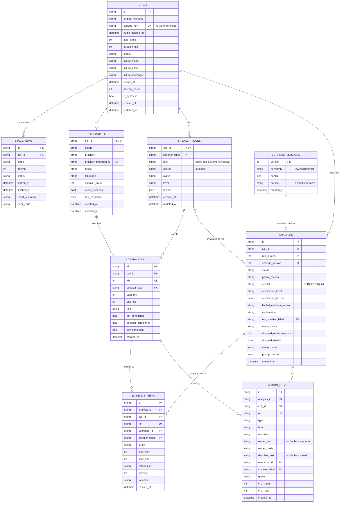

# DATABASE.md: Database Design

**Product:** Sales Call Quality Analysis Agent
**Source documents:** `PRD.md` v1.0 and `ARCHITECTURE.md` v1.0 (source of truth); `DESIGN.md` used only to confirm status and role vocabulary
**Status:** Draft v1.0 (23 Nov 2026). Schema, constraints and seed data only. No application code.
**Verification:** The reference DDL (section 12) and seed data (section 8) were executed against SQLite 3.45.1 with `PRAGMA foreign_keys = ON`, and 19 negative tests (fabricated quote, evidence on a customer utterance, invented owner, invalid verdict, edited settings version, and others) were rejected as intended. PostgreSQL was **not** tested; section 9.5 lists the known differences.

---

## 0. Reconciliation With the Source Documents

The request template suggested a generic entity list. Where it conflicts with `PRD.md` or `ARCHITECTURE.md`, the source documents win. Each difference is deliberate:

| Template suggestion | What this schema does | Source |
|---|---|---|
| `users` table, `calls.uploaded_by`, `analysis_settings.user_id` | **Omitted.** No authentication, no accounts, one global settings profile. A user table would be dead schema. Section 7.5 shows how to add it later | PRD 3.2 and assumption 7; ARCH 10.3, ADR-20 |
| Tone classification `RED / GREEN / INSUFFICIENT_EVIDENCE` | **Verdict is `RED` or `GREEN` only, or `NULL`** when tone was not run (for example unresolved roles). Thin evidence is expressed by `confidence_level = 'low'` plus `limited_evidence_reason`. It is never stored as a third verdict, and `NULL` is never displayed as GREEN | PRD assumption 6, FR-T2, Q5; ARCH 3.5, 3.7 |
| `tone_analyses` + `tone_evidence` | Merged into `analyses` + `evidence_items`; one `analyses` row per run also anchors action items | ARCH 4.3 |
| `transcript_segments` | Named `utterances` (as in ARCH). They are the transcript | ARCH 4.3 |
| `transcript_text` column | Not stored. The text is the ordered `utterances`; one copy only, so evidence offsets cannot drift. The raw provider payload is kept in `transcripts.raw_response` | ARCH 1.6 |
| `speakers` | `speaker_roles` with composite key `(call_id, speaker_label)` | ARCH 4.3 |
| Numeric `confidence` | Rule-based `high / medium / low` plus stored `confidence_factors`. No model-reported percentages | ARCH ADR-12, ADR-14 |
| Action item `confidence`, `status` | Not stored. `modality` and `owner_basis` are stored instead. "Mark done" is a V2 item | ARCH ADR-14; PRD V6 |
| `action_item_evidence` table | Not a separate table. Every action item has exactly one supporting utterance and quote (`NOT NULL`), so a junction table would only allow zero-evidence rows | PRD FR-A2; ARCH 3.8 |
| `analysis_jobs` | Not a separate table. The job is the `calls` row (`status`, `locked_at`, `attempt_count`, failure fields), with progress in `stage_runs` | ARCH 6.4, ADR-07 |
| Call statuses `validating / processing / completed / partially_completed` | `uploaded, validating, transcribing, analyzing, complete, partial, failed` | ARCH 3.2; DESIGN 13.2 |
| `tone_evidence.timestamp` | Not stored. It is derived by join from `utterances.start_ms`, so it can never differ from the transcript (ARCH 3.7 forbids model-supplied timestamps) | ARCH 3.7 |
| `audio_format`, `uploaded_at` | Dropped. Format is always `.m4a`; `created_at` is the upload time | PRD 3.2 |

Two additions are not in ARCH 4.3. Both serve stated requirements: `calls.is_synthetic` (so demo data is never confused with real recordings and can be removed by one statement; PRD privacy section) and `calls.audio_deleted_at` (retention, ARCH 10.5).

---

## 1. Database Selection

Taken from ARCHITECTURE.md 1.1, 1.4, 6.8, 9 and ADR-06. Nothing here changes that selection.

| Item | Decision |
|---|---|
| Engine | **SQLite in WAL mode** for the MVP and the hosted demo. **PostgreSQL-ready** by changing `DATABASE_URL` |
| Engine version | SQLite with partial indexes, composite foreign keys and `RAISE` triggers (all long-standing features). The DDL was verified on 3.45.1. Print `sqlite3.sqlite_version` in the Day-0 checklist and in `/health` readiness |
| ORM | **SQLAlchemy 2.0** (typed declarative models). Portable types only: `String` for UUIDs, generic `JSON`, `DateTime`, `LargeBinary` |
| Migration tool | **Alembic**, with `render_as_batch=True` for SQLite |
| Driver | stdlib `sqlite3` via the `sqlite://` URL (no extra install) |
| Connection setting | `DATABASE_URL`, default `sqlite:///./data/app.db`. Loaded by Pydantic Settings; startup fails fast if invalid |
| Connection pragmas (set on every connection through a SQLAlchemy `connect` event) | `foreign_keys=ON` (mandatory; the schema relies on it), `journal_mode=WAL`, `busy_timeout` (value set at implementation, starting point 5000 ms), `synchronous=NORMAL`, and recommended `secure_delete=ON` (section 7.4) |
| Threading | One Uvicorn process plus worker threads (ARCH 6.4), so the engine is created with `check_same_thread=False`. One session per request or per stage; a short transaction per write, never a transaction held open across a provider call |
| Time | All timestamps are UTC. The UI converts to local time (DESIGN 13.3) |

**Environment strategy**

| Environment | Database | Notes |
|---|---|---|
| Development | `./data/app.db` (SQLite file) | `alembic upgrade head` on first run; optional demo seed (section 8) |
| Tests | Fresh temporary SQLite file per test session | Use a file, not `:memory:`, because worker threads need a shared database |
| Hosted demo (MVP production) | `/data/app.db` on the persistent volume, next to the audio directory | Backups with SQLite's online backup, not a raw file copy while writing |
| Scale-up path | PostgreSQL through `DATABASE_URL`, same migrations | Requires the worker split in ARCH 11 first, since SQLite means one writer |

---

## 2. Database Entities and Tables

Nine tables. Primary keys are UUID strings except `settings_versions.version`, `transcripts.call_id` and `speaker_roles`. The full DDL is in section 12; this section explains each table.

### 2.1 `calls` (template: Calls)

One row per uploaded recording. It doubles as the background job record.

| Column | Type | Null | Notes |
|---|---|---|---|
| `id` | string PK | no | Server-generated UUID. The audio is stored as `{id}.m4a` (FR-U6) |
| `original_filename` | string | no | Sanitized display name, 1-255 chars. Never used as a path. This is the "call name" shown in the UI (DESIGN has no rename) |
| `storage_key` | string, unique | yes | Null once audio has been removed by retention |
| `audio_deleted_at` | datetime | yes | Set when the audio file is removed. Exactly one of `storage_key` / `audio_deleted_at` is set |
| `size_bytes` | int | no | `> 0`. The upper bound is configurable (`MAX_UPLOAD_SIZE_MB`), so the service enforces it |
| `duration_ms` | int | yes | Saved even when out of range, so the file card can show it (ARCH 3.3) |
| `status` | string | no | `uploaded, validating, transcribing, analyzing, complete, partial, failed` |
| `failure_stage`, `failure_code`, `failure_message` | string | yes | Last failure, using ARCH 6.6 error codes. `failed` requires a code and message |
| `locked_at` | datetime | yes | Worker claim time, used for stale-job recovery (`JOB_STALE_AFTER_SEC`) |
| `attempt_count` | int | no | Recovery requeues, capped by `JOB_MAX_ATTEMPTS` |
| `is_synthetic` | bool | no | `1` for seed data only |
| `created_at`, `updated_at` | datetime | no | |

`failed` means no usable transcript. If a transcript exists and a later stage fails, the status is `partial` (ARCH 3.2). The database does not check that rule, because it depends on the transcript state; the orchestrator owns it.

### 2.2 `stage_runs` (template: Analysis Jobs, progress part)

One row per stage attempt. The stepper in the UI reads this table, so a stage shows Completed only if its row says `succeeded` (ARCH 3.1).

`stage` (7 keys from ARCH 3.1), `attempt` (starts at 1, increments on each retry or re-run), `status` (`running, succeeded, failed, skipped`), `started_at`, `finished_at`, `result_summary` (counts and timings, never transcript text), `error_code`. A `running` row has no `finished_at`; every other status has one; `failed` requires `error_code`. `UNIQUE (call_id, stage, attempt)`.

### 2.3 `transcripts` (template: Transcripts)

At most one per call (the call's `id` is the key). Created when the STT job is **submitted** so the provider job ID is saved before waiting (ARCH 3.4), which is why it has its own `status` (`submitted, completed, failed`).

`provider`, `provider_transcript_id` (unique), `model`, `language` (default `en`), `speaker_count`, `audio_seconds` (for cost reporting), `raw_response` (compressed provider payload, so stages 4-7 can re-run without paying for transcription again), `created_at`, `updated_at`.

### 2.4 `speaker_roles` (template: Speakers)

One row per diarization label in a call. Primary key `(call_id, speaker_label)`.

| Column | Values and rules |
|---|---|
| `role` | `sales_rep`, `customer`, `unknown`. Default `unknown`. **No assumption about speaker order**: nothing in the schema or defaults treats "A" or the first speaker as the rep |
| `source` | `auto` or `user` |
| `status` | `unresolved, uncertain, confident, confirmed` (ARCH 3.5). `unresolved` forces `role = 'unknown'`. `source = 'user'` if and only if `status = 'confirmed'` |
| `level` | `high / medium / low` (role confidence), nullable |
| `factors` | JSON of the checks that produced the level (verified cues, heuristic agreement, talk time) |

At most one `sales_rep` per call (partial unique index). Rows are created together with the utterances at Stage 2, as `unknown / unresolved`, and updated at Stage 3 (or by the user). This ordering is required because utterances have a foreign key to this table.

### 2.5 `utterances` (template: Transcript Segments)

Timestamped, speaker-attributed segments. Immutable after insert (update trigger).

`idx` (sequence, unique per call), `speaker_label`, `start_ms`, `end_ms` (`>= start_ms`), `text`, `asr_confidence` and `speaker_confidence` (0-1, nullable, because providers may not return them), `low_attribution` (flag for micro-speaker artifacts, ARCH 3.5). The composite foreign key `(call_id, speaker_label)` makes an invalid speaker assignment impossible.

### 2.6 `settings_versions` (template: Analysis Settings)

Append-only history of the single global settings profile.

`version` (integer, auto-increment, the primary key), `sensitivity` (`low, medium, high`), `config` (the settings document of ARCH 9.1 as JSON), `source` (`default, user, reset`), `created_at`. The current settings are the row with the highest `version`. Saving settings inserts a new row; rows can never be updated or deleted (triggers). `sensitivity` is stored both as a column (so the database can validate it) and inside `config.tone.sensitivity`; the service writes both from one validated object, and a check query in section 10.4 detects drift.

There is no `user_id` and no `is_default` flag: there is one profile, and defaults are version 1 or a row with `source = 'reset'`.

### 2.7 `analyses` (template: Tone Analyses)

One row per analysis run of a call. Re-running stages 4-7 (role change, retry, new settings) adds a row; the latest is the highest `run_number` (ARCH 3.5, 4.3).

| Column | Notes |
|---|---|
| `run_number` | `>= 1`, unique per call |
| `settings_version` | Foreign key to `settings_versions`. `ON DELETE RESTRICT` |
| `status` | `complete` or `partial`. `partial` requires `partial_reason`; `complete` requires a verdict and an explanation. (A call whose analysis failed completely has no analysis row; the failure is on `calls`) |
| `partial_reason` | For example `ROLES_UNRESOLVED`, `TONE_FAILED`, `EXPLANATION_FAILED`, `ACTION_ITEMS_FAILED` (vocabulary owned by the service) |
| `verdict` | `RED`, `GREEN` or `NULL` (tone not run). `NULL` verdict and `NULL` confidence go together |
| `confidence_level`, `confidence_factors` | Rule-based level and the factor table behind the "Why?" popover |
| `limited_evidence_reason` | Specific text for the limited-evidence banner |
| `explanation` | "AI interpretation". Nullable only if the explanation call failed (never invented) |
| `rep_speaker_label`, `roles_source` | Which speaker was evaluated as the rep in **this** run, and whether that was automatic or user-confirmed. Required when a verdict exists |
| `dropped_evidence_count`, `dropped_details` | Findings that failed verification, with reason codes (ARCH 3.7) |
| `model_name`, `prompt_version` | Reproducibility (ARCH ADR-24) |
| `created_at` | No `updated_at`: rows are immutable (update trigger) |

### 2.8 `evidence_items` (template: Tone Evidence)

Verified quotes supporting a tone finding.

`ref` (for example `E1`, unique per analysis; the explanation cites these), `utterance_id`, `speaker_label`, `quote`, `char_start` / `char_end` (0-based, end exclusive, in the **utterance text**), `criterion_id` (matches an id in the settings snapshot, including custom criteria; this is why it is text and not a database enum), `severity` (1-3), `rationale` (AI interpretation). `call_id` and `speaker_label` are repeated from the parents so that composite foreign keys can enforce the rules in section 10.

`quote` stores the **span copied from the transcript**, not the model's own string. A trigger checks that `substr(utterance.text, char_start + 1, char_end - char_start) = quote` on every insert. The model's wording only matters during verification; the stored value is always the transcript's.

### 2.9 `action_items` (template: Action Items and Action Item Evidence)

`ref`, `type` (`commitment, follow_up, information_promised, customer_task`), `task` ("AI summary"), `modality` (`definite` or `tentative` only; conditional, hypothetical and question items are discarded before storage), `owner_text` / `owner_basis`, `deadline_text`, and the supporting `utterance_id`, `speaker_label`, `quote`, `char_start`, `char_end`.

- **Owner**: `owner_text` is null if and only if `owner_basis = 'none'`. When the basis is `committing_speaker`, the service writes the speaker's role label ("Sales Rep"); the model never supplies it.
- **Deadline**: `deadline_text` is null unless the wording appeared in the quote (verified by the service). It is stored exactly as spoken ("by Friday") and never converted to a calendar date (FR-A4).
- **Evidence**: `utterance_id`, `quote` and offsets are `NOT NULL`, and the quote trigger applies. An action item cannot exist without a real supporting line. This replaces the template's separate evidence table.

---

## 3. Relationships

No many-to-many relationships exist. Evidence and action items each cite exactly one utterance, so a junction table would only add the possibility of items with zero or many unverifiable citations.

| # | Parent -> Child | Cardinality | Foreign key (child columns) | On delete | Child FK nullable? |
|---|---|---|---|---|---|
| 1 | `calls` -> `stage_runs` | 1 : many | `call_id` | CASCADE | no |
| 2 | `calls` -> `transcripts` | **1 : 0..1** | `call_id` (also the child's PK) | CASCADE | no |
| 3 | `calls` -> `speaker_roles` | 1 : many | `call_id` | CASCADE | no |
| 4 | `transcripts` -> `utterances` | 1 : many | `call_id` | CASCADE | no |
| 5 | `speaker_roles` -> `utterances` | 1 : many | `(call_id, speaker_label)` | CASCADE | no |
| 6 | `calls` -> `analyses` | 1 : many (runs) | `call_id` | CASCADE | no |
| 7 | `settings_versions` -> `analyses` | 1 : many | `settings_version` | **RESTRICT** | no |
| 8 | `speaker_roles` -> `analyses` (evaluated rep) | 1 : many | `(call_id, rep_speaker_label)` | NO ACTION (rows go through the call cascade) | **yes** (tone not run) |
| 9 | `analyses` -> `evidence_items` | 1 : many | `(analysis_id, call_id, speaker_label)` -> `analyses(id, call_id, rep_speaker_label)` | CASCADE | no |
| 10 | `utterances` -> `evidence_items` | 1 : many | `(utterance_id, call_id, speaker_label)` -> `utterances(id, call_id, speaker_label)` | CASCADE | no |
| 11 | `analyses` -> `action_items` | 1 : many | `(analysis_id, call_id)` -> `analyses(id, call_id)` | CASCADE | no |
| 12 | `utterances` -> `action_items` | 1 : many | `(utterance_id, call_id, speaker_label)` | CASCADE | no |

Template relationships not present: *User to Calls* and *Users to Analysis Settings* (no users, section 0), *Calls to Analysis Jobs* (the job is the call row; progress is relationship 1), *Action Items to Action Item Evidence* (folded into the action item).

**Keys and uniqueness**

| Table | Primary key | Unique constraints |
|---|---|---|
| `calls` | `id` | `storage_key` |
| `stage_runs` | `id` | `(call_id, stage, attempt)` |
| `transcripts` | `call_id` | `provider_transcript_id` |
| `speaker_roles` | `(call_id, speaker_label)` | one `sales_rep` per call (partial unique index) |
| `utterances` | `id` | `(call_id, idx)`, `(id, call_id, speaker_label)` (target of composite FKs) |
| `settings_versions` | `version` | none needed |
| `analyses` | `id` | `(call_id, run_number)`, `(id, call_id)`, `(id, call_id, rep_speaker_label)` |
| `evidence_items` | `id` | `(analysis_id, ref)` |
| `action_items` | `id` | `(analysis_id, ref)` |

**Deletion behavior.** Deleting a call hard-deletes everything below it in one cascade (PRD FR-D6, privacy requirement). `settings_versions` is never deleted, and a version cannot be removed while any analysis references it. There is **no soft deletion**: the PRD requires deletion to remove audio, transcript and analysis, and a soft-deleted transcript would still be customer speech on disk.

---

## 4. ER Diagram



`UK` on `idx`, `run_number` and `ref` means the column is unique **within its parent** (a composite unique constraint), as listed in section 3. `speaker_label` on `utterances`, `evidence_items` and `action_items` is the second half of a composite foreign key.

---

## 5. Database Constraints and Validation

All of these are enforced by the database (see DDL), so a bug in application code cannot store invalid analysis data.

| Area | Rule | Mechanism |
|---|---|---|
| Call status | `uploaded, validating, transcribing, analyzing, complete, partial, failed` | `CHECK` |
| Failed calls | `failed` requires `failure_code` and `failure_message` | `CHECK` |
| Failure stage | One of the 7 stage keys | `CHECK` |
| Stage run status | `running, succeeded, failed, skipped`; `running` has no `finished_at`, others do; `finished_at >= started_at`; `failed` has `error_code` | `CHECK` |
| Transcript status | `submitted, completed, failed` | `CHECK` |
| Tone verdict | `RED`, `GREEN` or `NULL`. There is no `INSUFFICIENT_EVIDENCE` value | `CHECK` |
| Verdict and confidence | Both set or both null; a verdict requires `rep_speaker_label` and `roles_source` | `CHECK` |
| Confidence level | `high, medium, low` | `CHECK` |
| Analysis status | `complete` or `partial`; `partial` needs `partial_reason`; `complete` needs verdict and explanation | `CHECK` |
| Speaker roles | `sales_rep, customer, unknown`; `unresolved` implies `unknown`; `source = 'user'` iff `confirmed`; one `sales_rep` per call | `CHECK` + partial unique index |
| Sensitivity | `low, medium, high` | `CHECK` on `settings_versions.sensitivity` |
| Settings history | Rows cannot be updated or deleted | Triggers |
| File metadata | `size_bytes > 0`; `duration_ms >= 0`; filename 1-255 chars; `storage_key` and `audio_deleted_at` mutually exclusive | `CHECK` |
| File limits (50 MB, 10 s to 30 min) | Configurable (`MAX_UPLOAD_SIZE_MB`, `MIN/MAX_DURATION_SEC`) | **Service**, not `CHECK`. A hard-coded limit would break when the config changes, and out-of-range durations must still be storable for the file card |
| Timestamps | `start_ms >= 0`, `end_ms >= start_ms`, `idx >= 0`; `finished_at >= started_at`; all `created_at` / `updated_at` `NOT NULL` with defaults, UTC | `CHECK` / defaults |
| Confidences | `asr_confidence`, `speaker_confidence` between 0 and 1 | `CHECK` |
| Evidence | `severity` 1-3; `char_end > char_start`; quote 1-400 chars; quote equals the transcript span at the offsets | `CHECK` + trigger |
| Action items | Type, modality (`definite`/`tentative`), owner basis enumerated; `owner_text IS NULL` iff `owner_basis = 'none'`; deadline length 1-120 | `CHECK` + trigger |
| Same-call integrity | Evidence and action items must belong to the same call as their analysis and utterance | Composite foreign keys |
| Referential | All foreign keys; `foreign_keys=ON` per connection | FK |
| Uniqueness | Section 3 table | `UNIQUE` / partial unique |

**Enforced by the service, not the database** (cannot be expressed as a portable constraint): quote word count 3-60 and normalized matching (ARCH 3.7; the trigger only confirms the stored span is exact), `criterion_id` is enabled in the snapshot, `RED` has at least one evidence item (section 10), deadline and owner wording appear in the quote, tentative items only when the setting allows, call status versus transcript state, settings document schema and length limits (ARCH 6.3).

---

## 6. Indexing Strategy

Primary keys and unique constraints already create indexes; they are listed where they serve a requested access path. Data volume is small, so the list is deliberately short.

| Access path | Index | Why it is needed |
|---|---|---|
| Calls by upload date (History default sort, newest first) | `ix_calls_created_at (created_at DESC)` | History is paginated and sorted by date on every visit |
| Calls by processing status (History filter, dashboard "awaiting analysis" / "needs attention") | `ix_calls_status_locked (status, locked_at)` | Serves the status filter and the worker's claim and stale-job recovery query (`status IN (...) AND locked_at < ?`), so it also covers "jobs by status" |
| Calls by tone classification (History filter `red / green / none`, KPI counts) | `ix_analyses_verdict (verdict, call_id)` plus `UNIQUE (call_id, run_number)` | The filter joins calls to the **latest** analysis; the unique index finds the latest run per call, and the verdict index supports grouped counts. No `verdict` copy is stored on `calls`, to avoid a second source of truth |
| Latest analysis for a call | `UNIQUE (call_id, run_number)` | `ORDER BY run_number DESC LIMIT 1` for every call open |
| Transcript segments by transcript and sequence | `UNIQUE (call_id, idx)` | The transcript is always read in order for one call; also prevents duplicate or missing sequence numbers |
| Speakers by call | Primary key `(call_id, speaker_label)` | Roles are loaded with every transcript view and every pipeline stage |
| Action items by call and by analysis | `ix_actions_call (call_id)`, `ix_actions_analysis (analysis_id)` | Results screen reads by analysis; dashboard "recent action items" reads across calls |
| Evidence by analysis | `ix_evidence_analysis (analysis_id)` | Results screen and export |
| Evidence / action items by utterance | `ix_evidence_utterance`, `ix_actions_utterance` | Foreign-key lookups so cascades and "which items cite this line" (transcript highlighting) do not scan |
| Settings by user | **Not applicable** (no users). Current settings: `settings_versions.version` primary key, `ORDER BY version DESC LIMIT 1` | Single profile |
| Analyses by settings version | `ix_analyses_settings (settings_version)` | The "differs from current settings" chip and the `RESTRICT` check |
| Jobs / stage progress | `ix_stage_runs_call (call_id, stage)` | The 7-stage stepper reads all stages of one call on every poll |
| Audio retention sweep | `ix_calls_audio_retention (created_at) WHERE storage_key IS NOT NULL` | The daily sweep touches only calls whose audio still exists |

Not indexed: filename search uses `LIKE '%q%'`, which no B-tree helps at this scale (ARCH 11 accepts this; Postgres `pg_trgm` later). Foreign-key columns on tiny parent tables are not indexed separately.

---

## 7. Security and Data Access

### 7.1 Access model

The PRD has no login and no roles (PRD 3.2, assumption 3). There is therefore **one trust domain**: everyone who can reach the application can see every call. The optional HTTP Basic gate (`BASIC_AUTH_USER/PASSWORD`, ARCH 10.3) protects a hosted demo but is a single shared credential, not per-user access control. This schema does not claim per-user isolation.

### 7.2 Rules by data type

| Data | Where | Access rule |
|---|---|---|
| Uploaded audio | Local disk, key `{call_id}.m4a`, directory `0700`, files `0600`, outside any web root | **No read route exists** (ARCH 1.6, ADR-18). Only the pipeline reads it. `storage_key` is a UUID, never a user path |
| Transcripts and utterances | `utterances`, `transcripts.raw_response` | Read only through `GET /calls/:id/transcript` and export. Never written to logs (ARCH 6.7) |
| Analysis results and evidence | `analyses`, `evidence_items` | Read through `GET /calls/:id/analysis` and export. Immutable after insert |
| Action items | `action_items` | Same as analysis results |
| Settings | `settings_versions` | Readable and writable through `/settings`. Write means append a new version. The UI warns not to type customer data into free-text guidance |
| Provider payload | `transcripts.raw_response` | Never returned by any endpoint (ARCH 6.2: "no endpoint that returns raw provider payloads") |
| Secrets | Not in the database | Environment variables only |

The database file and the audio directory are readable only by the service user. All queries go through the SQLAlchemy layer with bound parameters; no SQL is built from user input (search uses a bound `LIKE` parameter with wildcard characters escaped).

### 7.3 Retention and deletion

- **Audio**: kept `AUDIO_RETENTION_DAYS` (default 30). The daily sweep deletes the file, then sets `storage_key = NULL` and `audio_deleted_at = now()` in one transaction (the `CHECK` keeps the pair consistent). With `AUDIO_RETENTION_DAYS=0`, the same update runs right after the transcript is saved. A transcription retry then needs a re-upload, which the error copy states.
- **Transcript, evidence, action items**: kept until the user deletes the call. The PRD sets no automatic expiry for text.
- **User deletion** (`DELETE /calls/:id`): one transaction deletes the `calls` row and the cascade removes every dependent row; the audio file is removed after commit. If file removal fails, the row is already gone and an orphan sweep at startup removes files with no matching `calls.storage_key`. The call returns `409` while the call is processing.
- **Settings versions** are not deleted. They contain configuration, not customer content, which is why the UI warns against pasting customer data into guidance.

### 7.4 Residual-data caveats

- SQLite does not erase deleted rows from free pages by default. Set `secure_delete=ON` so deleted transcript text is overwritten; `VACUUM` can be run after bulk deletes.
- Backups taken before a deletion still contain that call until the backup expires. State the backup retention in the README.
- Provider-side copies (STT and LLM vendors) are outside the database; deletion there is attempted only where the provider API supports it (ARCH 10.5, Day-0 item).

### 7.5 Future extension (not implemented)

If accounts are added: a `users` table, `calls.owner_user_id` (`NOT NULL`, foreign key, indexed), a per-owner filter in every query, and `owner_user_id` on `settings_versions`. Because every table descends from `calls`, only the `calls` and `settings_versions` tables change; child tables inherit ownership through their foreign keys.

---

## 8. Sample Seed Data

Two **synthetic** calls modelled on the PRD's RED and GREEN demo calls. The people, company names and conversations are invented. Both rows have `is_synthetic = 1`, filenames starting `SYNTHETIC_`, provider `synthetic-seed`, and no audio file (`storage_key` is null). They are not recordings of real customers.

| | RED test call | GREEN test call |
|---|---|---|
| File | `SYNTHETIC_red_billing_dispute.m4a` | `SYNTHETIC_green_seat_upgrade.m4a` |
| Rep speaker label | **B** (the customer speaks first) | **A** |
| Verdict | `RED`, confidence `medium` | `GREEN`, confidence `medium` |
| Evidence | 3 items (E1 and E2 `dismissive`, E3 `rude`; severity 2) | none |
| Action item | "Send the corrected invoice", owner Sales Rep (committing speaker), deadline "by Friday" | "Email a quote for ten additional seats", owner Sales Rep, deadline "by Thursday" |
| Deliberately not stored | none | "we might also set up a refresher session later" (tentative, excluded by default) and the customer's "I'll confirm the final seat count" (customer tasks are off by default) |
| Settings | version 1 (defaults, medium sensitivity) | version 1 |

The rep is label B in one call and A in the other so the seed itself shows that speaker order is not assumed. Confidence is `medium` rather than `high` in both because the rep speaks under 45 seconds (ARCH 5.4 rule). The GREEN explanation claims only that no criteria matched (FR-T7); it makes no claim of "professionalism".

```sql
-- Default settings (v1). In production this row is created by migration 0002, not by the demo seed.
INSERT OR IGNORE INTO settings_versions (version, sensitivity, config, source) VALUES (1, 'medium', '{"tone": {"criteria": [{"id": "rude", "label": "Rude", "description": "Disrespectful or impolite remarks", "enabled": true, "custom": false}, {"id": "hostile", "label": "Hostile", "description": "Aggressive, insulting or threatening language", "enabled": true, "custom": false}, {"id": "dismissive", "label": "Dismissive", "description": "Brushing off or ignoring the customer''s concern", "enabled": true, "custom": false}], "sensitivity": "medium", "guidance": ""}, "actions": {"types": {"commitments": true, "follow_ups": true, "information_promised": true, "customer_tasks": false}, "include_tentative": false, "owner_rule": "explicit_or_committing_speaker", "capture_relative_deadlines": true, "guidance": ""}}', 'default');

-- ===== RED test call (SYNTHETIC) =====
INSERT INTO calls (id, original_filename, storage_key, audio_deleted_at, size_bytes, duration_ms, status, is_synthetic)
VALUES ('bac8b72d-5aa1-54d3-b061-55501f86e604', 'SYNTHETIC_red_billing_dispute.m4a', NULL, CURRENT_TIMESTAMP, 960000, 59000, 'complete', 1);
INSERT INTO transcripts (call_id, status, provider, language, speaker_count) VALUES ('bac8b72d-5aa1-54d3-b061-55501f86e604', 'completed', 'synthetic-seed', 'en', 2);
INSERT INTO speaker_roles (call_id, speaker_label, role, source, status, level) VALUES ('bac8b72d-5aa1-54d3-b061-55501f86e604', 'A', 'customer', 'auto', 'confident', 'high');
INSERT INTO speaker_roles (call_id, speaker_label, role, source, status, level) VALUES ('bac8b72d-5aa1-54d3-b061-55501f86e604', 'B', 'sales_rep', 'auto', 'confident', 'high');
INSERT INTO utterances (id, call_id, idx, speaker_label, start_ms, end_ms, text) VALUES ('70d0b2a7-ce4b-522a-a30b-cf23355d7965', 'bac8b72d-5aa1-54d3-b061-55501f86e604', 0, 'A', 0, 7000, 'Hello, this is Maria Chen from Northfield Dental. I''m calling about the invoice for our team plan, it looks higher than what we agreed.');
INSERT INTO utterances (id, call_id, idx, speaker_label, start_ms, end_ms, text) VALUES ('4f758908-40d0-5227-8681-d64fdd18abfe', 'bac8b72d-5aa1-54d3-b061-55501f86e604', 1, 'B', 7200, 15000, 'Brightwave Software, Jordan speaking. Look, I already explained the pricing in the last email, so I don''t know why we''re doing this again.');
INSERT INTO utterances (id, call_id, idx, speaker_label, start_ms, end_ms, text) VALUES ('52e9c6d6-ab17-5ea0-8e2b-cfcca9f19e19', 'bac8b72d-5aa1-54d3-b061-55501f86e604', 2, 'A', 15200, 22000, 'I understand, but the invoice shows forty seats and we only signed up for twenty-five.');
INSERT INTO utterances (id, call_id, idx, speaker_label, start_ms, end_ms, text) VALUES ('5cebbfb4-3e4b-52b6-a680-fd7d59b8104e', 'bac8b72d-5aa1-54d3-b061-55501f86e604', 3, 'B', 22300, 30000, 'That is not my problem. You should have read the contract before signing it.');
INSERT INTO utterances (id, call_id, idx, speaker_label, start_ms, end_ms, text) VALUES ('530f7d69-b020-5ed5-a3f1-875d278f771a', 'bac8b72d-5aa1-54d3-b061-55501f86e604', 4, 'A', 30200, 36000, 'I did read it. Could you please just check the seat count on your side?');
INSERT INTO utterances (id, call_id, idx, speaker_label, start_ms, end_ms, text) VALUES ('8041fd07-1e1c-5b53-a8bc-450f6a406562', 'bac8b72d-5aa1-54d3-b061-55501f86e604', 5, 'B', 36200, 44000, 'Honestly, if you can''t keep track of your own seat count, that''s on you.');
INSERT INTO utterances (id, call_id, idx, speaker_label, start_ms, end_ms, text) VALUES ('787c1729-368e-5786-b2d3-ff3b144d7064', 'bac8b72d-5aa1-54d3-b061-55501f86e604', 6, 'A', 44200, 48000, 'I''m only asking for a correction.');
INSERT INTO utterances (id, call_id, idx, speaker_label, start_ms, end_ms, text) VALUES ('cbeb5fd8-04f5-58d4-9ed0-9af163f535aa', 'bac8b72d-5aa1-54d3-b061-55501f86e604', 7, 'B', 48300, 56000, 'Fine, I''ll send you the corrected invoice by Friday. Is there anything else?');
INSERT INTO utterances (id, call_id, idx, speaker_label, start_ms, end_ms, text) VALUES ('1591800a-210a-5cb3-9b9e-98210830162d', 'bac8b72d-5aa1-54d3-b061-55501f86e604', 8, 'A', 56200, 59000, 'No, that''s all. Thank you.');
INSERT INTO analyses (id, call_id, run_number, settings_version, status, verdict, confidence_level, confidence_factors, explanation, rep_speaker_label, roles_source, model_name, prompt_version)
VALUES ('d8f7d498-b11b-54c6-a4d6-8b2e3e911fd8', 'bac8b72d-5aa1-54d3-b061-55501f86e604', 1, 1, 'complete', 'RED', 'medium', '{"role_confidence": "high", "rep_speech_seconds": 31.0, "rep_speech": "medium", "evidence_strength": "high", "dropped_evidence": "none"}', 'The sales rep dismissed the customer''s billing question (E1, E2) and blamed the customer for the seat-count discrepancy (E3). These behaviors match the Dismissive and Rude criteria at Medium sensitivity.', 'B', 'auto', 'synthetic-seed', 'seed-v1');
INSERT INTO evidence_items (id, analysis_id, call_id, ref, utterance_id, speaker_label, quote, char_start, char_end, criterion_id, severity, rationale)
VALUES ('19a62e1a-049f-516e-98f0-808f03a14d80', 'd8f7d498-b11b-54c6-a4d6-8b2e3e911fd8', 'bac8b72d-5aa1-54d3-b061-55501f86e604', 'E1', '4f758908-40d0-5227-8681-d64fdd18abfe', 'B', 'I already explained the pricing in the last email', 44, 93, 'dismissive', 2, 'Brushes off the customer''s question by pointing to an earlier email.');
INSERT INTO evidence_items (id, analysis_id, call_id, ref, utterance_id, speaker_label, quote, char_start, char_end, criterion_id, severity, rationale)
VALUES ('9ec35d7c-4859-565e-bb4b-03a509e5e90f', 'd8f7d498-b11b-54c6-a4d6-8b2e3e911fd8', 'bac8b72d-5aa1-54d3-b061-55501f86e604', 'E2', '5cebbfb4-3e4b-52b6-a680-fd7d59b8104e', 'B', 'That is not my problem', 0, 22, 'dismissive', 2, 'Rejects responsibility for the customer''s billing concern.');
INSERT INTO evidence_items (id, analysis_id, call_id, ref, utterance_id, speaker_label, quote, char_start, char_end, criterion_id, severity, rationale)
VALUES ('0f566784-a810-5485-b543-adf10663f5f5', 'd8f7d498-b11b-54c6-a4d6-8b2e3e911fd8', 'bac8b72d-5aa1-54d3-b061-55501f86e604', 'E3', '8041fd07-1e1c-5b53-a8bc-450f6a406562', 'B', 'if you can''t keep track of your own seat count, that''s on you', 10, 71, 'rude', 2, 'Places blame on the customer in a disrespectful way.');
INSERT INTO action_items (id, analysis_id, call_id, ref, type, task, modality, owner_text, owner_basis, deadline_text, utterance_id, speaker_label, quote, char_start, char_end)
VALUES ('a44aaf6a-66aa-5b78-92f5-d1291905b999', 'd8f7d498-b11b-54c6-a4d6-8b2e3e911fd8', 'bac8b72d-5aa1-54d3-b061-55501f86e604', 'A1', 'commitment', 'Send the corrected invoice', 'definite', 'Sales Rep', 'committing_speaker', 'by Friday', 'cbeb5fd8-04f5-58d4-9ed0-9af163f535aa', 'B', 'I''ll send you the corrected invoice by Friday', 6, 51);

-- ===== GREEN test call (SYNTHETIC) =====
INSERT INTO calls (id, original_filename, storage_key, audio_deleted_at, size_bytes, duration_ms, status, is_synthetic)
VALUES ('45da07ee-34cd-5974-a379-4092832fc7f6', 'SYNTHETIC_green_seat_upgrade.m4a', NULL, CURRENT_TIMESTAMP, 960000, 60000, 'complete', 1);
INSERT INTO transcripts (call_id, status, provider, language, speaker_count) VALUES ('45da07ee-34cd-5974-a379-4092832fc7f6', 'completed', 'synthetic-seed', 'en', 2);
INSERT INTO speaker_roles (call_id, speaker_label, role, source, status, level) VALUES ('45da07ee-34cd-5974-a379-4092832fc7f6', 'A', 'sales_rep', 'auto', 'confident', 'high');
INSERT INTO speaker_roles (call_id, speaker_label, role, source, status, level) VALUES ('45da07ee-34cd-5974-a379-4092832fc7f6', 'B', 'customer', 'auto', 'confident', 'high');
INSERT INTO utterances (id, call_id, idx, speaker_label, start_ms, end_ms, text) VALUES ('b5a78ec4-312b-5e68-a001-72f19f69d721', '45da07ee-34cd-5974-a379-4092832fc7f6', 0, 'A', 0, 8000, 'Good morning, this is Sam Rivera from Brightwave Software. Thanks for taking the time to speak with me today.');
INSERT INTO utterances (id, call_id, idx, speaker_label, start_ms, end_ms, text) VALUES ('25a3dec7-a383-5785-9a4d-33daa485804e', '45da07ee-34cd-5974-a379-4092832fc7f6', 1, 'B', 8200, 13000, 'Morning. I wanted to ask about adding more seats to our plan.');
INSERT INTO utterances (id, call_id, idx, speaker_label, start_ms, end_ms, text) VALUES ('68e06a1d-f2bc-5de2-b5a1-6a89429abfa7', '45da07ee-34cd-5974-a379-4092832fc7f6', 2, 'A', 13200, 21000, 'Happy to help with that. Could you tell me how many additional seats you''re thinking about?');
INSERT INTO utterances (id, call_id, idx, speaker_label, start_ms, end_ms, text) VALUES ('04a13db8-afd0-5912-b584-c690db7acc9c', '45da07ee-34cd-5974-a379-4092832fc7f6', 3, 'B', 21200, 25000, 'Probably around ten, but we''re not sure yet.');
INSERT INTO utterances (id, call_id, idx, speaker_label, start_ms, end_ms, text) VALUES ('ddd7bc8a-be01-5354-ade2-b57d55966aad', '45da07ee-34cd-5974-a379-4092832fc7f6', 4, 'A', 25200, 35000, 'That works. I''ll email you a quote for ten additional seats by Thursday, and you can adjust the number once your team confirms.');
INSERT INTO utterances (id, call_id, idx, speaker_label, start_ms, end_ms, text) VALUES ('a56038d1-286b-5c74-ac66-a405e5117198', '45da07ee-34cd-5974-a379-4092832fc7f6', 5, 'B', 35200, 40000, 'Great. And can you also tell me whether the training sessions are included?');
INSERT INTO utterances (id, call_id, idx, speaker_label, start_ms, end_ms, text) VALUES ('1d903115-a3d4-59be-9cca-842d3b01143c', '45da07ee-34cd-5974-a379-4092832fc7f6', 6, 'A', 40200, 49000, 'Yes, onboarding training is included. If you''d like, we might also set up a refresher session later.');
INSERT INTO utterances (id, call_id, idx, speaker_label, start_ms, end_ms, text) VALUES ('cec31c2d-359b-5b96-a55e-5a2e17c89e25', '45da07ee-34cd-5974-a379-4092832fc7f6', 7, 'B', 49200, 54000, 'I''ll confirm the final seat count with my team and let you know.');
INSERT INTO utterances (id, call_id, idx, speaker_label, start_ms, end_ms, text) VALUES ('d41eae3b-f74f-5406-986c-367846e213b1', '45da07ee-34cd-5974-a379-4092832fc7f6', 8, 'A', 54200, 60000, 'Thank you for your time, and please reach out if anything else comes up.');
INSERT INTO analyses (id, call_id, run_number, settings_version, status, verdict, confidence_level, confidence_factors, explanation, rep_speaker_label, roles_source, model_name, prompt_version)
VALUES ('e814bc07-1a38-52e0-8300-2d90b6f757ad', '45da07ee-34cd-5974-a379-4092832fc7f6', 1, 1, 'complete', 'GREEN', 'medium', '{"role_confidence": "high", "rep_speech_seconds": 40.2, "rep_speech": "medium", "evidence_strength": "n/a", "dropped_evidence": "none"}', 'No behavior matching the enabled criteria (Rude, Hostile, Dismissive) was found in the sales rep''s utterances at Medium sensitivity.', 'A', 'auto', 'synthetic-seed', 'seed-v1');
INSERT INTO action_items (id, analysis_id, call_id, ref, type, task, modality, owner_text, owner_basis, deadline_text, utterance_id, speaker_label, quote, char_start, char_end)
VALUES ('09c54f3a-afaf-58ff-b659-afc533500734', 'e814bc07-1a38-52e0-8300-2d90b6f757ad', '45da07ee-34cd-5974-a379-4092832fc7f6', 'A1', 'commitment', 'Email a quote for ten additional seats', 'definite', 'Sales Rep', 'committing_speaker', 'by Thursday', 'ddd7bc8a-be01-5354-ade2-b57d55966aad', 'A', 'I''ll email you a quote for ten additional seats by Thursday', 12, 71);
```

Applying the seed: run only in development or tests, never in production (section 9.4). Every UUID is deterministic (UUIDv5), so re-running after `DELETE FROM calls WHERE is_synthetic = 1;` is repeatable.

---

## 9. Migration Strategy

### 9.1 Tooling

Alembic with `render_as_batch=True` (SQLite cannot alter most constraints in place; batch mode rebuilds the table). Migration files are reviewed by hand; `--autogenerate` output is a starting point, not the result, because Alembic does not detect triggers, partial indexes or `CHECK` changes reliably.

### 9.2 Initial migrations

| Revision | Content |
|---|---|
| `0001_initial_schema` | All tables, indexes and triggers in section 12, in the order below |
| `0002_default_settings` | Inserts `settings_versions` row 1 (`source = 'default'`, ARCH 9.1 defaults). Required: the application reads the highest version and fails startup readiness if none exists |

**Table creation order** (each table's foreign-key parents exist first; drop in the reverse order):

| Order | Table | Depends on |
|---|---|---|
| 1 | `settings_versions` | none |
| 2 | `calls` | none |
| 3 | `stage_runs` | `calls` |
| 4 | `transcripts` | `calls` |
| 5 | `speaker_roles` | `calls` |
| 6 | `utterances` | `transcripts`, `speaker_roles` |
| 7 | `analyses` | `calls`, `settings_versions`, `speaker_roles` |
| 8 | `evidence_items` | `analyses`, `utterances` |
| 9 | `action_items` | `analyses`, `utterances` |
| 10 | Indexes, then triggers | all tables |

**Insert order at runtime** (matters because of the foreign keys): `calls` -> `transcripts` (at STT submission) -> `speaker_roles` and `utterances` (at transcript completion, roles as `unknown / unresolved`) -> role update (Stage 3) -> `analyses` -> `evidence_items` and `action_items` (the last three in the Stage 7 transaction, ARCH 3.9).

### 9.3 Schema update procedure

1. Change the SQLAlchemy models and write the migration (additive first: new nullable column or new table).
2. Run the full migration chain on an empty database in CI, then run the test suite, including the constraint tests of section 10.
3. Run it on a copy of the real database file.
4. Before applying in the hosted demo, take a backup with the SQLite online backup (`.backup`), not a plain copy of a live WAL database.
5. Apply `alembic upgrade head` at container start, before the web server and worker start. If it fails, the container exits and does not serve a half-migrated database.
6. Use expand then contract for risky changes: add the new column, deploy code that writes both, then remove the old column in a later migration. Never rename or drop a column in the same release that stops using it.

### 9.4 Rollback strategy

- Every migration has a working `downgrade()`; it is exercised in CI (`upgrade head`, `downgrade base`, `upgrade head`).
- Destructive steps (drop column or table) are never combined with other changes, so reverting the application is possible without restoring data.
- If a migration fails or a downgrade would lose data, restore the pre-migration backup from step 4 and redeploy the previous image. With a single SQLite file this is a file swap.
- Settings versions are append-only, so no migration ever rewrites history. A migration that changes the `config` document shape must be **additive** (new keys with defaults handled in code), because old versions must stay readable.

### 9.5 Seed-data insertion

- `0002_default_settings` runs in every environment.
- The demo seed in section 8 is **not** a migration. It is a separate script, run manually in development or tests, and refuses to run when `APP_ENV=production`. It uses `INSERT OR IGNORE` for settings version 1, so it is safe after `0002`. `DELETE FROM calls WHERE is_synthetic = 1;` removes all demo rows.
- **PostgreSQL notes** (not tested): `AUTOINCREMENT` becomes an identity column; the `JSON` type becomes `JSONB` if querying is needed; the `CHECK` constraints and partial indexes carry over; the eight trigger bodies must be rewritten as PL/pgSQL trigger functions (`RAISE EXCEPTION`); `INSERT OR IGNORE` becomes `ON CONFLICT DO NOTHING`; datetimes should use `timestamptz`.

---

## 10. Data Integrity and Reliability

### 10.1 How the schema prevents each failure

| Failure to prevent | Mechanism | Guarantee level |
|---|---|---|
| **Action item without supporting evidence** | `utterance_id`, `quote`, `char_start`, `char_end` are `NOT NULL`; composite FK to a real utterance; trigger requires the quote to equal the transcript span | **Database**. No such row can be inserted |
| **Evidence referencing a nonexistent segment** | Composite FK `(utterance_id, call_id, speaker_label)` to `utterances`; same trigger | **Database** |
| **Fabricated or reworded quotes** | Trigger compares the stored quote to `substr(utterance.text, ...)`. The stored quote is the transcript span, not the model's string | **Database** (exact span); normalization and fuzzy tolerance are decided earlier by the verifier |
| **Evidence from the customer** (customer tone blamed on the rep) | `evidence_items.speaker_label` must equal both the cited utterance's speaker and the analysis's `rep_speaker_label` through two composite FKs. An evidence row on a customer line is rejected (tested) | **Database** |
| **Invalid speaker assignments** | Utterances reference `speaker_roles` by composite FK; role values are enumerated; at most one `sales_rep` per call; `unresolved` forces `unknown`; a user-set role is always `confirmed` | **Database**. Whether the *chosen* speaker is truly the rep is a judgment the schema records (`source`, `status`, `level`, `factors`) but cannot decide |
| **Missing analysis status** | `status` is `NOT NULL` with a `CHECK` on both `calls` and `analyses`; `complete` requires verdict and explanation; `partial` requires a reason; `failed` requires code and message | **Database** |
| **Unsupported owner or deadline** | Owner is null iff `owner_basis = 'none'`; deadline is null by default; `modality` can only be `definite` or `tentative` | **Database** for shape. The check that the wording appears in the quote is the service's (ARCH 3.8) |
| **Incorrect call-to-analysis relationships** | `call_id` is repeated on children and tied to the parents by composite FKs, so evidence from call X cannot attach to an analysis of call Y | **Database** |
| **`INSUFFICIENT_EVIDENCE` shown as GREEN** | Verdict is `NULL` when tone was not run, and the schema allows no GREEN without a confidence level and rep speaker. Low confidence is a stored value (`low`) with `limited_evidence_reason` | **Database** stores it honestly; the UI must render `NULL` as "Not analyzed" (DESIGN 13.2) |
| **Loss of historical analysis settings** | `analyses.settings_version` is a required FK with `RESTRICT`; `settings_versions` rows cannot be updated or deleted (triggers) | **Database** |
| **Edited history** | Update triggers on `analyses`, `evidence_items`, `action_items`, `utterances` | **Database** |
| **Orphaned data after deletion** | `ON DELETE CASCADE` from `calls`; `PRAGMA foreign_key_check` in tests | **Database** |
| **Stuck jobs** | `locked_at`, `attempt_count`, `stage_runs`; recovery at startup (ARCH 6.4) | Service, supported by the schema |

### 10.2 Traceability to settings

Every analysis names the settings version that produced it. The settings row holds the criteria, sensitivity and action-item rules as they were. Reading an old analysis therefore always shows the criteria and sensitivity used then, even after many later saves. The "differs from current settings" chip compares `analyses.settings_version` with the highest `settings_versions.version`. Each run also stores `model_name` and `prompt_version`, and `rep_speaker_label` plus `roles_source`, so the speaker mapping used for a past verdict stays visible even after the user later corrects the roles.

### 10.3 Partial results and failures

A call that transcribes but fails analysis keeps its transcript and utterances, ends `partial`, and can be retried from stored data (FR-E5). A failed call keeps `failure_stage`, `failure_code` and `failure_message`. No table has a column for substitute analysis text: if the explanation call fails, `explanation` is null, never a placeholder (FR-E1).

### 10.4 Verification queries (run in tests and optionally nightly)

Each should return zero rows.

```sql
-- RED verdict without any evidence (the one rule the database cannot enforce alone)
SELECT a.id FROM analyses a
WHERE a.verdict = 'RED'
  AND NOT EXISTS (SELECT 1 FROM evidence_items e WHERE e.analysis_id = a.id);

-- GREEN or not-analyzed verdict that carries evidence
SELECT a.id FROM analyses a
WHERE (a.verdict IS NULL OR a.verdict = 'GREEN')
  AND EXISTS (SELECT 1 FROM evidence_items e WHERE e.analysis_id = a.id);

-- sensitivity column drifted from the settings document
SELECT version FROM settings_versions
WHERE sensitivity <> json_extract(config, '$.tone.sensitivity');

-- calls marked complete without a completed transcript or any analysis
SELECT c.id FROM calls c
WHERE c.status = 'complete'
  AND (NOT EXISTS (SELECT 1 FROM transcripts t WHERE t.call_id = c.id AND t.status = 'completed')
       OR NOT EXISTS (SELECT 1 FROM analyses a WHERE a.call_id = c.id));

-- evidence or action-item quotes that do not match the transcript (should be impossible)
SELECT e.id FROM evidence_items e JOIN utterances u ON u.id = e.utterance_id
WHERE substr(u.text, e.char_start + 1, e.char_end - e.char_start) <> e.quote;
```

---

## 11. Design Decisions

| # | Decision | Reason | Alternatives | Trade-offs |
|---|---|---|---|---|
| 1 | SQLite (WAL), Postgres-ready, as selected in ARCH | Zero setup, one volume, single-user demo | PostgreSQL now | One writer, one host. Triggers need a rewrite for Postgres |
| 2 | No `users` table | PRD and ARCH state no authentication | Add users "for later" | Adding ownership later touches `calls` and `settings_versions` (section 7.5) |
| 3 | Verdict is `RED / GREEN / NULL`, not a third value | PRD FR-T2 and assumption 6 require a binary verdict; uncertainty goes in confidence | Add `INSUFFICIENT_EVIDENCE` | UI must treat `NULL` as "Not analyzed" and show low confidence prominently |
| 4 | `analyses` is a versioned run table | Role correction and retry create a new run; history stays auditable | One mutable result row | Latest-run lookups need `run_number` ordering |
| 5 | Settings in an append-only `settings_versions` table; analyses point at a version | Exact reproducibility; cheap "differs from current" check | Copy the full settings JSON into each analysis; one mutable row | One extra table; the settings JSON is shared, so its shape can only change additively |
| 6 | `sensitivity` as a column and inside the JSON | Lets the database validate the enum | JSON only | Two copies; a drift query guards it |
| 7 | Evidence and action items cite one utterance; quote stored as the transcript span with offsets | Direct highlighting; the database can verify the span; no junction table | Separate evidence table with many-to-many; store the model's string | A claim spanning two utterances needs two items |
| 8 | Composite foreign keys carrying `call_id` and `speaker_label` | The database itself rejects evidence from the customer or from another call | Plain single-column FKs plus service checks | Wider keys and a few extra unique indexes; some redundancy in child tables |
| 9 | No timestamp column on evidence | The utterance's `start_ms` is the only timestamp, so it cannot differ | Denormalized timestamp | One join when rendering |
| 10 | `calls` is the job record; `stage_runs` holds progress | Matches ARCH 6.4; no queue or job table | Separate `analysis_jobs` | A call has only one active job at a time (as intended) |
| 11 | Transcript text not duplicated; raw provider response kept compressed | Single source for offsets; stages 4-7 can re-run without re-transcribing | Store full text on `transcripts` | Joining utterances to build a full-text export |
| 12 | Hard delete with cascade, no soft delete | PRD requires removal of audio, transcript and analysis | `deleted_at` flags | No undo; section 7.4 covers residual copies |
| 13 | Quote integrity by trigger, not only by service code | The strongest anti-fabrication guarantee available in the data layer | Service checks only | Triggers must be ported to Postgres; they are not detected by Alembic autogenerate |
| 14 | Configurable limits (size, duration) enforced in the service, not `CHECK` | Config can change without a migration; out-of-range durations remain storable | Hard-coded `CHECK` | The database alone does not reject an oversized value |
| 15 | UUID strings as keys; datetimes in UTC | Portable between SQLite and Postgres; IDs safe to expose | Integer keys | Slightly larger indexes (immaterial at this scale) |
| 16 | `is_synthetic` flag | Demo data is always identifiable and removable | Filename convention only | One extra column |

---

## 12. Reference DDL

This is the SQLite-dialect form that was executed and tested. Alembic migration `0001` should produce the same constraints, indexes and triggers; compare the two in review.

```sql
-- Reference DDL (SQLite dialect). The Alembic migration 0001 produces the equivalent
-- through SQLAlchemy 2.0 portable types. Run with: PRAGMA foreign_keys = ON;

CREATE TABLE settings_versions (
    version      INTEGER PRIMARY KEY AUTOINCREMENT,
    sensitivity  TEXT     NOT NULL CHECK (sensitivity IN ('low','medium','high')),
    config       JSON     NOT NULL,
    source       TEXT     NOT NULL CHECK (source IN ('default','user','reset')),
    created_at   DATETIME NOT NULL DEFAULT CURRENT_TIMESTAMP
);

CREATE TABLE calls (
    id                TEXT PRIMARY KEY,
    original_filename TEXT     NOT NULL CHECK (length(original_filename) BETWEEN 1 AND 255),
    storage_key       TEXT     UNIQUE,
    audio_deleted_at  DATETIME,
    size_bytes        INTEGER  NOT NULL CHECK (size_bytes > 0),
    duration_ms       INTEGER  CHECK (duration_ms IS NULL OR duration_ms >= 0),
    status            TEXT     NOT NULL DEFAULT 'uploaded'
                      CHECK (status IN ('uploaded','validating','transcribing','analyzing',
                                        'complete','partial','failed')),
    failure_stage     TEXT     CHECK (failure_stage IS NULL OR failure_stage IN
                      ('validation','transcription','speaker_identification','tone_analysis',
                       'evidence_extraction','action_items','completion')),
    failure_code      TEXT,
    failure_message   TEXT,
    locked_at         DATETIME,
    attempt_count     INTEGER  NOT NULL DEFAULT 0 CHECK (attempt_count >= 0),
    is_synthetic      INTEGER  NOT NULL DEFAULT 0 CHECK (is_synthetic IN (0,1)),
    created_at        DATETIME NOT NULL DEFAULT CURRENT_TIMESTAMP,
    updated_at        DATETIME NOT NULL DEFAULT CURRENT_TIMESTAMP,
    CHECK ((storage_key IS NOT NULL AND audio_deleted_at IS NULL)
        OR (storage_key IS NULL     AND audio_deleted_at IS NOT NULL)),
    CHECK (status <> 'failed' OR (failure_code IS NOT NULL AND failure_message IS NOT NULL))
);

CREATE TABLE stage_runs (
    id             TEXT PRIMARY KEY,
    call_id        TEXT    NOT NULL REFERENCES calls(id) ON DELETE CASCADE,
    stage          TEXT    NOT NULL CHECK (stage IN
                   ('validation','transcription','speaker_identification','tone_analysis',
                    'evidence_extraction','action_items','completion')),
    attempt        INTEGER NOT NULL DEFAULT 1 CHECK (attempt >= 1),
    status         TEXT    NOT NULL CHECK (status IN ('running','succeeded','failed','skipped')),
    started_at     DATETIME NOT NULL,
    finished_at    DATETIME,
    result_summary TEXT,
    error_code     TEXT,
    UNIQUE (call_id, stage, attempt),
    CHECK ((status = 'running' AND finished_at IS NULL)
        OR (status <> 'running' AND finished_at IS NOT NULL)),
    CHECK (finished_at IS NULL OR finished_at >= started_at),
    CHECK (status <> 'failed' OR error_code IS NOT NULL)
);

CREATE TABLE transcripts (
    call_id                TEXT PRIMARY KEY REFERENCES calls(id) ON DELETE CASCADE,
    status                 TEXT    NOT NULL CHECK (status IN ('submitted','completed','failed')),
    provider               TEXT    NOT NULL,
    provider_transcript_id TEXT    UNIQUE,
    model                  TEXT,
    language               TEXT    NOT NULL DEFAULT 'en',
    speaker_count          INTEGER CHECK (speaker_count IS NULL OR speaker_count >= 0),
    audio_seconds          REAL    CHECK (audio_seconds IS NULL OR audio_seconds >= 0),
    raw_response           BLOB,
    created_at             DATETIME NOT NULL DEFAULT CURRENT_TIMESTAMP,
    updated_at             DATETIME NOT NULL DEFAULT CURRENT_TIMESTAMP
);

CREATE TABLE speaker_roles (
    call_id       TEXT NOT NULL REFERENCES calls(id) ON DELETE CASCADE,
    speaker_label TEXT NOT NULL CHECK (length(speaker_label) BETWEEN 1 AND 16),
    role          TEXT NOT NULL DEFAULT 'unknown' CHECK (role IN ('sales_rep','customer','unknown')),
    source        TEXT NOT NULL DEFAULT 'auto'    CHECK (source IN ('auto','user')),
    status        TEXT NOT NULL DEFAULT 'unresolved'
                  CHECK (status IN ('unresolved','uncertain','confident','confirmed')),
    level         TEXT CHECK (level IS NULL OR level IN ('high','medium','low')),
    factors       JSON,
    created_at    DATETIME NOT NULL DEFAULT CURRENT_TIMESTAMP,
    updated_at    DATETIME NOT NULL DEFAULT CURRENT_TIMESTAMP,
    PRIMARY KEY (call_id, speaker_label),
    CHECK (status <> 'unresolved' OR role = 'unknown'),
    CHECK ((source = 'user') = (status = 'confirmed'))
);
CREATE UNIQUE INDEX uq_speaker_roles_one_rep ON speaker_roles (call_id) WHERE role = 'sales_rep';

CREATE TABLE utterances (
    id               TEXT PRIMARY KEY,
    call_id          TEXT    NOT NULL REFERENCES transcripts(call_id) ON DELETE CASCADE,
    idx              INTEGER NOT NULL CHECK (idx >= 0),
    speaker_label    TEXT    NOT NULL,
    start_ms         INTEGER NOT NULL CHECK (start_ms >= 0),
    end_ms           INTEGER NOT NULL,
    text             TEXT    NOT NULL CHECK (length(text) > 0),
    asr_confidence   REAL    CHECK (asr_confidence     IS NULL OR asr_confidence     BETWEEN 0 AND 1),
    speaker_confidence REAL  CHECK (speaker_confidence IS NULL OR speaker_confidence BETWEEN 0 AND 1),
    low_attribution  INTEGER NOT NULL DEFAULT 0 CHECK (low_attribution IN (0,1)),
    created_at       DATETIME NOT NULL DEFAULT CURRENT_TIMESTAMP,
    UNIQUE (call_id, idx),
    UNIQUE (id, call_id, speaker_label),
    CHECK (end_ms >= start_ms),
    FOREIGN KEY (call_id, speaker_label) REFERENCES speaker_roles (call_id, speaker_label) ON DELETE CASCADE
);

CREATE TABLE analyses (
    id                      TEXT PRIMARY KEY,
    call_id                 TEXT    NOT NULL REFERENCES calls(id) ON DELETE CASCADE,
    run_number              INTEGER NOT NULL CHECK (run_number >= 1),
    settings_version        INTEGER NOT NULL REFERENCES settings_versions(version) ON DELETE RESTRICT,
    status                  TEXT    NOT NULL CHECK (status IN ('complete','partial')),
    partial_reason          TEXT,
    verdict                 TEXT    CHECK (verdict IS NULL OR verdict IN ('RED','GREEN')),
    confidence_level        TEXT    CHECK (confidence_level IS NULL OR confidence_level IN ('high','medium','low')),
    confidence_factors      JSON,
    limited_evidence_reason TEXT,
    explanation             TEXT,
    rep_speaker_label       TEXT,
    roles_source            TEXT    CHECK (roles_source IS NULL OR roles_source IN ('auto','user')),
    dropped_evidence_count  INTEGER NOT NULL DEFAULT 0 CHECK (dropped_evidence_count >= 0),
    dropped_details         JSON,
    model_name              TEXT,
    prompt_version          TEXT,
    created_at              DATETIME NOT NULL DEFAULT CURRENT_TIMESTAMP,
    UNIQUE (call_id, run_number),
    UNIQUE (id, call_id),
    UNIQUE (id, call_id, rep_speaker_label),
    FOREIGN KEY (call_id, rep_speaker_label) REFERENCES speaker_roles (call_id, speaker_label),
    CHECK ((verdict IS NULL) = (confidence_level IS NULL)),
    CHECK (verdict IS NULL OR (rep_speaker_label IS NOT NULL AND roles_source IS NOT NULL)),
    CHECK (status <> 'partial'  OR partial_reason IS NOT NULL),
    CHECK (status <> 'complete' OR (verdict IS NOT NULL AND explanation IS NOT NULL))
);

CREATE TABLE evidence_items (
    id            TEXT PRIMARY KEY,
    analysis_id   TEXT    NOT NULL,
    call_id       TEXT    NOT NULL,
    ref           TEXT    NOT NULL,
    utterance_id  TEXT    NOT NULL,
    speaker_label TEXT    NOT NULL,
    quote         TEXT    NOT NULL CHECK (length(quote) BETWEEN 1 AND 400),
    char_start    INTEGER NOT NULL CHECK (char_start >= 0),
    char_end      INTEGER NOT NULL,
    criterion_id  TEXT    NOT NULL,
    severity      INTEGER NOT NULL CHECK (severity IN (1,2,3)),
    rationale     TEXT    NOT NULL,
    created_at    DATETIME NOT NULL DEFAULT CURRENT_TIMESTAMP,
    UNIQUE (analysis_id, ref),
    CHECK (char_end > char_start),
    FOREIGN KEY (analysis_id, call_id, speaker_label)
        REFERENCES analyses   (id, call_id, rep_speaker_label) ON DELETE CASCADE,
    FOREIGN KEY (utterance_id, call_id, speaker_label)
        REFERENCES utterances (id, call_id, speaker_label)     ON DELETE CASCADE
);

CREATE TABLE action_items (
    id            TEXT PRIMARY KEY,
    analysis_id   TEXT    NOT NULL,
    call_id       TEXT    NOT NULL,
    ref           TEXT    NOT NULL,
    type          TEXT    NOT NULL CHECK (type IN ('commitment','follow_up','information_promised','customer_task')),
    task          TEXT    NOT NULL CHECK (length(task) BETWEEN 1 AND 500),
    modality      TEXT    NOT NULL CHECK (modality IN ('definite','tentative')),
    owner_text    TEXT,
    owner_basis   TEXT    NOT NULL DEFAULT 'none'
                  CHECK (owner_basis IN ('explicit_name','explicit_role','committing_speaker','none')),
    deadline_text TEXT,
    utterance_id  TEXT    NOT NULL,
    speaker_label TEXT    NOT NULL,
    quote         TEXT    NOT NULL CHECK (length(quote) BETWEEN 1 AND 400),
    char_start    INTEGER NOT NULL CHECK (char_start >= 0),
    char_end      INTEGER NOT NULL,
    created_at    DATETIME NOT NULL DEFAULT CURRENT_TIMESTAMP,
    UNIQUE (analysis_id, ref),
    CHECK (char_end > char_start),
    CHECK ((owner_basis = 'none') = (owner_text IS NULL)),
    CHECK (deadline_text IS NULL OR length(deadline_text) BETWEEN 1 AND 120),
    FOREIGN KEY (analysis_id, call_id) REFERENCES analyses (id, call_id) ON DELETE CASCADE,
    FOREIGN KEY (utterance_id, call_id, speaker_label)
        REFERENCES utterances (id, call_id, speaker_label) ON DELETE CASCADE
);

-- Indexes (beyond PK / UNIQUE constraints above)
CREATE INDEX ix_calls_created_at      ON calls (created_at DESC);
CREATE INDEX ix_calls_status_locked   ON calls (status, locked_at);
CREATE INDEX ix_calls_audio_retention ON calls (created_at) WHERE storage_key IS NOT NULL;
CREATE INDEX ix_stage_runs_call       ON stage_runs (call_id, stage);
CREATE INDEX ix_analyses_verdict      ON analyses (verdict, call_id);
CREATE INDEX ix_analyses_settings     ON analyses (settings_version);
CREATE INDEX ix_evidence_analysis     ON evidence_items (analysis_id);
CREATE INDEX ix_evidence_utterance    ON evidence_items (utterance_id);
CREATE INDEX ix_actions_analysis      ON action_items (analysis_id);
CREATE INDEX ix_actions_call          ON action_items (call_id);
CREATE INDEX ix_actions_utterance     ON action_items (utterance_id);

-- Triggers: the transcript is the single source of truth for quotes
CREATE TRIGGER trg_evidence_quote_is_transcript_span BEFORE INSERT ON evidence_items
WHEN (SELECT substr(text, NEW.char_start + 1, NEW.char_end - NEW.char_start)
        FROM utterances WHERE id = NEW.utterance_id) IS NOT NEW.quote
BEGIN SELECT RAISE(ABORT, 'evidence quote is not the transcript span at the given offsets'); END;

CREATE TRIGGER trg_action_quote_is_transcript_span BEFORE INSERT ON action_items
WHEN (SELECT substr(text, NEW.char_start + 1, NEW.char_end - NEW.char_start)
        FROM utterances WHERE id = NEW.utterance_id) IS NOT NEW.quote
BEGIN SELECT RAISE(ABORT, 'action-item quote is not the transcript span at the given offsets'); END;

-- Triggers: history is append-only
CREATE TRIGGER trg_settings_versions_no_update BEFORE UPDATE ON settings_versions
BEGIN SELECT RAISE(ABORT, 'settings_versions rows are immutable'); END;
CREATE TRIGGER trg_settings_versions_no_delete BEFORE DELETE ON settings_versions
BEGIN SELECT RAISE(ABORT, 'settings_versions rows cannot be deleted'); END;
CREATE TRIGGER trg_utterances_no_update BEFORE UPDATE ON utterances
BEGIN SELECT RAISE(ABORT, 'utterances are immutable'); END;
CREATE TRIGGER trg_analyses_no_update BEFORE UPDATE ON analyses
BEGIN SELECT RAISE(ABORT, 'analyses are immutable; create a new run'); END;
CREATE TRIGGER trg_evidence_no_update BEFORE UPDATE ON evidence_items
BEGIN SELECT RAISE(ABORT, 'evidence_items are immutable'); END;
CREATE TRIGGER trg_actions_no_update BEFORE UPDATE ON action_items
BEGIN SELECT RAISE(ABORT, 'action_items are immutable'); END;
```
