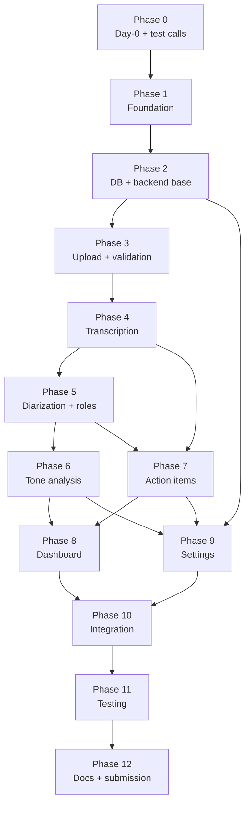

# PLAN.md: Implementation Roadmap

**Project:** Sales Call Quality Analysis Agent  
**Context:** ScaleWorks AI Forward Deployed Engineer assessment  
**Plan date:** 23 Nov 2026  
**Status:** Planning only. **No implementation has started.**

This roadmap is built from `PRD.md`, `DESIGN.md`, `ARCHITECTURE.md`, `DATABASE.md`, `API.md` and `AGENTS.md`. Where they disagree, the priority order in `AGENTS.md` section 2 applies, and the **Zero-Cost Development Policy (AGENTS.md section 3A) overrides the paid providers named in ARCHITECTURE.md**.

## Contents

1. [Project Objective](#1-project-objective)
2. [Development Strategy](#2-development-strategy)
3. [Implementation Phases](#3-implementation-phases)
4. [Task Format](#4-task-format)
5. [Dependencies](#5-dependencies)
6. [Definition of Done](#6-definition-of-done)
7. [Critical Path](#7-critical-path)
8. [Risk Management](#8-risk-management)
9. [Time Allocation](#9-time-allocation)
10. [Final Submission Checklist](#10-final-submission-checklist)

---

## Progress Tracker

Update this table and the checkboxes as work is **verified** (never before). Counts exclude stretch tasks.

| Phase | Tasks | Done | 24h cut (h) | 48h plan (h) | Status |
|---|---:|---:|---:|---:|---|
| Phase 0 – Day-0 Verification and Zero-Cost Reconciliation | 5 | 5 | 1.5 | 2.5 | ✅ Complete |
| Phase 1 – Project Foundation | 3 | 3 | 1.75 | 2.25 | ✅ Complete |
| Phase 2 – Database and Backend Foundation | 3 | 3 | 1 | 2 | ✅ Complete |
| Phase 3 – Audio Upload and Validation | 5 | 5 | 2 | 3.25 | ✅ Complete |
| Phase 4 – Transcription Pipeline | 4 | 4 | 1.5 | 3 | ✅ Complete |
| Phase 5 – Speaker Diarization and Identification | 8 | 8 | 3.5 | 5.25 | ✅ Complete |
| Phase 6 – Tone Analysis Engine | 8 | 8 | 3.75 | 6 | ✅ Complete |
| Phase 7 – Action Item Extraction | 4 | 4 | 1.5 | 2.75 | ✅ Complete |
| Phase 8 – Analysis Dashboard | 5 | 5 | 1.25 | 3.5 | ✅ Complete |
| Phase 9 – Configurable Analysis Settings | 5 | 5 | 2 | 2.75 | ✅ Complete |
| Phase 10 – Integration and End-to-End Workflow | 5 | 5 | 1 | 2.75 | ✅ Complete |
| Phase 11 – Testing and Reliability | 5 | 5 | 0.75 | 2.5 | ✅ Complete |
| Phase 12 – Documentation and Submission | 7 | 7 | 1.5 | 3 | ✅ Complete |
| **Total** | **67** | **67** | **23** | **41.5** | **100% Complete** |

Stretch tasks (not scheduled in either plan): P11-T4, P11-T6, P12-T7 (about 2.25 h).

---

## 1. Project Objective

Build a working, end-to-end web application where a sales manager uploads an `.m4a` recording and receives:

- A readable, timestamped transcript.
- Speaker identification wherever feasible, with visible uncertainty and manual role confirmation.
- A RED/GREEN tone classification of the **sales representative only**.
- Evidence-backed explanations (verbatim, verified quotes).
- Concrete action items (owner and deadline only when explicit).
- Configurable analysis settings that demonstrably change results.
- Complete in-app analysis results.

| Assessment area | Weight | How this plan serves it |
|---|---:|---|
| Accuracy & Reliability | 40% | Phases 5-7 and 11. The model proposes; server code verifies and decides. Pure, unit-tested safeguards are built before the stages that use them. Failures end in explicit `partial`/`failed` states, never placeholder analysis. Live accuracy checks and tuning are scheduled (P6-T8). |
| User Experience | 30% | Vertical slices (every phase ships a screen), plus Phase 8 and the state/accessibility sweep. Real processing stages, specific errors, evidence next to the verdict. |
| Configurability | 30% | Phase 9 plus settings built into the prompt builder from the start. FR-C4 (same transcript flips by sensitivity) is a measured acceptance test. Model sizes and limits are configuration. |

### Ground rules that shape this plan

| Rule | Source | Effect on the plan |
|---|---|---|
| Zero paid services. Local Faster-Whisper, pyannote.audio Community-1 and Ollama; SQLite; local storage. App must run with no paid API keys. | AGENTS.md 3A | Phases 4-6 use local models. If a model cannot run efficiently here, **propose a smaller open-source alternative and wait for approval** before changing anything. |
| Verdict is `RED`, `GREEN` or `null` (tone not run). There is **no** `INSUFFICIENT_EVIDENCE` verdict; thin evidence is Low confidence plus `limited_evidence_reason`. | PRD FR-T2; DATABASE 0; API 0 | The brief's "support insufficient evidence" task is implemented this way (P6-T1, P6-T4). |
| No `/process` or `/jobs` endpoint. Analysis starts automatically on upload (`202`). | API 0 | "Connect upload to processing" is the worker claiming the call row (P3-T3). |
| Only rep speech is evaluated; the LLM never sets the verdict, timestamps, owner labels or confidence. | AGENTS.md 5 | Verification safeguards are first-class tasks with tests. |
| Do not mark a task complete before verification. | AGENTS.md 8-12 | Every task has a verification procedure and acceptance criteria. |

### Current repository state

Only documents exist: `PRD.md`, `DESIGN.md`, `ARCHITECTURE.md`, `DATABASE.md`, `API.md`, `AGENTS.md`, `README.md`. There is no source code, configuration, migration, test or sample recording. `ARCHITECTURE.md`, `API.md`, `DATABASE.md`, `PRD.md` (section 10.3) and `README.md` still name AssemblyAI and Anthropic; they are reconciled in P0-T5 (provisional) and P12-T3 (as built).

### Deviations from the requested phase list (flagged for approval)

1. **Phase 0 added** (Day-0 verification). `ARCHITECTURE.md` Appendix A requires it, and the zero-cost policy makes it essential: nothing else is safe to build until the three local models are proven to run here.
2. **Quote matcher built in Phase 5** (P5-T3), not Phase 6, because role-inference cues must be verified with it. Evidence extraction in Phase 6 reuses it.
3. **Test-call creation moved to Phase 0** (P0-T4) so every later phase can be verified on real audio.
4. **Estimates are not 1-2 hours per task.** "1-2 hours" is treated as the upper bound; with the task count required, most tasks are 0.25-1 h of AI-assisted effort (see 3.1).

---

## 2. Development Strategy

**MVP-first, vertical slices.** Each phase delivers a backend capability **and** the screen that exposes it, so the application stays runnable and demonstrable after every phase.

| After phase | The app can... |
|---|---|
| 0 | Nothing yet; local models proven on this machine; two test calls exist. |
| 1 | Start backend and frontend; health check reached through the proxy. |
| 2 | Run on a migrated database; list, open and delete (seeded) calls via API. |
| 3 | Accept an upload in the UI, validate it, reject bad files with specific errors, show real stage status. |
| 4 | Transcribe locally and show a timestamped transcript; failures show an error. |
| 5 | Show speaker labels aligned to words, warn when roles are uncertain, and let the user assign the rep. |
| 6 | Return a RED/GREEN verdict with verified evidence and explanation on the Results page. |
| 7 | List evidence-linked action items with 'Not specified' where absent. |
| 8 | Show history, dashboard overview, complete Results page and export. |
| 9 | Edit and version settings that change analysis behavior. |
| 10 | Run the whole journey on real local models, including role changes and recovery. |
| 11 | Pass the recorded test suites and report reliability honestly. |
| 12 | Be set up from the README and demonstrated. |

Working rules:

- Build the **pure safeguards and their unit tests first** (ARCH Appendix C), then the stages that call models.
- Use **fake STT, diarization and LLM adapters** for development and tests, so the suite is fast and needs no models.
- Do not implement all backend modules before starting the frontend; each phase touches both.
- Prioritize working functionality over decoration. No V2 or Later features (DESIGN rule 10).
- One feature at a time (AGENTS.md 8); tasks stay at or under 1 h.
- If something cannot be verified, it is not done.

---

## 3. Implementation Phases

Each task lists: ID, description, estimate, priority, dependencies, files, steps, verification and acceptance criteria (see section 4). **Tier** tells you which schedule includes it. In the 24h cut a task is done in a *lean* form (smallest version that satisfies the critical path); the 48h plan does the full version. Estimates are explained in 3.1.

### 3.1 Estimation assumptions

- Effort is **wall-clock time with an AI coding assistant** writing the code and a human reviewing, running and verifying it. Doing the same work by hand would take roughly 2 to 2.5 times longer and would **not** fit 48 hours.
- Model downloads, first-run model loading and local inference waiting time are included.
- Hardware is unknown until P0-T1. If this machine has no GPU, expect slower transcription and LLM calls; P10-T4 re-measures and the plan is adjusted.
- Estimates exclude a rest/overhead buffer. The schedules in section 9 add one explicitly.

---

### Phase 0 – Day-0 Verification and Zero-Cost Reconciliation (added)

**Goal:** Prove the free local stack works on this machine before any feature is built, create the two test calls, and record the approved switch from paid providers to local models.  
**Runnable state after this phase:** No application yet. Throwaway smoke scripts and a verification record exist.  
**Depends on:** None (first phase).  
**Assessment criteria served:** Accuracy (feasibility of diarization/LLM), Configurability (model sizes are config)  
**Effort:** 24h cut 1.5 h · 48h plan 2.5 h

**Phase Definition of Done**

_In the 24h plan, items that rely on a task cut from that plan are deferred and recorded as known limitations._

- [ ] Faster-Whisper, pyannote.audio Community-1 and Ollama each produced real output on a sample clip, or a blocker is recorded with a smaller open-source alternative **proposed and awaiting approval** (AGENTS.md 3A).
- [ ] Chosen model names/sizes and measured speeds are written to `docs/DAY0_VERIFICATION.md`.
- [ ] RED and GREEN synthetic `.m4a` calls with scripts exist.
- [ ] No paid service, key or cloud model was used.
- [ ] Relevant tests were actually executed and pass; documentation touched by this phase is updated.

- [ ] **P0-T1 · Inventory the machine and smoke-test Faster-Whisper**
  - **Estimate:** 24h cut 0.25 h · 48h plan 0.5 h
  - **Priority:** Critical · **Tier:** 24h + 48h
  - **Depends on:** None
  - **Files:** `docs/DAY0_VERIFICATION.md`, `scripts/day0/whisper_smoke.py` (throwaway)
  - **Steps:**
    1. Record OS, CPU, RAM, GPU (if any), free disk; check Python 3.12, Node/npm, git, `ffmpeg`, `ffprobe`.
    2. In a scratch venv install Faster-Whisper; download a small model size.
    3. Normalize a short `.m4a` to 16 kHz mono WAV with ffmpeg and transcribe with word timestamps; record elapsed time versus audio length.
  - **Verification:** Run the script; output shows words with start/end times; timings and tool versions are written to the verification file.
  - **Acceptance criteria:** A model size/compute type that finishes a 1-minute clip in acceptable time is chosen, or a smaller open-source alternative is proposed (no architecture change without approval).

- [ ] **P0-T2 · Verify pyannote.audio Community-1 access and diarization**
  - **Estimate:** 24h cut 0.25 h · 48h plan 0.5 h
  - **Priority:** Critical · **Tier:** 24h + 48h
  - **Depends on:** P0-T1
  - **Files:** `docs/DAY0_VERIFICATION.md`, `scripts/day0/pyannote_smoke.py` (throwaway)
  - **Steps:**
    1. Read the model's current access conditions; if gated, create the free account, accept the terms and create a read token (token stays in an env var, never committed).
    2. Install pyannote.audio and its free dependencies; run diarization on a two-voice clip with speaker-count hints 1 to 3.
    3. Record number of speakers found, turn boundaries, runtime and memory.
  - **Verification:** Script prints speaker turns for the sample; runtime recorded; token is not written to any file in the repo.
  - **Acceptance criteria:** Two distinct speakers are returned on the two-voice sample, or the blocker (access, memory, speed) is documented with a proposed smaller open-source alternative awaiting approval.

- [ ] **P0-T3 · Install Ollama and verify local structured output**
  - **Estimate:** 24h cut 0.25 h · 48h plan 0.5 h
  - **Priority:** Critical · **Tier:** 24h + 48h
  - **Depends on:** P0-T1
  - **Files:** `docs/DAY0_VERIFICATION.md`, `scripts/day0/ollama_smoke.py` (throwaway)
  - **Steps:**
    1. Install Ollama locally; pull one small instruct model that runs on this machine (local models only, never a cloud model).
    2. Call the local API with a JSON-schema output constraint using a toy tone-findings schema; repeat 3 times.
    3. Record latency, whether valid JSON was returned each time, and whether a fixed seed/temperature 0 is honored.
  - **Verification:** Three runs return schema-valid JSON, or failures are recorded; confirm the model name is a local model.
  - **Acceptance criteria:** A local model name is chosen for `LLM_MODEL` with measured latency; if too slow or too weak, a smaller alternative is proposed for approval.

- [ ] **P0-T4 · Create the two representative synthetic test calls**
  - **Estimate:** 24h cut 0.5 h · 48h plan 0.75 h
  - **Priority:** Critical · **Tier:** 24h + 48h
  - **Depends on:** P0-T1
  - **Files:** `samples/red_call_01.m4a`, `samples/red_call_01.script.md`, `samples/green_call_01.m4a`, `samples/green_call_01.script.md`, `samples/README.md`, optional `scripts/generate_sample_calls.py`
  - **Steps:**
    1. Write a RED script (rep is clearly dismissive or hostile; includes one explicit commitment with owner and deadline, and one hypothetical statement).
    2. Write a GREEN script (rep is firm but polite; includes a commitment with no owner or deadline stated).
    3. Optionally add a third short script: hostile customer with professional rep (needed for the false-RED test).
    4. Generate two distinct voices with a free local text-to-speech tool (confirm its license and get approval before adding it) or use consenting volunteers; export `.m4a` with ffmpeg.
    5. In each `.script.md` record speaker roles, expected verdict, expected evidence lines and expected action items.
  - **Verification:** `ffprobe` accepts each file; the Day-0 Whisper script transcribes them; each file is within the 10 s to 30 min limits.
  - **Acceptance criteria:** Two valid `.m4a` files with scripts and expected results exist; all audio is synthetic or consented.

- [ ] **P0-T5 · Record the zero-cost reconciliation**
  - **Estimate:** 24h cut 0.25 h · 48h plan 0.25 h
  - **Priority:** High · **Tier:** 24h + 48h
  - **Depends on:** P0-T1, P0-T2, P0-T3
  - **Files:** `ARCHITECTURE.md` (sections 0.2, 1.1, 1.5, 9), `docs/DAY0_VERIFICATION.md`
  - **Steps:**
    1. Add an ADR/decision note: AssemblyAI and Anthropic are replaced by Faster-Whisper, pyannote.audio and Ollama, per AGENTS.md 3A.
    2. Draft the replacement environment-variable list (model sizes, device, Ollama base URL, `LLM_MODEL`, optional model-download token) and mark names as provisional until P1-T1.
    3. List every other document needing changes (API, DATABASE, PRD 10.3, README) for P12-T3.
  - **Verification:** Search `ARCHITECTURE.md` for AssemblyAI/Anthropic and confirm each remaining mention is marked superseded.
  - **Acceptance criteria:** No document instructs anyone to use a paid service; the change is recorded as approved.

---

### Phase 1 – Project Foundation

**Goal:** A running frontend and backend that talk to each other and read configuration safely.  
**Runnable state after this phase:** Backend starts and serves `/api/v1/health`; the frontend shell loads and reaches it.  
**Depends on:** Phase 0 (stack choices and model names).  
**Assessment criteria served:** UX (shell, tokens), Reliability (fail-fast config)  
**Effort:** 24h cut 1.75 h · 48h plan 2.25 h

**Phase Definition of Done**

_In the 24h plan, items that rely on a task cut from that plan are deferred and recorded as known limitations._

- [ ] Backend and frontend start with documented commands.
- [ ] `/api/v1/health` returns readiness for database and ffmpeg.
- [ ] Missing required configuration fails fast with a clear message.
- [ ] `.env` is git-ignored; `.env.example` has placeholders only.
- [ ] Frontend request reaches the backend through the dev proxy.
- [ ] Relevant tests were actually executed and pass; documentation touched by this phase is updated.

- [ ] **P1-T1 · Create the repository skeleton and backend project**
  - **Estimate:** 24h cut 0.5 h · 48h plan 0.75 h
  - **Priority:** Critical · **Tier:** 24h + 48h
  - **Depends on:** P0-T5
  - **Files:** `.gitignore`, `.env.example`, `backend/pyproject.toml`, `backend/app/config.py`, folders from ARCHITECTURE 5.1 needed now
  - **Steps:**
    1. Create the approved folder structure (only what is needed now; no invented folders).
    2. Add `.gitignore` entries for `.env`, `data/`, `*.db`, model directories and caches.
    3. Pin approved dependencies in `pyproject.toml`: FastAPI, Uvicorn, Pydantic v2, SQLAlchemy 2.0, Alembic, pytest, plus the policy-approved local stack (Faster-Whisper, pyannote.audio, an HTTP client for Ollama). Propose anything else before adding it.
    4. Implement `config.py` with Pydantic Settings, secrets as `SecretStr`, fail-fast validation; write `.env.example` with blank placeholders.
  - **Verification:** Start Python with the variable missing and with it set; check `.env` is ignored by git.
  - **Acceptance criteria:** Config loads from environment, errors are readable, no secret appears in any committed file.

- [ ] **P1-T2 · App factory, database connection, logging and health endpoint**
  - **Estimate:** 24h cut 0.5 h · 48h plan 0.5 h
  - **Priority:** Critical · **Tier:** 24h + 48h
  - **Depends on:** P1-T1
  - **Files:** `backend/app/main.py`, `db/base.py`, `db/session.py`, `logging_config.py`, `api/v1/router.py`, `api/v1/health.py`
  - **Steps:**
    1. Create the FastAPI app factory mounting `/api/v1`.
    2. Configure SQLAlchemy engine with SQLite WAL and busy timeout.
    3. Add structured JSON logging with request id and a redaction filter (no transcript or audio content).
    4. Implement `GET /api/v1/health` (liveness plus readiness: database, ffmpeg binary; report local-model reachability as non-fatal information).
  - **Verification:** Start the server with a single Uvicorn process; `curl` the health URL; stop ffmpeg from PATH and confirm readiness reports it.
  - **Acceptance criteria:** Health endpoint matches API.md API-15 and exposes no versions, paths or secrets.

- [ ] **P1-T3 · Initialize the frontend shell and verify frontend-backend communication**
  - **Estimate:** 24h cut 0.75 h · 48h plan 1 h
  - **Priority:** Critical · **Tier:** 24h + 48h
  - **Depends on:** P1-T2
  - **Files:** `frontend/package.json`, `vite.config.ts`, `tailwind.config.ts`, `src/styles/tokens.css`, `src/api/client.ts`, `src/components/layout/*`, `src/routes.tsx`, `src/pages/*` stubs
  - **Steps:**
    1. Scaffold React 18 + TypeScript + Vite; add Tailwind and the approved libraries as they are first used.
    2. Copy DESIGN 13.1 tokens verbatim into `tokens.css`; map Tailwind utilities to the tokens.
    3. Build AppShell, Sidebar, TopBar and route stubs for Dashboard, Upload, Processing, Results, History and Settings.
    4. Configure the Vite proxy to the backend; write `client.ts` with error-envelope parsing; add the script that generates API types from the OpenAPI schema.
  - **Verification:** Open the app, navigate all routes; confirm in the network tab that a call through the proxy reaches `/api/v1/health` (temporary dev check, no extra UI).
  - **Acceptance criteria:** Frontend and backend communicate; shell follows DESIGN tokens; no off-scale colors or fonts.

---

### Phase 2 – Database and Backend Foundation

**Goal:** The approved schema, migrations, error handling and call-metadata endpoints.  
**Runnable state after this phase:** Backend starts on a migrated database; list/detail/delete call endpoints work on seeded rows.  
**Depends on:** Phase 1.  
**Assessment criteria served:** Reliability (integrity constraints, honest errors)  
**Effort:** 24h cut 1 h · 48h plan 2 h

**Phase Definition of Done**

_In the 24h plan, items that rely on a task cut from that plan are deferred and recorded as known limitations._

- [ ] `alembic upgrade head`, `downgrade base`, `upgrade head` succeed.
- [ ] Default settings version 1 exists; readiness fails if it is missing.
- [ ] All errors use the central envelope.
- [ ] Call list/detail/delete endpoints match API.md.
- [ ] Database constraint tests pass.
- [ ] Relevant tests were actually executed and pass; documentation touched by this phase is updated.

- [ ] **P2-T1 · Models, Alembic migrations and default settings**
  - **Estimate:** 24h cut 0.5 h · 48h plan 1 h
  - **Priority:** Critical · **Tier:** 24h + 48h
  - **Depends on:** P1-T2
  - **Files:** `backend/app/db/models/*`, `alembic.ini`, `alembic/env.py`, `alembic/versions/0001_initial.py`, `0002_default_settings.py`, `services/settings_service.py`
  - **Steps:**
    1. Implement the nine models from DATABASE.md (calls, stage_runs, transcripts, speaker_roles, utterances, settings_versions, analyses, evidence_items, action_items).
    2. Configure Alembic with `render_as_batch=True`; write `0001` from the reference DDL including indexes and triggers; hand-review it.
    3. Write `0002` inserting settings version 1 from ARCH 9.1 defaults; implement `get_current_settings`.
    4. Make readiness fail when no settings version exists.
  - **Verification:** Run upgrade, downgrade, upgrade on an empty database; inspect tables, triggers and the default row.
  - **Acceptance criteria:** Schema matches DATABASE.md exactly; no silent schema deviations (any deviation is documented and approved).

- [ ] **P2-T2 · Central error handling, schemas and call-metadata endpoints**
  - **Estimate:** 24h cut 0.5 h · 48h plan 0.75 h
  - **Priority:** Critical · **Tier:** 24h + 48h
  - **Depends on:** P2-T1
  - **Files:** `errors.py`, `error_handlers.py`, `schemas/common.py`, `schemas/call.py`, `services/call_service.py`, `api/v1/calls.py`
  - **Steps:**
    1. Implement `AppError` and the error-code catalog; one handler mapping everything (including unexpected errors) to the API.md envelope with `request_id`.
    2. Implement pagination and call schemas; unknown fields rejected on writes.
    3. Implement `GET /calls`, `GET /calls/{id}`, `DELETE /calls/{id}` (409 while processing) in the service layer, keeping routers free of logic.
  - **Verification:** Insert rows by script; call the three endpoints; trigger a 404 and a 409; confirm no stack trace in responses.
  - **Acceptance criteria:** Responses match API.md; `CALL_NOT_FOUND` and `CALL_IN_PROGRESS` work.

- [ ] **P2-T3 · Database operation tests**
  - **Estimate:** 48h plan 0.25 h (not in 24h cut)
  - **Priority:** High · **Tier:** 48h only
  - **Depends on:** P2-T1, P2-T2
  - **Files:** `backend/tests/conftest.py`, `tests/integration/test_db_constraints.py`
  - **Steps:**
    1. Add fixtures for a temporary database; test CHECK constraints, triggers, foreign keys and cascade/restrict behavior.
    2. Run the verification queries from DATABASE.md 10.4.
    3. Test migration upgrade/downgrade/upgrade.
  - **Verification:** Run `pytest` and record the real output.
  - **Acceptance criteria:** Constraint violations fail as designed; tests actually executed and passing.

---

### Phase 3 – Audio Upload and Validation

**Goal:** Secure `.m4a` upload, two-layer validation and a visible processing status.  
**Runnable state after this phase:** User uploads a file in the UI; valid files are validated by the worker; invalid files are rejected with specific messages and no model is run.  
**Depends on:** Phase 2.  
**Assessment criteria served:** UX (clear errors, progress), Reliability (validate before compute), Privacy  
**Effort:** 24h cut 2 h · 48h plan 3.25 h

**Phase Definition of Done**

_In the 24h plan, items that rely on a task cut from that plan are deferred and recorded as known limitations._

- [ ] Upload works end to end from the UI with progress.
- [ ] Wrong type, oversized, empty, corrupted, silent and out-of-range files are rejected with the documented error codes.
- [ ] No model is invoked for invalid audio (asserted by test).
- [ ] Stored files use UUID names and restricted permissions.
- [ ] Processing page shows real stage states only.
- [ ] Relevant tests were actually executed and pass; documentation touched by this phase is updated.

- [ ] **P3-T1 · Upload checks, local storage and `POST /calls`**
  - **Estimate:** 24h cut 0.5 h · 48h plan 1 h
  - **Priority:** Critical · **Tier:** 24h + 48h
  - **Depends on:** P2-T2
  - **Files:** `audio/upload_checks.py`, `storage/base.py`, `storage/local.py`, `services/call_service.py`, `api/v1/calls.py`
  - **Steps:**
    1. Streaming size guard, extension, advisory MIME and MP4 `ftyp` signature checks.
    2. `Storage` interface and local adapter (UUID file names, directory 0700, files 0600, outside any served path).
    3. `POST /calls` multipart: stream to storage, create the call (`uploaded`), sanitize display name, return `202 {id,status}`; add per-IP throttle and daily cap.
    4. Map errors: 413, 415, 422, 429, 503.
  - **Verification:** Upload a valid file, a renamed `.mp3`, an empty file and an oversized file with curl; inspect stored file names and permissions.
  - **Acceptance criteria:** Behavior matches API.md API-01; user filenames never used as paths.

- [ ] **P3-T2 · ffmpeg wrapper and deep audio validation**
  - **Estimate:** 24h cut 0.5 h · 48h plan 0.5 h
  - **Priority:** Critical · **Tier:** 24h + 48h
  - **Depends on:** P3-T1
  - **Files:** `audio/ffmpeg.py`, `audio/validation.py`
  - **Steps:**
    1. Argument-list subprocess wrapper (no shell, timeouts, local-file protocol only, bounded output).
    2. Probe container/stream, full decode test, duration range from config, silence detection.
    3. Map failures to `AUDIO_UNREADABLE`, `AUDIO_CORRUPTED`, `AUDIO_SILENT`, `DURATION_OUT_OF_RANGE`.
  - **Verification:** Run the validator on valid, truncated, silent, too-short and too-long fixtures.
  - **Acceptance criteria:** Each invalid file produces its specific code; valid file passes.

- [ ] **P3-T3 · Worker, orchestrator, stage events and status endpoint**
  - **Estimate:** 24h cut 0.5 h · 48h plan 0.75 h
  - **Priority:** Critical · **Tier:** 24h + 48h
  - **Depends on:** P3-T2
  - **Files:** `jobs/worker.py`, `pipeline/orchestrator.py`, `pipeline/context.py`, `pipeline/stages/validation.py`, `api/v1/calls.py`
  - **Steps:**
    1. Implement the in-process worker: atomic claim with `locked_at`, concurrency semaphore (default low for local models), graceful shutdown.
    2. Orchestrator writes a `stage_runs` row at the start and end of each stage.
    3. Implement the validation stage and `GET /calls/{id}/status` (seven stage entries with real messages and elapsed times).
    4. Until Phase 4 lands, later stages stay `pending` and the call is not shown as complete (no fake progress; temporary state removed in P4-T2).
  - **Verification:** Upload a valid and an invalid file; poll `/status`; confirm the invalid one shows `failed` at validation with its code.
  - **Acceptance criteria:** A stage shows succeeded only after it actually finished.

- [ ] **P3-T4 · Upload page and Processing page**
  - **Estimate:** 24h cut 0.5 h · 48h plan 0.75 h
  - **Priority:** Critical · **Tier:** 24h + 48h
  - **Depends on:** P3-T1, P3-T3
  - **Files:** `src/pages/UploadPage.tsx`, `ProcessingPage.tsx`, `components/upload/*`, `components/processing/*`, `src/api/upload.ts`, `src/api/calls.ts`
  - **Steps:**
    1. DropZone and FileCard with client-side extension/size checks, consent notice and active-settings summary per DESIGN 6B.
    2. XHR upload with progress and abort; inline errors from the error envelope.
    3. Processing page with Stepper polling `/status` every 2 s; failure state with reason.
  - **Verification:** Upload valid and invalid files in the browser; watch the stepper; keyboard-test the drop zone.
  - **Acceptance criteria:** Behavior and copy follow DESIGN 6B/6C; loading, error and success states exist.

- [ ] **P3-T5 · Invalid and corrupted audio tests**
  - **Estimate:** 48h plan 0.25 h (not in 24h cut)
  - **Priority:** High · **Tier:** 48h only
  - **Depends on:** P3-T2, P3-T3
  - **Files:** `tests/fixtures/audio/*`, `tests/unit/test_audio_validation.py`, `tests/integration/test_upload_api.py`
  - **Steps:**
    1. Generate tiny fixtures with ffmpeg: valid, renamed mp3, truncated, zero-byte, silent, too short, too long.
    2. Assert specific error codes and that a spy STT/diarization/LLM adapter is never called.
  - **Verification:** Run `pytest`; record the output.
  - **Acceptance criteria:** All invalid inputs rejected with specific messages and no model run (PRD acceptance criteria).

---

### Phase 4 – Transcription Pipeline

**Goal:** Local Faster-Whisper transcription stored and displayed with timestamps.  
**Runnable state after this phase:** Uploading a valid file yields a stored, viewable timestamped transcript; failures show an error and Retry.  
**Depends on:** Phase 3.  
**Assessment criteria served:** Reliability (honest failure), UX (readable transcript)  
**Effort:** 24h cut 1.5 h · 48h plan 3 h

**Phase Definition of Done**

_In the 24h plan, items that rely on a task cut from that plan are deferred and recorded as known limitations._

- [ ] Valid file produces a transcript with segment/word timestamps.
- [ ] Empty or failed transcription ends `failed` with a code and a Retry button; no transcript is invented.
- [ ] Transcript endpoint and viewer work with loading, error and empty states.
- [ ] Temp files are removed.
- [ ] Tests with fake STT pass.
- [ ] Relevant tests were actually executed and pass; documentation touched by this phase is updated.

- [ ] **P4-T1 · STT interface, audio normalization and Faster-Whisper adapter**
  - **Estimate:** 24h cut 0.5 h · 48h plan 1 h
  - **Priority:** Critical · **Tier:** 24h + 48h
  - **Depends on:** P3-T3, P0-T1
  - **Files:** `pipeline/providers/stt/base.py`, `pipeline/providers/stt/faster_whisper.py`, `audio/normalize.py`, `tests/conftest.py` (fake STT)
  - **Steps:**
    1. Define `SttProvider` and normalized types (words with start/end, segments).
    2. Normalize to 16 kHz mono WAV in a private temp directory with cleanup.
    3. Implement the adapter: lazy single model load, model size/device/compute type from config, English, word timestamps, overall timeout, error mapping to `STT_*` codes.
    4. Add a fake STT adapter for tests.
  - **Verification:** Transcribe the RED sample through the adapter; compare against the script.
  - **Acceptance criteria:** Adapter returns timestamped words; swapping to the fake adapter needs no pipeline change.

- [ ] **P4-T2 · Transcription stage and persistence**
  - **Estimate:** 24h cut 0.5 h · 48h plan 0.75 h
  - **Priority:** Critical · **Tier:** 24h + 48h
  - **Depends on:** P4-T1
  - **Files:** `pipeline/stages/transcription.py`, `services/call_service.py`, `jobs/worker.py`
  - **Steps:**
    1. Run normalize then transcribe; persist `transcripts` (compressed raw result) and `utterances` (speaker unknown for now).
    2. Empty transcript raises `STT_EMPTY_TRANSCRIPT`; any failure sets `failed` with code, keeps stage detail and cleans temp files.
    3. Set `transcribing` then `analyzing`; remove the Phase 3 temporary parking behavior.
  - **Verification:** Upload valid and silent-but-valid fixtures; inspect rows and statuses.
  - **Acceptance criteria:** Transcript rows saved only on success; failures produce no placeholder text.

- [ ] **P4-T3 · Transcript endpoint and transcript viewer**
  - **Estimate:** 24h cut 0.5 h · 48h plan 0.75 h
  - **Priority:** Critical · **Tier:** 24h + 48h
  - **Depends on:** P4-T2
  - **Files:** `api/v1/calls.py`, `schemas/transcript.py`, `components/transcript/*`, `pages/CallResultsPage.tsx` (initial)
  - **Steps:**
    1. Implement `GET /calls/{id}/transcript` (409 `TRANSCRIPT_NOT_READY`, `Cache-Control: no-store`, no raw provider payload).
    2. Build TranscriptPanel/TranscriptSegment with timestamps and the 'From the transcript' treatment, an auto-generated-transcript footer, and loading/error/empty states.
  - **Verification:** Open a processed call in the browser; verify timestamps against the script.
  - **Acceptance criteria:** Transcript renders as text only, follows DESIGN 7.12, and survives page refresh.

- [ ] **P4-T4 · Retry endpoint and transcription failure tests**
  - **Estimate:** 48h plan 0.5 h (not in 24h cut)
  - **Priority:** High · **Tier:** 48h only
  - **Depends on:** P4-T2
  - **Files:** `api/v1/calls.py`, `services/call_service.py`, `tests/integration/test_pipeline_failures.py`, `src/components/feedback/*`
  - **Steps:**
    1. Implement `POST /calls/{id}/retry` with the `stage` body (`409 NOT_RETRYABLE` when not allowed) and a Retry button on failed states.
    2. Fake-STT tests: timeout, provider error, unsupported audio, empty transcript produce `failed` and no invented transcript.
  - **Verification:** Force a failure with the fake adapter; retry; confirm state transitions.
  - **Acceptance criteria:** Failures show a specific message and recovery action; retry resumes from the named stage.

---

### Phase 5 – Speaker Diarization and Identification

**Goal:** Local pyannote diarization, word-to-speaker alignment, role resolution and manual confirmation.  
**Runnable state after this phase:** Transcript shows Speaker/Role labels with a confidence-aware warning; the user can assign the sales rep.  
**Depends on:** Phase 4 (and the quote matcher built in this phase).  
**Assessment criteria served:** Accuracy (correct rep attribution is the main failure risk)  
**Effort:** 24h cut 3.5 h · 48h plan 5.25 h

**Phase Definition of Done**

_In the 24h plan, items that rely on a task cut from that plan are deferred and recorded as known limitations._

- [ ] Two-voice sample shows two labelled speakers aligned to words.
- [ ] Uncertain/unresolved roles show a banner; user can assign the rep.
- [ ] 1-speaker or null LLM pick marks roles `unresolved` (tone will not run).
- [ ] Alignment, role resolution and quote matching are pure functions with passing unit tests.
- [ ] Relevant tests were actually executed and pass; documentation touched by this phase is updated.

- [ ] **P5-T1 · Diarization adapter (pyannote.audio Community-1)**
  - **Estimate:** 24h cut 0.5 h · 48h plan 0.75 h
  - **Priority:** Critical · **Tier:** 24h + 48h
  - **Depends on:** P4-T1, P0-T2
  - **Files:** `pipeline/providers/diarization/base.py`, `pipeline/providers/diarization/pyannote.py`
  - **Steps:**
    1. Define a diarization interface returning speaker turns and a fake adapter.
    2. Implement the pyannote adapter: load the pipeline once, run on the normalized WAV, pass min/max speaker hints from config, map failures to `DIARIZATION_UNAVAILABLE`.
    3. Read any model-download token only from the environment; never log it.
  - **Verification:** Run on the RED sample; compare turns to the script.
  - **Acceptance criteria:** Turns returned for two-voice audio; failure produces a clean error, not a crash.

- [ ] **P5-T2 · Word-to-speaker alignment (pure function)**
  - **Estimate:** 24h cut 0.5 h · 48h plan 0.75 h
  - **Priority:** Critical · **Tier:** 24h + 48h
  - **Depends on:** P5-T1, P4-T1
  - **Files:** `pipeline/safeguards/speaker_alignment.py`, `tests/unit/test_speaker_alignment.py`
  - **Steps:**
    1. Assign each Whisper word to the speaker turn with maximum overlap; define rules for gaps and ties.
    2. Split segments at speaker changes and group words into utterances.
    3. Flag micro-speakers (under 5% talk time and under 10 s), rapid label flips and low-attribution utterances.
    4. Unit tests: overlap, gap, single speaker, interleaved speakers, micro-speaker.
  - **Verification:** Run unit tests; manually inspect the aligned RED sample.
  - **Acceptance criteria:** Misalignment lowers attribution flags, never produces false certainty; tests pass.

- [ ] **P5-T3 · Quote matcher with offsets (shared safeguard)**
  - **Estimate:** 24h cut 0.5 h · 48h plan 0.5 h
  - **Priority:** Critical · **Tier:** 24h + 48h
  - **Depends on:** P2-T1
  - **Files:** `pipeline/safeguards/quote_matcher.py`, `utils/text.py`, `tests/unit/test_quote_matcher.py`
  - **Steps:**
    1. Normalize (Unicode NFKC, casefold, collapse whitespace, strip surrounding quotes, ignore punctuation) and test contiguous-substring match.
    2. Return offsets into the original utterance text through an index map.
    3. Enforce 3 to 60 words and 400 characters with drop codes (`QUOTE_NOT_FOUND`, `QUOTE_TOO_SHORT`, `QUOTE_TOO_LONG`).
    4. Tests: case, spacing, punctuation differences pass; near-miss and paraphrased quotes fail.
  - **Verification:** Run unit tests including adversarial near-miss quotes.
  - **Acceptance criteria:** No paraphrase can pass as a verbatim quote. Pulled forward because role cues and evidence both depend on it.

- [ ] **P5-T4 · Role resolution safeguard**
  - **Estimate:** 24h cut 0.5 h · 48h plan 0.75 h
  - **Priority:** Critical · **Tier:** 24h + 48h
  - **Depends on:** P5-T2
  - **Files:** `pipeline/safeguards/role_resolution.py`, `tests/unit/test_role_resolution.py`
  - **Steps:**
    1. Compute speaker stats and heuristic signals (introductions, product/pricing offers, discovery questions); first speaker is never decisive.
    2. Implement the ARCH 3.5 resolution table: confident/uncertain/unresolved/confirmed with levels.
    3. Test every table row, 3+ speakers, 1 speaker, heuristic/LLM disagreement.
  - **Verification:** Run unit tests covering each row.
  - **Acceptance criteria:** Decision table behavior is exactly as ARCHITECTURE 3.5; user-confirmed roles override.

- [ ] **P5-T5 · LLM client interface and Ollama adapter**
  - **Estimate:** 24h cut 0.5 h · 48h plan 0.75 h
  - **Priority:** Critical · **Tier:** 24h + 48h
  - **Depends on:** P0-T3, P1-T1
  - **Files:** `pipeline/providers/llm/base.py`, `pipeline/providers/llm/ollama_client.py`, `pipeline/llm_schemas.py` (base), fake LLM in `tests/conftest.py`
  - **Steps:**
    1. Define `LlmClient` (structured call plus repair call) and a fake client.
    2. Implement the Ollama adapter against the local server only: JSON-schema constrained output, temperature 0, bounded tokens, timeouts, bounded retry on connection errors, truncation detection.
    3. Map failures to `LLM_UNAVAILABLE`, `LLM_INVALID_OUTPUT`; always re-validate with Pydantic.
  - **Verification:** Call the model with a toy schema; stop Ollama and confirm a clean error.
  - **Acceptance criteria:** Valid output is parsed; malformed/truncated output raises the right error; no cloud model can be configured.

- [ ] **P5-T6 · Role inference prompt and speaker-identification stage**
  - **Estimate:** 24h cut 0.5 h · 48h plan 0.75 h
  - **Priority:** Critical · **Tier:** 24h + 48h
  - **Depends on:** P5-T3, P5-T4, P5-T5
  - **Files:** `pipeline/prompts/role_inference.v1.md`, `pipeline/stages/speaker_identification.py`, `pipeline/llm_schemas.py`
  - **Steps:**
    1. Write the role-inference prompt (stats plus first/last/sample utterances; cues must be verbatim quotes).
    2. Verify cues with the quote matcher; discard unverified cues; ignore any self-stated certainty.
    3. Persist `speaker_roles` (role, status, source, confidence) and utterance speaker labels; 1 speaker or null pick sets `unresolved`.
  - **Verification:** Run on both samples; inspect stored roles and verified cues.
  - **Acceptance criteria:** Roles are persisted with status and source; the LLM never decides alone.

- [ ] **P5-T7 · Roles UI and `PUT /speaker-roles`**
  - **Estimate:** 24h cut 0.5 h · 48h plan 0.75 h
  - **Priority:** High · **Tier:** 24h + 48h
  - **Depends on:** P5-T6
  - **Files:** `api/v1/calls.py`, `services/call_service.py`, `components/transcript/RolesModal.tsx`, banners in `components/feedback/*`
  - **Steps:**
    1. Show Sales Rep/Customer labels with the uncertainty banner per DESIGN 6D.2.
    2. Implement the roles modal and `PUT /calls/{id}/speaker-roles` (exactly one `sales_rep`, `422 INVALID_ROLES`, not while processing); store `source=user` and queue a re-run (stages 4-7 connect in P10-T2).
  - **Verification:** Swap roles in the browser; refresh; confirm roles persist and the validation errors show.
  - **Acceptance criteria:** User confirmation overrides automatic roles and is stored as `user`.

- [ ] **P5-T8 · Speaker attribution tests**
  - **Estimate:** 48h plan 0.25 h (not in 24h cut)
  - **Priority:** High · **Tier:** 48h only
  - **Depends on:** P5-T6
  - **Files:** `tests/integration/test_speaker_pipeline.py`
  - **Steps:**
    1. Fake diarization/LLM tests: ambiguous roles, disagreement, 3 speakers, 1 speaker, null LLM pick, user override.
  - **Verification:** Run `pytest`; record the output.
  - **Acceptance criteria:** Each scenario yields the specified role status and never an unsupported assignment.

---

### Phase 6 – Tone Analysis Engine (highest assessment priority)

**Goal:** Rep-only tone findings, server-side verification, RED/GREEN verdict, confidence and grounded explanation.  
**Runnable state after this phase:** Sample RED call returns RED with verified rep quotes; sample GREEN returns GREEN; the Results page shows verdict, explanation and evidence.  
**Depends on:** Phase 5.  
**Assessment criteria served:** Accuracy (primary), UX (verdict + proof visible together)  
**Effort:** 24h cut 3.75 h · 48h plan 6 h

**Phase Definition of Done**

_In the 24h plan, items that rely on a task cut from that plan are deferred and recorded as known limitations._

- [ ] Verdict is computed by code from verified findings only.
- [ ] No evidence quote exists that is absent from the transcript or belongs to the customer.
- [ ] Thin evidence yields Low confidence plus a limited-evidence reason; verdict stays RED/GREEN, or `null` when tone did not run.
- [ ] RED demo call and GREEN demo call both behave as specified on real local models.
- [ ] Tests pass for every sensitivity boundary.
- [ ] Relevant tests were actually executed and pass; documentation touched by this phase is updated.

- [ ] **P6-T1 · Verdict decision and confidence safeguards**
  - **Estimate:** 24h cut 0.5 h · 48h plan 0.75 h
  - **Priority:** Critical · **Tier:** 24h + 48h
  - **Depends on:** P5-T3
  - **Files:** `pipeline/safeguards/tone_decision.py`, `pipeline/safeguards/confidence.py`, `tests/unit/test_tone_decision.py`, `tests/unit/test_confidence.py`
  - **Steps:**
    1. Implement the Low/Medium/High sensitivity rules from ARCH 3.7 as named constants.
    2. Implement the rule-based confidence factors (minimum rule), `limited_evidence_reason`, and 'not available' factors when data is missing.
    3. Boundary tests for each sensitivity and every factor level.
  - **Verification:** Run unit tests.
  - **Acceptance criteria:** Verdict never rises because of an unverified finding; no percentages or model-reported confidence exist.

- [ ] **P6-T2 · Prompt builder and tone-findings contract**
  - **Estimate:** 24h cut 0.5 h · 48h plan 0.75 h
  - **Priority:** Critical · **Tier:** 24h + 48h
  - **Depends on:** P5-T5, P2-T1
  - **Files:** `pipeline/prompts/builder.py`, `pipeline/prompts/tone_findings.v1.md`, `pipeline/llm_schemas.py`
  - **Steps:**
    1. Build prompts from the settings snapshot: enabled criteria, sensitivity text, severity rubric, firmness-vs-rudeness guidance.
    2. Rep utterances go in the evaluation block; customer lines in a read-only context block; custom guidance only inside the fixed-preamble `<team_guidance>` block.
    3. Define the `ToneFindings` schema with criterion enum built from enabled criteria.
  - **Verification:** Render prompts for default settings and for a custom criterion; inspect for fencing.
  - **Acceptance criteria:** The model is never asked for the verdict; injected guidance cannot change format or target speaker.

- [ ] **P6-T3 · Tone-analysis stage (LLM Call A)**
  - **Estimate:** 24h cut 0.5 h · 48h plan 0.75 h
  - **Priority:** Critical · **Tier:** 24h + 48h
  - **Depends on:** P6-T2, P5-T6
  - **Files:** `pipeline/stages/tone_analysis.py`
  - **Steps:**
    1. Skip with `ROLES_UNRESOLVED` when roles are unresolved (never guess).
    2. Call the local model on rep utterances only; validate output; one repair call when invalid or when more than half of findings fail verification; second failure marks the stage failed.
  - **Verification:** Run on both samples; test with a fake LLM returning bad output.
  - **Acceptance criteria:** Failures degrade to `partial`, never to invented findings.

- [ ] **P6-T4 · Evidence verification and verdict**
  - **Estimate:** 24h cut 0.5 h · 48h plan 0.75 h
  - **Priority:** Critical · **Tier:** 24h + 48h
  - **Depends on:** P6-T1, P6-T3, P5-T3
  - **Files:** `pipeline/stages/evidence_extraction.py`
  - **Steps:**
    1. Verify each finding: utterance exists, speaker is the rep, quote verbatim, length limits, criterion enabled, de-duplicate with drop reason codes.
    2. Resolve timestamps and offsets from the stored utterance only.
    3. Compute verdict, confidence and dropped-evidence counts.
  - **Verification:** Feed fake findings including fabricated, customer-cited and duplicate quotes; check what survives.
  - **Acceptance criteria:** Only verified rep evidence remains; dropped items are counted and disclosed.

- [ ] **P6-T5 · Grounded explanation (LLM Call B) and completion of the tone result**
  - **Estimate:** 24h cut 0.5 h · 48h plan 0.75 h
  - **Priority:** Critical · **Tier:** 24h + 48h
  - **Depends on:** P6-T4
  - **Files:** `pipeline/prompts/tone_explanation.v1.md`, `pipeline/stages/completion.py`, `schemas/analysis.py`, `api/v1/calls.py`
  - **Steps:**
    1. Generate a 2-4 sentence explanation from verified evidence only; guard against unknown evidence ids; one retry; on repeated failure store `null` and mark `partial`.
    2. GREEN explanations never claim positive qualities.
    3. Write the `analyses` and `evidence_items` rows in one transaction; implement `GET /calls/{id}/analysis` (tone fields, settings snapshot, `limited_evidence_reason`, `409 ANALYSIS_NOT_READY`).
  - **Verification:** Call `/analysis` for both samples; compare with the scripts.
  - **Acceptance criteria:** Response matches API.md API-06 for tone; explanation never invented.

- [ ] **P6-T6 · Verdict card, evidence panel and linked highlighting**
  - **Estimate:** 24h cut 0.5 h · 48h plan 1 h
  - **Priority:** Critical · **Tier:** 24h + 48h
  - **Depends on:** P6-T5, P4-T3
  - **Files:** `components/tone/*`, `components/evidence/*`, `pages/CallResultsPage.tsx`, `components/transcript/*`
  - **Steps:**
    1. ToneBadge with text and icon (and a 'Not analyzed' state), VerdictCard, ConfidenceMeter with a 'Why?' popover.
    2. EvidenceCard with 'From the transcript' vs 'AI interpretation' treatments; clicking highlights the exact span in the transcript.
    3. Banners: limited evidence, unverified quotes, uncertain roles.
  - **Verification:** Open RED and GREEN results; click evidence; check keyboard and screen-reader labels.
  - **Acceptance criteria:** Evidence is above the fold next to the verdict; RED/GREEN never relies on color alone.

- [ ] **P6-T7 · Tone tests with fakes**
  - **Estimate:** 24h cut 0.25 h · 48h plan 0.5 h
  - **Priority:** High · **Tier:** 24h + 48h
  - **Depends on:** P6-T4, P6-T5
  - **Files:** `tests/integration/test_pipeline_happy_path.py`, `tests/integration/test_pipeline_failures.py`, `tests/fixtures/transcripts/*`, `tests/fixtures/llm_responses/*`
  - **Steps:**
    1. RED and GREEN fixtures; hostile customer with professional rep returns GREEN; fabricated quote dropped; customer utterance cited as rep dropped; malformed JSON; explanation citing an unknown evidence id; thin rep speech gives Low confidence with the verdict unchanged.
  - **Verification:** Run `pytest`; record the output.
  - **Acceptance criteria:** Each documented safeguard has a passing test.

- [ ] **P6-T8 · Live accuracy check and prompt tuning on the two samples**
  - **Estimate:** 24h cut 0.5 h · 48h plan 0.75 h
  - **Priority:** Critical · **Tier:** 24h + 48h
  - **Depends on:** P6-T6, P0-T4
  - **Files:** `pipeline/prompts/*.md`, `docs/prompts.md`, `docs/RELIABILITY_TESTING.md` (draft)
  - **Steps:**
    1. Run the RED and GREEN samples with the real local models; record verdict, evidence, confidence and timing.
    2. Adjust prompts and rubric only (never loosen verification); version prompts (`v2`...) and record why.
  - **Verification:** Real runs repeated; results written down honestly, including failures.
  - **Acceptance criteria:** RED sample returns RED with at least one verified rep quote; GREEN sample returns GREEN. If a small local model cannot achieve this, propose a different local model for approval.

---

### Phase 7 – Action Item Extraction

**Goal:** Concrete, evidence-linked action items with no invented owners or deadlines.  
**Runnable state after this phase:** Results page lists action items with quote, timestamp, and 'Not specified' where absent.  
**Depends on:** Phase 4 (transcript) and Phase 5 (role labels for owner rule); can run in parallel with Phase 6 UI work.  
**Assessment criteria served:** Accuracy (zero fabricated owners/deadlines), UX  
**Effort:** 24h cut 1.5 h · 48h plan 2.75 h

**Phase Definition of Done**

_In the 24h plan, items that rely on a task cut from that plan are deferred and recorded as known limitations._

- [ ] Every item has a verified quote and timestamp.
- [ ] Owner/deadline are null unless supported by the quote or confident role.
- [ ] Hypothetical/conditional/question items are excluded by default.
- [ ] Empty state shown when none found.
- [ ] Tests for missing owner and deadline pass.
- [ ] Relevant tests were actually executed and pass; documentation touched by this phase is updated.

- [ ] **P7-T1 · Action-item rules (pure safeguards)**
  - **Estimate:** 24h cut 0.5 h · 48h plan 0.75 h
  - **Priority:** Critical · **Tier:** 24h + 48h
  - **Depends on:** P5-T3, P5-T4
  - **Files:** `pipeline/safeguards/action_rules.py`, `tests/unit/test_action_rules.py`
  - **Steps:**
    1. Modality filter (keep definite; tentative only if enabled; always drop conditional, hypothetical, question).
    2. Owner rule (explicit name/role must appear in quote or utterance; committing-speaker role set by the server only when roles are confident or confirmed) and deadline rule (verbatim text in the quote; never converted to a date).
    3. Type filter from settings; de-duplicate overlapping spans.
  - **Verification:** Run unit tests with adversarial candidates.
  - **Acceptance criteria:** Invented owners and deadlines become null.

- [ ] **P7-T2 · Action-item prompt, schema and extraction stage (LLM Call C)**
  - **Estimate:** 24h cut 0.5 h · 48h plan 1 h
  - **Priority:** Critical · **Tier:** 24h + 48h
  - **Depends on:** P7-T1, P6-T2
  - **Files:** `pipeline/prompts/action_items.v1.md`, `pipeline/llm_schemas.py`, `pipeline/stages/action_items.py`
  - **Steps:**
    1. Prompt over the full labelled transcript with enabled types and fenced guidance; schema per ARCH 3.8.
    2. Verify with the quote matcher and `action_rules`; assign timestamps from utterances.
    3. Extend the completion transaction to store `action_items`; set `complete` or `partial` (`ACTION_ITEMS_FAILED`).
  - **Verification:** Run on both samples; compare with script expectations (explicit owner/deadline vs none).
  - **Acceptance criteria:** Items shown only if verified; failures leave transcript and tone results intact (`partial`).

- [ ] **P7-T3 · Action-items panel and API fields**
  - **Estimate:** 24h cut 0.5 h · 48h plan 0.5 h
  - **Priority:** Critical · **Tier:** 24h + 48h
  - **Depends on:** P7-T2, P6-T6
  - **Files:** `components/actions/*`, `schemas/analysis.py`
  - **Steps:**
    1. Return action items in `/analysis` with modality and owner basis.
    2. ActionItemCard shows task text labelled 'AI summary', verbatim quote, timestamp, owner/deadline or 'Not specified'; click highlights the transcript line; explicit empty state.
  - **Verification:** View both samples in the browser.
  - **Acceptance criteria:** Matches DESIGN 7.14; never blank or 'N/A'.

- [ ] **P7-T4 · Action-item tests**
  - **Estimate:** 48h plan 0.5 h (not in 24h cut)
  - **Priority:** High · **Tier:** 48h only
  - **Depends on:** P7-T2
  - **Files:** `tests/integration/test_pipeline_failures.py`, `tests/fixtures/llm_responses/*`
  - **Steps:**
    1. Tests: missing owner, missing deadline, hypothetical and conditional excluded, model-invented owner dropped, deadline not in quote nulled, tentative setting on/off, customer-task setting, no items found.
  - **Verification:** Run `pytest`; record the output.
  - **Acceptance criteria:** Zero fabricated owners or deadlines on adversarial fixtures.

---

### Phase 8 – Analysis Dashboard

**Goal:** Results screen, history, dashboard overview, export and complete UI states.  
**Runnable state after this phase:** A manager can review any past call, see KPIs, and export a result.  
**Depends on:** Phases 6 and 7 (stored analyses).  
**Assessment criteria served:** UX (30%)  
**Effort:** 24h cut 1.25 h · 48h plan 3.5 h

**Phase Definition of Done**

_In the 24h plan, items that rely on a task cut from that plan are deferred and recorded as known limitations._

- [ ] Results page shows verdict, explanation, evidence, transcript and action items on one screen.
- [ ] History lists, filters and reopens calls after refresh; delete works.
- [ ] Dashboard shows KPIs and tone distribution with a table alternative.
- [ ] Every screen handles loading, empty, partial and error states.
- [ ] Export downloads valid JSON and Markdown.
- [ ] Relevant tests were actually executed and pass; documentation touched by this phase is updated.

- [ ] **P8-T1 · Complete the Results page**
  - **Estimate:** 24h cut 0.5 h · 48h plan 0.75 h
  - **Priority:** Critical · **Tier:** 24h + 48h
  - **Depends on:** P6-T6, P7-T3
  - **Files:** `pages/CallResultsPage.tsx`, `components/tone/SettingsUsedPanel.tsx`
  - **Steps:**
    1. Assemble DESIGN 6D layout: header, verdict card, evidence, transcript, action items, settings-used panel; roles control.
    2. Partial and failed states with Retry; preserve a visible transcript when analysis fails.
  - **Verification:** Open complete, partial and failed calls.
  - **Acceptance criteria:** Matches DESIGN 6D including states 6D.7.

- [ ] **P8-T2 · Call history page**
  - **Estimate:** 24h cut 0.5 h · 48h plan 0.75 h
  - **Priority:** High · **Tier:** 24h + 48h
  - **Depends on:** P2-T2, P8-T1
  - **Files:** `pages/CallHistoryPage.tsx`, `components/ui/Table.tsx`, `src/api/calls.ts`
  - **Steps:**
    1. Table with search by name, tone/status filters, sort and pagination; status chips and tone badges.
    2. Open row; delete with confirmation modal (409 handled).
  - **Verification:** Create several calls (including failed); filter and delete.
  - **Acceptance criteria:** Matches DESIGN 6E; survives refresh.

- [ ] **P8-T3 · Dashboard summary and overview page**
  - **Estimate:** 48h plan 0.75 h (not in 24h cut)
  - **Priority:** Medium · **Tier:** 48h only
  - **Depends on:** P8-T2
  - **Files:** `services/dashboard_service.py`, `api/v1/dashboard.py`, `pages/DashboardPage.tsx`, `components/charts/ToneDistributionBar.tsx`
  - **Steps:**
    1. Implement `GET /dashboard/summary` (counts, tone distribution, recent calls and action items).
    2. Build KPI row, hand-built stacked bar with pattern fills and a table toggle, and empty state.
  - **Verification:** Compare numbers to the database.
  - **Acceptance criteria:** KPIs are correct; no chart library added.

- [ ] **P8-T4 · JSON and Markdown export**
  - **Estimate:** 24h cut 0.25 h · 48h plan 0.5 h
  - **Priority:** High · **Tier:** 24h + 48h
  - **Depends on:** P7-T3
  - **Files:** `services/export_service.py`, `api/v1/exports.py`, results page menu
  - **Steps:**
    1. Generate on demand (never stored) with verdict, explanation, evidence, transcript, action items, settings snapshot and timestamp; sanitize filename; `Cache-Control: no-store`.
  - **Verification:** Download both formats; validate the JSON.
  - **Acceptance criteria:** Export matches API.md API-09.

- [ ] **P8-T5 · UI states, accessibility and responsive sweep**
  - **Estimate:** 48h plan 0.75 h (not in 24h cut)
  - **Priority:** Medium · **Tier:** 48h only
  - **Depends on:** P8-T1, P8-T2
  - **Files:** `components/feedback/*`, `src/lib/errorMessages.ts`
  - **Steps:**
    1. Walk through DESIGN 6G states for every screen; confirm non-color-only indicators, focus visibility, labels and tablet layout.
  - **Verification:** Manual keyboard and zoom pass; record defects.
  - **Acceptance criteria:** No screen lacks loading/empty/error handling.

---

### Phase 9 – Configurable Analysis Settings

**Goal:** Versioned, validated settings that demonstrably change analysis behavior.  
**Runnable state after this phase:** Editing settings in the UI changes the next analysis; each analysis shows the snapshot it used.  
**Depends on:** Phase 2 (settings table); wiring needs Phases 6-7.  
**Assessment criteria served:** Configurability (30%)  
**Effort:** 24h cut 2 h · 48h plan 2.75 h

**Phase Definition of Done**

_In the 24h plan, items that rely on a task cut from that plan are deferred and recorded as known limitations._

- [ ] Settings persist server-side and are validated (limits, at least one criterion and one action type).
- [ ] Saving creates a new version; past analyses unchanged.
- [ ] Changing sensitivity or criteria changes output on the same transcript (FR-C4).
- [ ] Reset to defaults works.
- [ ] Relevant tests were actually executed and pass; documentation touched by this phase is updated.

- [ ] **P9-T1 · Settings API, validation and versioning**
  - **Estimate:** 24h cut 0.5 h · 48h plan 0.75 h
  - **Priority:** Critical · **Tier:** 24h + 48h
  - **Depends on:** P2-T1
  - **Files:** `schemas/settings.py`, `services/settings_service.py`, `api/v1/settings.py`, `tests/unit/test_settings_validation.py`
  - **Steps:**
    1. Pydantic settings document per ARCH 9.1; rules: at least one criterion and one action type enabled, up to 5 custom criteria (1-140 chars), guidance up to 500, control characters stripped, duplicates rejected.
    2. Implement `GET /settings`, `PUT /settings` (new version), `POST /settings/reset` with per-field errors (`SETTINGS_INVALID`).
  - **Verification:** Call endpoints with valid and invalid bodies.
  - **Acceptance criteria:** Matches API.md API-12..14; history of versions kept.

- [ ] **P9-T2 · Settings page: tone criteria and sensitivity**
  - **Estimate:** 24h cut 0.5 h · 48h plan 0.75 h
  - **Priority:** Critical · **Tier:** 24h + 48h
  - **Depends on:** P9-T1, P3-T4
  - **Files:** `pages/SettingsPage.tsx`, `components/settings/ToneSection.tsx`, `SaveBar.tsx`
  - **Steps:**
    1. Criteria toggles, custom criteria, sensitivity (Low/Medium/High) with helper text, react-hook-form + zod, inline errors, save bar and unsaved-changes guard.
  - **Verification:** Edit, save, reload; trigger validation errors.
  - **Acceptance criteria:** Matches DESIGN 6F; notice that changes apply to subsequent analyses only.

- [ ] **P9-T3 · Settings page: action-item rules, guidance and reset**
  - **Estimate:** 24h cut 0.25 h · 48h plan 0.5 h
  - **Priority:** High · **Tier:** 24h + 48h
  - **Depends on:** P9-T2
  - **Files:** `components/settings/ActionItemsSection.tsx`, `SafeguardsCard.tsx`
  - **Steps:**
    1. Action-item type toggles, tentative statements, owner rule, relative-deadline capture, guidance fields, always-on safeguards card, reset to defaults with confirmation.
  - **Verification:** Edit each control; reset.
  - **Acceptance criteria:** All ARCH 9.1 settings editable; fixed safeguards are displayed, not editable.

- [ ] **P9-T4 · Connect settings snapshot to the analysis engine**
  - **Estimate:** 24h cut 0.5 h · 48h plan 0.5 h
  - **Priority:** Critical · **Tier:** 24h + 48h
  - **Depends on:** P9-T1, P6-T5, P7-T2
  - **Files:** `pipeline/context.py`, `pipeline/prompts/builder.py`, `safeguards/tone_decision.py`, `safeguards/action_rules.py`, `components/tone/SettingsUsedPanel.tsx`
  - **Steps:**
    1. Each analysis reads the latest settings version when it starts and stores the version; prompts, verdict rule and action rules consume that snapshot only.
    2. Show the snapshot on the Results page.
  - **Verification:** Run the same call under two settings versions.
  - **Acceptance criteria:** Old results keep their snapshot; new results use the new one.

- [ ] **P9-T5 · Verify settings change outputs**
  - **Estimate:** 24h cut 0.25 h · 48h plan 0.25 h
  - **Priority:** Critical · **Tier:** 24h + 48h
  - **Depends on:** P9-T4
  - **Files:** `tests/integration/test_settings_changes_output.py`
  - **Steps:**
    1. Same transcript with fake LLM findings: Low vs Medium vs High gives the expected verdict pattern; disabling a criterion removes its findings; toggling an action-item type changes items.
    2. Manually confirm with the real local model on one sample.
  - **Verification:** Run `pytest`; do the manual check.
  - **Acceptance criteria:** PRD FR-C4 demonstrated (a transcript flips GREEN to RED by sensitivity).

---

### Phase 10 – Integration and End-to-End Workflow

**Goal:** The full upload-to-results journey on real local models, including role changes and failures.  
**Runnable state after this phase:** Complete journey works from the browser for both samples.  
**Depends on:** Phases 3-9.  
**Assessment criteria served:** All three criteria  
**Effort:** 24h cut 1 h · 48h plan 2.75 h

**Phase Definition of Done**

_In the 24h plan, items that rely on a task cut from that plan are deferred and recorded as known limitations._

- [ ] Upload automatically starts processing and reaches Results.
- [ ] Role change re-runs stages 4-7 and stores a new analysis run.
- [ ] Interrupted jobs recover or fail with Retry.
- [ ] Measured processing times and timeouts are recorded.
- [ ] Defect list from the walkthrough has no open critical items.
- [ ] Relevant tests were actually executed and pass; documentation touched by this phase is updated.

- [ ] **P10-T1 · End-to-end run on both samples**
  - **Estimate:** 24h cut 0.5 h · 48h plan 0.75 h
  - **Priority:** Critical · **Tier:** 24h + 48h
  - **Depends on:** P6-T8, P7-T3, P8-T1
  - **Files:** (wiring fixes as needed), `docs/RELIABILITY_TESTING.md`
  - **Steps:**
    1. Upload RED and GREEN from the browser; follow the stepper; review results.
    2. Fix wiring defects only; log each defect and its fix.
  - **Verification:** Observe the full journey; save the actual outputs.
  - **Acceptance criteria:** Seven stages complete for both samples with the expected verdicts.

- [ ] **P10-T2 · Role-change re-run flow**
  - **Estimate:** 24h cut 0.25 h · 48h plan 0.5 h
  - **Priority:** High · **Tier:** 24h + 48h
  - **Depends on:** P5-T7, P10-T1
  - **Files:** `services/call_service.py`, `pipeline/orchestrator.py`
  - **Steps:**
    1. `PUT /speaker-roles` creates a new `analyses` run (higher `run_number`) using current settings; previous runs kept; UI refreshes.
    2. Check that swapping roles flips attribution of evidence.
  - **Verification:** Swap roles on the RED sample and confirm the effect.
  - **Acceptance criteria:** No re-upload or re-transcription; history of runs preserved.

- [ ] **P10-T3 · Failure injection and restart recovery**
  - **Estimate:** 48h plan 0.75 h (not in 24h cut)
  - **Priority:** High · **Tier:** 48h only
  - **Depends on:** P10-T1
  - **Files:** `jobs/recovery.py`, `tests/integration/test_pipeline_failures.py`
  - **Steps:**
    1. Stop Ollama mid-run; kill the server mid-job; remove a model file.
    2. Implement startup recovery (requeue safe stages, otherwise `JOB_INTERRUPTED` with Retry, capped attempts); confirm partial results survive.
  - **Verification:** Perform each injection and observe the UI.
  - **Acceptance criteria:** No fake success; Retry works; transcript preserved when analysis fails.

- [ ] **P10-T4 · Measure performance and set timeouts and model sizes**
  - **Estimate:** 48h plan 0.5 h (not in 24h cut)
  - **Priority:** High · **Tier:** 48h only
  - **Depends on:** P10-T1
  - **Files:** `.env.example`, `docs/DAY0_VERIFICATION.md`, `docs/KNOWN_LIMITATIONS.md` (draft)
  - **Steps:**
    1. Time each stage on a 1-minute and a roughly 5-minute call; tune model size, `MAX_CONCURRENT_JOBS`, STT and LLM timeouts.
    2. Compare with the PRD under-2-minutes target and record any shortfall honestly.
  - **Verification:** Timing table in the verification file.
  - **Acceptance criteria:** Timeouts are not shorter than real stage times; any shortfall is documented, not hidden.

- [ ] **P10-T5 · Full user-journey walkthrough**
  - **Estimate:** 24h cut 0.25 h · 48h plan 0.25 h
  - **Priority:** Critical · **Tier:** 24h + 48h
  - **Depends on:** P10-T1, P10-T2, P9-T5
  - **Files:** `docs/RELIABILITY_TESTING.md`
  - **Steps:**
    1. Follow PRD 6.1 to 6.8 start to finish as a first-time user; record every defect with severity.
  - **Verification:** Written walkthrough result.
  - **Acceptance criteria:** No critical defect remains open.

---

### Phase 11 – Testing and Reliability

**Goal:** Close test gaps, measure reliability and fix critical defects.  
**Runnable state after this phase:** Test suite runs green and reliability results are recorded.  
**Depends on:** Phase 10.  
**Assessment criteria served:** Accuracy (40%)  
**Effort:** 24h cut 0.75 h · 48h plan 2.5 h

**Phase Definition of Done**

_In the 24h plan, items that rely on a task cut from that plan are deferred and recorded as known limitations._

- [ ] All suites run and results are recorded exactly as executed.
- [ ] Safeguard unit tests cover every documented rule.
- [ ] API validation and authorization tests pass.
- [ ] Reliability metrics measured against PRD targets (reported honestly even if missed).
- [ ] Relevant tests were actually executed and pass; documentation touched by this phase is updated.

- [ ] **P11-T1 · Safeguard test coverage audit**
  - **Estimate:** 48h plan 0.25 h (not in 24h cut)
  - **Priority:** Critical · **Tier:** 48h only
  - **Depends on:** P9-T5
  - **Files:** `tests/unit/*`
  - **Steps:**
    1. Check every rule in ARCH 3.5, 3.7, 3.8 has at least one test; add missing cases.
  - **Verification:** Run the backend unit suite; list gaps closed.
  - **Acceptance criteria:** No untested safeguard rule.

- [ ] **P11-T2 · API tests**
  - **Estimate:** 24h cut 0.25 h · 48h plan 0.75 h
  - **Priority:** High · **Tier:** 24h + 48h
  - **Depends on:** P8-T4, P9-T1
  - **Files:** `tests/integration/test_upload_api.py`, `tests/integration/test_api_*.py`
  - **Steps:**
    1. Validation errors, error envelope, 404/409/422, optional Basic gate, no audio route, `no-store` headers, settings validation, delete and retention.
  - **Verification:** Run `pytest`.
  - **Acceptance criteria:** Matches API.md for success and error cases.

- [ ] **P11-T3 · Pipeline failure matrix**
  - **Estimate:** 48h plan 0.5 h (not in 24h cut)
  - **Priority:** High · **Tier:** 48h only
  - **Depends on:** P6-T7, P7-T4
  - **Files:** `tests/integration/test_pipeline_failures.py`
  - **Steps:**
    1. Fake adapters: fabricated quote, customer cited as rep, invented owner, absent deadline, truncated JSON, wrong enum, Ollama unreachable, model missing, diarization failure, empty transcript.
  - **Verification:** Run `pytest`.
  - **Acceptance criteria:** Every case drops the bad item or fails the stage; no synthesized output.

- [ ] **P11-T4 · Golden transcript set and evaluation script (opt-in)**
  - **Estimate:** stretch 0.75 h
  - **Priority:** Medium · **Tier:** Stretch (not scheduled)
  - **Depends on:** P6-T8
  - **Files:** `tests/fixtures/transcripts/*`, `scripts/eval_golden_set.py`, `tests/live/test_golden_set_live.py`
  - **Steps:**
    1. Write 10 to 20 labelled transcripts: clear RED, clear GREEN, hostile customer, firm-but-polite rep, short rep speech, hypothetical commitments, explicit owners/deadlines, no action items.
    2. Run against the real local model; report agreement and false-RED rates.
  - **Verification:** Run the script; save the report.
  - **Acceptance criteria:** Rates reported against PRD targets (85% agreement, 10% false-RED) whatever the result.

- [ ] **P11-T5 · Run-to-run consistency**
  - **Estimate:** 48h plan 0.25 h (not in 24h cut)
  - **Priority:** Medium · **Tier:** 48h only
  - **Depends on:** P10-T1
  - **Files:** `docs/RELIABILITY_TESTING.md`
  - **Steps:**
    1. Run each sample 3 times; record verdict agreement (target 90%).
  - **Verification:** Results table.
  - **Acceptance criteria:** Measured values recorded.

- [ ] **P11-T6 · Frontend component tests and accessibility checks**
  - **Estimate:** stretch 0.75 h
  - **Priority:** Medium · **Tier:** Stretch (not scheduled)
  - **Depends on:** P8-T5
  - **Files:** `frontend/src/test/*`
  - **Steps:**
    1. Vitest tests for ToneBadge, EvidenceCard, ActionItemCard ('Not specified'), Settings validation; automated and keyboard accessibility checks.
  - **Verification:** Run the frontend test script.
  - **Acceptance criteria:** Tests pass; no color-only indicators.

- [ ] **P11-T7 · Critical defect fixing buffer**
  - **Estimate:** 24h cut 0.5 h · 48h plan 0.75 h
  - **Priority:** Critical · **Tier:** 24h + 48h
  - **Depends on:** P11-T1, P11-T2, P11-T3
  - **Files:** as needed
  - **Steps:**
    1. Fix only defects that break an acceptance criterion; re-run affected tests.
  - **Verification:** Re-run tests; update defect list.
  - **Acceptance criteria:** No known regression.

---

### Phase 12 – Documentation and Submission

**Goal:** Accurate as-built documentation, sample calls, verified setup and a rehearsed demo.  
**Runnable state after this phase:** A reviewer can set up from the README and run the demo.  
**Depends on:** Phase 11.  
**Assessment criteria served:** All criteria (deliverables)  
**Effort:** 24h cut 1.5 h · 48h plan 3 h

**Phase Definition of Done**

_In the 24h plan, items that rely on a task cut from that plan are deferred and recorded as known limitations._

- [ ] README, TESTING.md, design decisions, known limitations and reliability report exist and match the code.
- [ ] ARCHITECTURE, DATABASE, API updated to the as-built local stack.
- [ ] Two test recordings and transcripts are included.
- [ ] Setup verified on a clean environment.
- [ ] Final checklist complete.
- [ ] Relevant tests were actually executed and pass; documentation touched by this phase is updated.

- [ ] **P12-T1 · TESTING.md and reliability report**
  - **Estimate:** 24h cut 0.25 h · 48h plan 0.5 h
  - **Priority:** Critical · **Tier:** 24h + 48h
  - **Depends on:** P11-T3
  - **Files:** `TESTING.md`, `docs/RELIABILITY_TESTING.md`
  - **Steps:**
    1. Document commands, suites, fixtures and the actual results (pass/fail, counts, dates); label anything not run.
  - **Verification:** Every number traceable to a run.
  - **Acceptance criteria:** No claimed result that was not executed.

- [ ] **P12-T2 · README as built**
  - **Estimate:** 24h cut 0.25 h · 48h plan 0.5 h
  - **Priority:** Critical · **Tier:** 24h + 48h
  - **Depends on:** P10-T4
  - **Files:** `README.md`
  - **Steps:**
    1. Rewrite for the local stack: models, sizes, licenses, one-time download steps and hardware needs; real folder tree, real commands (Windows and Linux/macOS), real env vars, screenshots, status of each feature.
    2. Remove every paid-provider reference.
  - **Verification:** Compare each command with the actual files.
  - **Acceptance criteria:** No invented command; no unimplemented feature marked implemented.

- [ ] **P12-T3 · Update ARCHITECTURE, DATABASE and API to as-built**
  - **Estimate:** 24h cut 0.25 h · 48h plan 0.5 h
  - **Priority:** High · **Tier:** 24h + 48h
  - **Depends on:** P10-T4
  - **Files:** `ARCHITECTURE.md`, `DATABASE.md`, `API.md`, `PRD.md` (dependencies), `docs/prompts.md`
  - **Steps:**
    1. Apply the P0-T5 list: providers, env variables, error codes, stored model fields, hosting section; record deviations as approved changes.
  - **Verification:** Search for remaining AssemblyAI/Anthropic references.
  - **Acceptance criteria:** Documents match the code.

- [ ] **P12-T4 · Design decisions and known limitations**
  - **Estimate:** 24h cut 0.25 h · 48h plan 0.5 h
  - **Priority:** Critical · **Tier:** 24h + 48h
  - **Depends on:** P10-T4
  - **Files:** `docs/DESIGN_DECISIONS.md`, `docs/KNOWN_LIMITATIONS.md`
  - **Steps:**
    1. Record key decisions and trade-offs (local stack, binary verdict with confidence, server-verified evidence) and honest limitations (ASR, diarization, role inference, small-model quality, speed, text-only tone).
  - **Verification:** Review against measured results.
  - **Acceptance criteria:** Limitations are stated, not hidden.

- [ ] **P12-T5 · Finalize sample recordings and transcripts**
  - **Estimate:** 48h plan 0.25 h (not in 24h cut)
  - **Priority:** Critical · **Tier:** 48h only
  - **Depends on:** P10-T1
  - **Files:** `samples/*`
  - **Steps:**
    1. Add generated transcripts and actual results next to each script; confirm files are synthetic or consented.
  - **Verification:** Re-run each sample once.
  - **Acceptance criteria:** Both samples reproduce the documented results or the difference is documented.

- [ ] **P12-T6 · Clean-environment setup verification**
  - **Estimate:** 24h cut 0.25 h · 48h plan 0.5 h
  - **Priority:** Critical · **Tier:** 24h + 48h
  - **Depends on:** P12-T2
  - **Files:** README fixes
  - **Steps:**
    1. Follow the README exactly in a fresh clone or fresh virtual environment; time it (target under 10 minutes excluding model downloads); fix gaps.
  - **Verification:** Fresh setup log.
  - **Acceptance criteria:** A reviewer can run the app from the README alone.

- [ ] **P12-T7 · Optional local Docker setup**
  - **Estimate:** stretch 0.75 h
  - **Priority:** Low · **Tier:** Stretch (not scheduled)
  - **Depends on:** P12-T6
  - **Files:** `Dockerfile`, `docker-compose.yml`
  - **Steps:**
    1. Only if time remains: container with FFmpeg and a volume for data; document how it reaches the host's Ollama and where models live. No hosted deployment.
  - **Verification:** Build and run locally.
  - **Acceptance criteria:** Free and local only; skip if time is short.

- [ ] **P12-T8 · Demo rehearsal and final checklist**
  - **Estimate:** 24h cut 0.25 h · 48h plan 0.25 h
  - **Priority:** Critical · **Tier:** 24h + 48h
  - **Depends on:** P12-T6
  - **Files:** `PLAN.md` (checkboxes)
  - **Steps:**
    1. Rehearse upload to results with both samples, a role swap and a settings change; walk the final submission checklist and tick only verified items.
  - **Verification:** Run the rehearsal.
  - **Acceptance criteria:** Checklist complete with evidence.

---

## 4. Task Format

Every task above has the same fields:

| Field | Meaning |
|---|---|
| Task ID | `P<phase>-T<n>`; stable, referenced by dependencies |
| Description | The task title and its steps |
| Estimated duration | 24h-cut and 48h-plan hours (AI-assisted wall-clock) |
| Priority | **Critical** = on the critical path or an assessment requirement; **High** = needed for a complete submission; **Medium** = quality improvement; **Low** = optional |
| Dependencies | Task IDs that must be verified first |
| Files | Files to create or modify, following the ARCHITECTURE.md folder tree |
| Steps | Implementation steps |
| Verification | What to run or inspect to prove it works |
| Acceptance criteria | Measurable condition for done |

Checkbox rules:

- `- [ ]` Not started or not verified. `- [x]` Completed **and verified** (verification procedure run, tests executed).
- Never tick a task because the code was written. Tick it when the verification step passed.
- If a task is partly done, leave it unticked and add a dated note under it.
- Record deviations and newly found tasks in this file; do not silently skip them.

---

## 5. Dependencies

| Dependency | Why |
|---|---|
| Transcription depends on audio upload and validation | The worker only transcribes validated, stored audio (P3 before P4). |
| Speaker identification depends on transcription and diarization output | Roles are assigned to diarized speakers whose words come from the transcript (P4, P5-T1, P5-T2). |
| Tone analysis depends on reliable speaker-role identification | Only rep utterances are evaluated; unresolved roles mean tone is **not run** (P5 before P6). |
| Evidence extraction depends on transcript segments and the quote matcher | Evidence is verified against stored utterances (P5-T3 before P6-T4). |
| Action-item extraction depends on transcript availability | It needs the transcript, and role labels for the owner rule (P7 after P4/P5). |
| Dashboard results depend on stored analysis | Results, history and KPIs read persisted analyses (P8 after P6/P7). |
| Settings configuration must be connected to the analysis engine | The settings snapshot feeds the prompt builder, verdict rule and action rules (P9-T4); the engine reads default settings until then. |
| Role change re-run depends on analysis stages | `PUT /speaker-roles` stores roles in P5-T7; the re-run is connected in P10-T2. |
| Completion transaction is shared | Created in P6-T5 for tone, extended in P7-T2 for action items. |

Task-level dependencies are listed on each task.

---

## 6. Definition of Done

A **task** is done when its verification step passed and its acceptance criteria are met. A **phase** is done only when all of the following hold:

1. Implementation is finished (all non-stretch tasks of the phase for the chosen plan).
2. Relevant tests **were executed** and pass (results recorded, never assumed).
3. Error handling works, with specific messages and a recovery action where the user can act.
4. Frontend and backend are integrated where the phase has both (no mock data left in the UI).
5. No invented content: no placeholder analysis, owners, deadlines or fake progress.
6. No paid service, key or cloud model was introduced (AGENTS.md 3A).
7. Documentation touched by the phase is updated.
8. The application still starts and the previous phase's journey still works.

Measurable per-phase criteria are the checklist at the top of each phase.

---

## 7. Critical Path

The shortest route to a working demonstration. Build nothing optional until this flow works end to end.

| Step | Tasks |
|---|---|
| 1. Upload audio | P0-T1, P0-T4 → P1-T1..T3 → P2-T1, P2-T2 → P3-T1..T4 |
| 2. Transcribe audio | P4-T1 → P4-T2 → P4-T3 |
| 3. Identify speakers or expose uncertainty | P5-T1..T7 (diarization, alignment, quote matcher, role resolution, LLM client, role inference, roles UI) |
| 4. Evaluate rep tone | P6-T1 → P6-T2 → P6-T3 |
| 5. Extract supporting evidence | P6-T4 → P6-T5 → P6-T6 |
| 6. Extract action items | P7-T1 → P7-T2 → P7-T3 |
| 7. Display complete results | P8-T1, then P9-T1, P9-T2, P9-T4 (minimal settings), then P10-T1 and the live check P6-T8 |

Gate tasks that block everything after them: **P0-T2, P0-T3, P0-T4** (are local diarization and the local LLM viable on this machine?), **P5-T2** (word-to-speaker alignment), and **P6-T8** (do the chosen local models actually produce the right verdicts?). If a gate fails, stop and use the fallback procedure in AGENTS.md 3A (propose a smaller open-source model for approval).

Only after step 7 works: retry endpoint, history filters, dashboard KPIs, export polish, accessibility sweep, golden set, Docker.

---

## 8. Risk Management

There are no paid APIs, so classic API-failure and rate-limit risks become **local-runtime** risks. Fallbacks never involve a paid or hosted service.

| # | Risk | Probability | Impact | Mitigation | Fallback |
|---|---|---|---|---|---|
| 1 | Transcription failure (Faster-Whisper error, out of memory, too slow, poor accuracy) | Medium | High | Day-0 benchmark (P0-T1); model size/compute type are config; validate audio first; timeouts; `STT_*` error codes with Retry; fake STT for tests. | Propose a smaller Faster-Whisper model size or different compute type for approval; show failure honestly, never a made-up transcript. |
| 2 | Diarization failure or gated model access (pyannote Community-1) | Medium | High | Check access conditions and token on Day 0 (P0-T2); keep token in env only; diarization behind an interface with a fake; speaker-count hints. | Unlabeled transcript with warning and `ROLES_UNRESOLVED` (tone not run); propose a smaller/alternative open-source diarizer for approval. |
| 3 | Incorrect speaker-role identification | High | High | Never trust speaker order; verified verbatim cues; heuristic cross-check; resolution table; Low confidence on disagreement; roles banner and one-click correction; re-run (P5, P10-T2). | User confirms roles manually; tone skipped when unresolved. |
| 4 | Tone classification errors (small local LLM, subjective tone) | High | High | Server computes verdict from verified findings; fixed rubric; temperature 0; configurable sensitivity; live check and prompt tuning (P6-T8); golden set (P11-T4). | Propose a different/larger-but-still-local Ollama model; tighten sensitivity defaults; disclose limits. |
| 5 | Hallucinated evidence or action items (weaker local model) | High | High | Verbatim quote matcher; modality, owner and deadline rules; null-by-default fields; drop and count unverifiable items; adversarial tests (P7-T4, P11-T3). | Items dropped rather than shown; stage marked `partial` if the model output is unusable. |
| 6 | Malformed or truncated structured output from the local LLM | High | Medium | JSON-schema constrained output where supported, Pydantic validation always, one repair retry, truncation detection. | Stage fails explicitly (`LLM_INVALID_OUTPUT`) with Retry; smaller prompt window; propose a different local model. |
| 7 | Local runtime limits instead of API rate limits (CPU/RAM contention, concurrent jobs) | Medium | Medium | `MAX_CONCURRENT_JOBS` low by default; single Uvicorn process; per-IP and daily limits kept; measure in P10-T4. | Serialize jobs; queue visible in status; smaller models. |
| 8 | Slow processing (PRD target under 2 minutes for a 5-minute call) | High | Medium | Measure per stage (P10-T4); tune model sizes; real stage messages so the user sees genuine progress. | Document the measured time as a known limitation; never show fake progress. |
| 9 | Storage limitations (disk for audio, models, SQLite) | Low | Medium | 50 MB / 30 min caps; `AUDIO_RETENTION_DAYS`; models in a git-ignored directory; record sizes on Day 0. | Delete audio after transcription (`0` days); remove unused models. |
| 10 | Time constraints | High | High | Critical path first; lean 24h cut; stretch tasks excluded; gate tasks early; no V2 features. | Ship the 24h cut and document what is missing; keep evidence reliability intact. |
| 11 | Test calls unnatural or hard to diarize | Medium | Medium | Two distinct voices, short pauses, scripted turns (P0-T4); verify diarization on them Day 0. | Record consenting volunteers. |
| 12 | Document drift (docs still name paid providers) | High | Low | P0-T5 provisional reconciliation; P12-T3 as-built update. | Treat AGENTS.md 3A as authoritative until updated. |

---

## 9. Time Allocation

Both schedules assume one engineer using an AI coding assistant, estimates from section 3, and a ~10% buffer.

### 9.1 24-Hour Plan (minimum complete demonstration)

**Task effort:** 23 h · **Buffer:** about 1 h. **This plan has almost no slack.** It is a stretch target; it is only realistic if the Day-0 gates pass first time. Quality of evidence verification is **not** traded away: every safeguard task stays in.

| Block | Hours | Phase | Lean scope |
|---|---:|---|---|
| A | 1.5 | Phase 0 | Day-0: three local models, test calls, provisional doc note |
| B | 1.75 | Phase 1 | Skeleton, config, health, frontend shell, proxy |
| C | 1 | Phase 2 | Migrations, default settings, errors, call endpoints (no DB test task) |
| D | 2 | Phase 3 | Upload, validation, worker, status, upload and processing UI (invalid-audio cases checked manually) |
| E | 1.5 | Phase 4 | Local transcription, stage, transcript viewer (no retry endpoint) |
| F | 3.5 | Phase 5 | Diarization, alignment, quote matcher, role resolution, LLM client, role inference, roles UI |
| G | 3.75 | Phase 6 | Safeguards, prompts, tone stages, verdict card and evidence panel, live tuning |
| H | 1.5 | Phase 7 | Action-item rules, stage, panel |
| I | 1.25 | Phase 8 | Results page, history (basic), JSON/Markdown export |
| J | 2 | Phase 9 | Settings API, tone/sensitivity UI, snapshot wiring, flip test |
| K | 1 | Phase 10 | End-to-end run, role re-run, walkthrough |
| L | 2.25 | Phases 11-12 | README, TESTING.md, limitations, setup check, rehearsal |

**Included (24h tier):** every task with a 24h estimate in section 3.  
**Cut from the 24h plan (done only in the 48h plan):** P2-T3, P3-T5, P4-T4, P5-T8, P7-T4, P8-T3, P8-T5, P10-T3, P10-T4, P11-T1, P11-T3, P11-T5, P12-T5.

Consequences of the 24h cut, to be disclosed in KNOWN_LIMITATIONS: no retry endpoint or restart recovery, no dashboard KPI page, no transcript search, limited automated tests beyond the safeguards, no golden-set or run-to-run measurement, no accessibility sweep.

### 9.2 48-Hour Plan (accuracy, configurability, UX, testing, documentation)

**Task effort:** 41.5 h · **Buffer:** about 6.5 h (stretch tasks, about 2.25 h, only if time remains).

| Window | Hours | Phases | Focus |
|---|---:|---|---|
| Day 1 morning | 6.75 | 0, 1, 2 | Day-0 gates, foundation, database |
| Day 1 midday | 6.25 | 3, 4 | Upload, validation, transcription |
| Day 1 afternoon | 5.25 | 5 | Diarization, quote matcher, roles |
| Day 1 evening | 6 | 6 | Tone engine, evidence, live tuning |
| Day 2 morning | 5.5 | 7, 9 | Action items, settings and wiring |
| Day 2 midday | 6.25 | 8, 10 | Dashboard, history, export, end-to-end, recovery |
| Day 2 afternoon | 2.5 | 11 | Tests, reliability measurements, defects |
| Day 2 evening | 3 | 12 | Documentation, setup check, rehearsal |

Extra time in the 48h plan is spent on: accuracy (P6-T8 tuning, P11 measurements), configurability (full settings UI, P9-T3), UX (history filters, dashboard, state and accessibility sweep), robust testing (DB, API, failure matrix) and documentation. Optional work (golden set, frontend tests, Docker) is stretch and is only started when everything else is verified.

**Rule for both plans:** if time runs out, cut optional features, never evidence verification, honest error states, or the "Not specified" rules.

---

## 10. Final Submission Checklist

Tick an item only after you have verified it in the running application or by an executed command.

- [ ] Working application (starts from the README steps on a clean environment)
- [ ] `.m4a` upload (valid file accepted; renamed, corrupted, oversized, silent files rejected with specific messages)
- [ ] Readable transcript with timestamps
- [ ] Speaker distinction where feasible, with a visible warning when uncertain and a working role swap
- [ ] RED tone classification (RED representative call returns RED with a verified rep quote and timestamp)
- [ ] GREEN tone classification (GREEN representative call returns GREEN with an explanation)
- [ ] Hostile customer with professional rep returns GREEN
- [ ] Tone explanation and evidence (verbatim quotes visually separate from AI interpretation)
- [ ] Insufficient evidence shown as Low confidence plus limited-evidence note (verdict stays RED/GREEN)
- [ ] Action items (verified quote, timestamp, owner and deadline only when stated, 'Not specified' otherwise)
- [ ] Configurable settings (tone criteria, sensitivity, action-item rules; versioned; snapshot shown on results)
- [ ] Changing sensitivity or criteria demonstrably changes a result (FR-C4)
- [ ] Error handling (specific messages, retry or recovery where implemented, no fabricated output)
- [ ] RED representative test call and script included in the repository
- [ ] GREEN representative test call and script included in the repository
- [ ] No paid service, API key or cloud model used or required; app runs with no keys
- [ ] Source code
- [ ] README.md (local stack, setup, env variables, limitations, no invented commands)
- [ ] TESTING.md with real results
- [ ] Design decisions (`docs/DESIGN_DECISIONS.md`)
- [ ] Known limitations (`docs/KNOWN_LIMITATIONS.md`)
- [ ] Reliability testing documentation (`docs/RELIABILITY_TESTING.md`)
- [ ] ARCHITECTURE.md, DATABASE.md, API.md updated to the as-built local stack
- [ ] No secrets, tokens or model weights committed; `.env.example` has placeholders only
- [ ] Demo rehearsed end to end (upload, results, role swap, settings change)

---

## Maintaining this roadmap

- Update checkboxes and the progress tracker as tasks are **verified**.
- When an estimate is wrong, change it and note why; when a gate fails, record it under the phase.
- Any change to the stack, schema, security behavior or paid/free status needs approval first (AGENTS.md sections 3A and 13).
- Keep this file consistent with `AGENTS.md`; if they conflict, `AGENTS.md` wins and this file must be corrected.
