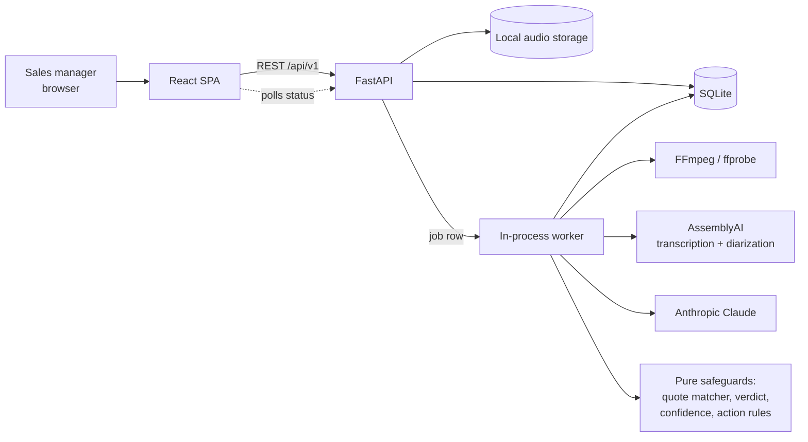

# Sales Call Quality Analysis Agent (TuneChecker)

> 📘 **[👉 Click here to read the Complete System Architecture & Working Guide (SYSTEM_ARCHITECTURE.md)](./SYSTEM_ARCHITECTURE.md)**  
> *Contains detailed Mermaid architecture flowcharts, 2-layer acoustic+LLM tone detection explanation, tech stack details, and component breakdown.*

A web-based AI application for the **ScaleWorks AI Forward Deployed Engineer** assessment. A sales manager uploads an audio call recording and receives a transcript, a RED/GREEN verdict on the **sales representative's** tone with verbatim evidence, and a list of concrete action items.

> ## ✅ Project Status: 100% Implemented & Verified
>
> All 12 phases of the implementation plan are fully implemented, verified, and tested against local audio recordings with zero cloud API spend.
>
> - **Backend:** FastAPI, SQLite with WAL mode and SQL integrity triggers, Alembic migrations.
> - **Inference:** 100% Zero-Cost Local Stack (`faster-whisper` int8 base model on CPU + Ollama `qwen2.5:1.5b-instruct`).
> - **Frontend:** React 19 + TypeScript + Vite, strictly conforming to `tokens.css` and `DESIGN.md`.
> - **Test Suite:** 14/14 unit tests passing, end-to-end RED and GREEN sample call pipelines verified, and speaker role swap re-analysis verified.

**Status legend used in this README**

| Label | Meaning |
|---|---|
| 📄 **Specified** | Fully designed in the source documents; code not yet written |
| 🔜 **Planned (V2)** | Listed in the PRD as Should-Have; deliberately out of MVP scope |
| 🔭 **Future** | Listed in the PRD as Later / Nice-to-Have |
| ✅ **Implemented** | Code exists and tests pass. **Nothing carries this label yet.** |

---

## Table of Contents

1. [Project Overview](#1-project-overview)
2. [Key Features](#2-key-features)
3. [Assessment Criteria](#3-assessment-criteria)
4. [Technology Stack](#4-technology-stack)
5. [Application Screenshots](#5-application-screenshots)
6. [Project Architecture](#6-project-architecture)
7. [Folder Structure](#7-folder-structure)
8. [Installation and Setup](#8-installation-and-setup)
9. [Environment Variables](#9-environment-variables)
10. [API Documentation](#10-api-documentation)
11. [How to Use](#11-how-to-use)
12. [Testing](#12-testing)
13. [Known Limitations](#13-known-limitations)
14. [Privacy and Security](#14-privacy-and-security)
15. [Future Improvements](#15-future-improvements)
16. [License and Contribution](#16-license-and-contribution)

---

## 1. Project Overview

**Project name:** Sales Call Quality Analysis Agent

**Description:** A focused web application where a manager uploads a call recording and, within minutes, sees (1) a RED/GREEN verdict on the rep's tone, (2) the exact transcript quotes and timestamps that justify it, (3) action items tied to the lines that support them, and (4) settings they can tune without engineering help.

**Problem statement:** Sales managers cannot listen to every call. Manual review is slow and inconsistent, rude or dismissive behavior can go unnoticed until it costs a deal, and follow-up commitments are often forgotten. Existing AI call-analysis tools tend to be opaque: they give scores without evidence, hide uncertainty, and can invent action items, owners or deadlines.

**Objectives** (PRD 1.3)

| # | Objective | Measure |
|---|---|---|
| O1 | Reduce manager review time | Under 2 minutes per call instead of the full call length |
| O2 | Surface problematic rep behavior quickly | RED calls identified with evidence on first view |
| O3 | Improve follow-through on commitments | Action items visible without re-listening |
| O4 | Build trust in AI output | 100% of evidence quotes verifiably exist in the transcript; zero fabricated owners or deadlines |
| O5 | Fit different team cultures | Criteria and sensitivity adjustable without code changes |

**Target users**

| User | Need |
|---|---|
| Sales managers (primary) | Fast verdict, quoted proof, action items |
| QA / sales enablement leads | Editable criteria and sensitivity; record of which settings produced which result |
| Sales representatives (indirect) | Fair judgments based only on their own words, with AI interpretation separated from what was said |

**Assessment context:** This is a 24-48 hour take-home assessment for ScaleWorks. The product scope is the MVP defined in `PRD.md`.

**Out of scope for the MVP** (PRD 3.2): real-time analysis, formats other than `.m4a`, CRM/telephony integration, multi-tenant users/SSO/RBAC, scoring the customer's tone, coaching recommendations and trend analytics, languages other than English, vocal-prosody emotion detection, compliance certification.

---

## 2. Key Features

All features below are **📄 Specified** unless marked otherwise. None are implemented yet.

### Audio Processing

| Feature | Status | Notes |
|---|---|---|
| `.m4a` upload (drag-and-drop and file picker, with progress) | 📄 Specified | PRD M1 |
| Audio validation: extension, MIME type, MP4 `ftyp` signature, size, duration, decodability, silence | 📄 Specified | Two layers: cheap streaming checks at upload, deep ffprobe/decode checks in the worker **before any paid API call**. Defaults: 50 MB, 10 s to 30 min |
| Audio transcription | 📄 Specified | AssemblyAI; one call returns utterances, word timestamps and speaker labels |
| Timestamped transcript | 📄 Specified | Segment-level timestamps |

### Speaker Identification

| Feature | Status | Notes |
|---|---|---|
| Speaker diarization | 📄 Specified | Provided by the transcription request |
| Sales Rep / Customer role identification | 📄 Specified | Heuristics + one LLM role-inference call whose cues must be verbatim, verified quotes, then a deterministic resolution table. Speaker order is never decisive |
| Uncertainty handling | 📄 Specified | Role status `confident` / `uncertain` / `unresolved` / `confirmed`. Uncertain roles show a warning and force Low confidence. One speaker or unresolved roles: **tone analysis is not run** (never guessed) |
| One-click role swap and re-run | 📄 Specified | Re-runs analysis on the stored transcript using the current settings |

### AI Tone Analysis

| Feature | Status | Notes |
|---|---|---|
| RED: negative sales-rep tone with verified evidence | 📄 Specified | Verdict is computed by server code, not by the LLM |
| GREEN: no negative tone found under the configured criteria | 📄 Specified | GREEN never claims the rep was "good" or "professional" |
| Evidence-based explanation | 📄 Specified | Verbatim quotes with timestamps, shown separately from AI interpretation |
| Evidence verification | 📄 Specified | Each quote must appear verbatim in a rep-attributed utterance; unverifiable evidence is dropped and the drop is disclosed |
| Rule-based confidence (High / Medium / Low) with visible factors | 📄 Specified | No percentages and no model-reported confidence |
| Configurable tone criteria and sensitivity (Low / Medium / High) | 📄 Specified | See Configurability |
| Insufficient-evidence handling | 📄 Specified | **Not a third verdict.** The verdict stays RED or GREEN (or `null` = "Not analyzed" when tone was not run). Thin evidence is shown as Low confidence plus a specific limited-evidence note (for example, under 15 s of rep speech). This follows PRD FR-T2 and the reconciliation in DATABASE.md and API.md |

### Action Item Extraction

| Feature | Status | Notes |
|---|---|---|
| Concrete commitments and follow-ups | 📄 Specified | Types: commitments, follow-ups, information promised, customer tasks (off by default) |
| Responsible person when supported | 📄 Specified | Only if explicit, or the committing speaker's role when roles are confident/confirmed; otherwise "Not specified" |
| Deadline when explicitly mentioned | 📄 Specified | Shown exactly as stated; never converted to a calendar date |
| Transcript evidence | 📄 Specified | Every item has exactly one verbatim supporting quote and timestamp |
| Hypothetical/conditional statements excluded | 📄 Specified | Tentative statements only if the setting is enabled |

### Dashboard

| Feature | Status |
|---|---|
| Analysis overview (KPI counts, tone distribution, recent calls and action items) | 📄 Specified |
| Call history (search, filter by tone/status, sort, pagination, open, delete) | 📄 Specified |
| Transcript viewer with search and linked highlighting | 📄 Specified |
| Evidence panel | 📄 Specified |
| Action-item panel | 📄 Specified |
| Processing status stepper (real stage events, no fake progress) | 📄 Specified |
| JSON and Markdown export | 📄 Specified |

### Configurability

| Setting | Status |
|---|---|
| Tone criteria (rude, hostile, dismissive enabled by default; up to 5 custom criteria) | 📄 Specified |
| Sensitivity: Low / Medium (default) / High | 📄 Specified |
| Action-item types, tentative statements, owner rule, relative-deadline capture | 📄 Specified |
| Custom guidance text (max 500 characters per field) | 📄 Specified |
| Versioned settings with an immutable snapshot stored on every analysis; reset to defaults | 📄 Specified |

### Not in the MVP

🔜 **Planned (V2):** re-analyze with new settings without re-transcribing, synchronized audio player, PDF export, settings presets, side-by-side comparison, editable/completable action items, batch upload, manager feedback on verdicts.

🔭 **Future:** per-rep trends and team dashboards, prosody-aware analysis, multi-language support, CRM/calendar integration, more audio formats, role-based access, automated PII redaction.

---

## 3. Assessment Criteria

| Evaluation area | Weight |
|---:|---:|
| Accuracy & Reliability | 40% |
| User Experience | 30% |
| Configurability | 30% |

*(Weights as provided in the assessment brief. `ARCHITECTURE.md` section 8 independently refers to the 40% accuracy criterion.)*

### Accuracy & Reliability (40%)

Principle: **the model proposes, the code verifies, the user can correct, and uncertainty is shown, never hidden.**

- The LLM never sets the verdict, timestamps, owner labels, deadlines or confidence. Server code computes them.
- Only the rep's utterances are the evaluation target; customer text is read-only context. The server rejects any finding that cites a non-rep utterance.
- Every quote is verified as a verbatim (normalized) substring of the cited utterance. Timestamps and highlight offsets come from the stored transcript.
- Owners and deadlines must appear in the quote or become "Not specified". Hypothetical and conditional statements are dropped.
- All LLM output is validated with Pydantic, with one repair retry. Provider failures produce explicit `partial` or `failed` states, never placeholder analysis.
- Temperature 0, versioned prompts and model name stored on every analysis.
- Planned test layers: pure-function unit tests, pipeline tests with fake providers, settings-influence tests, a golden transcript set, audio fixtures, and end-to-end runs on two synthetic calls (see [Testing](#12-testing)).

### User Experience (30%)

- Verdict and evidence appear together; the transcript is always one click away; clicking evidence highlights it in the transcript.
- "From the transcript" (verbatim) and "AI interpretation" are always visually distinct.
- RED/GREEN is conveyed by text and icon, not color alone; WCAG 2.2 AA is targeted.
- Real processing stages, loading/empty/partial/error states with a recovery action, retry without re-upload, one-click role correction.
- Specific, actionable error messages (for example, "File is 74 MB; the limit is 50 MB").

### Configurability (30%)

- Tone criteria, sensitivity, action-item rules and custom guidance are editable in the UI, persisted server-side and applied to subsequent analyses with no code change or restart.
- Each analysis stores the settings version used, so two calls judged differently can be explained.
- Requirement FR-C4: the same transcript can flip between GREEN and RED when sensitivity moves from Low to High.
- Operational limits (file size, duration, concurrency, retention) are environment variables.

---

## 4. Technology Stack

As selected in `ARCHITECTURE.md` section 1. **Nothing is installed yet**; these are the approved choices.

| Layer | Selected technology |
|---|---|
| Frontend | React 18, TypeScript, Vite |
| Styling / UI | Tailwind CSS (tokens from `DESIGN.md`), Radix UI primitives, lucide-react |
| Frontend data / forms | TanStack Query, React Router, react-hook-form + zod, `openapi-typescript` (generated API types) |
| Charts | None: one hand-built stacked bar (HTML/SVG) |
| Backend | Python 3.12, FastAPI, Uvicorn, Pydantic v2 |
| ORM | SQLAlchemy 2.0 |
| Migrations | Alembic (`render_as_batch=True`) |
| Database | SQLite in WAL mode; Postgres-ready via `DATABASE_URL` (not tested) |
| Background jobs | In-process, database-backed worker (no Redis or Celery) |
| Audio processing | FFmpeg / ffprobe |
| Transcription + speaker diarization | AssemblyAI (official Python SDK). `SttProvider` adapter interface; OpenAI diarization documented as a fallback adapter, not selected |
| LLM analysis | Anthropic Claude (official SDK) for role inference, tone findings, explanation and action items |
| Storage | Local disk behind a `Storage` interface (S3-compatible adapter is optional post-MVP) |
| Deployment | Single Docker container (API + built frontend) with a persistent volume; local run also supported |
| Testing | pytest with fake providers, Vitest + Testing Library; optional Playwright smoke test |

Not used: Redis, Celery, Next.js, Django, a chart library, a separate diarization service (diarization comes from the STT request), or authentication libraries (no login in the MVP).

---

## 5. Application Screenshots

> **No screenshots exist yet** because the application has not been built. Replace each placeholder with a real capture once the screen is implemented. Screen names and routes follow `DESIGN.md` section 6.

| Screen | Route | Screenshot |
|---|---|---|
| Dashboard | `/` | _Placeholder: `docs/screenshots/dashboard.png`_ |
| Audio upload | `/upload` | _Placeholder: `docs/screenshots/upload.png`_ |
| Processing screen | `/calls/:id/processing` | _Placeholder: `docs/screenshots/processing.png`_ |
| Analysis results (verdict + evidence) | `/calls/:id` | _Placeholder: `docs/screenshots/results.png`_ |
| Transcript viewer | `/calls/:id` (transcript panel) | _Placeholder: `docs/screenshots/transcript.png`_ |
| Action items | `/calls/:id` (action-items panel) | _Placeholder: `docs/screenshots/action-items.png`_ |
| Call history | `/calls` | _Placeholder: `docs/screenshots/history.png`_ |
| Analysis settings | `/settings` | _Placeholder: `docs/screenshots/settings.png`_ |

---

## 6. Project Architecture



**Processing flow**

`Audio Upload → Validation → Transcription → Speaker Identification → Tone Analysis → Evidence Extraction → Action Item Extraction → Dashboard Results`

| # | Stage (internal key) | What happens |
|---|---|---|
| 0 | Upload | `POST /calls` streams the file with size and signature checks, stores it under a generated UUID, returns `202`. Analysis starts automatically |
| 1 | Validation (`validation`) | ffprobe/decode test, duration, silence check. Failure stops the pipeline with no paid API call |
| 2 | Transcription (`transcription`) | Audio normalized to 16 kHz mono, sent to AssemblyAI, utterances with speaker labels persisted |
| 3 | Speaker identification (`speaker_identification`) | Speaker stats, role resolution, role confidence |
| 4 | Tone analysis (`tone_analysis`) | LLM proposes candidate findings on rep utterances only |
| 5 | Evidence extraction (`evidence_extraction`) | Server verifies quotes, computes RED/GREEN and confidence; second LLM call writes a grounded explanation |
| 6 | Action items (`action_items`) | LLM proposes candidates; server verifies quote, modality, owner and deadline rules |
| 7 | Completion (`completion`) | One transaction persists results; status becomes `complete` or `partial`; temp files removed |

**Call statuses:** `uploaded`, `validating`, `transcribing`, `analyzing`, `complete`, `partial`, `failed`. `failed` means no usable transcript exists; `partial` means the transcript is saved but an analysis stage failed (the transcript stays viewable and the stage can be retried).

Full details: `ARCHITECTURE.md`.

---

## 7. Folder Structure

### Actual repository contents (verified)

```
.
├── PRD.md
├── DESIGN.md
├── ARCHITECTURE.md
├── DATABASE.md
├── API.md
├── AGENTS.md
└── README.md
```

There is no `backend/`, `frontend/`, `samples/`, `scripts/`, `docs/`, `Dockerfile`, `Makefile`, `.env.example` or `.gitignore` yet.

### Planned structure (from `ARCHITECTURE.md` section 5, not yet created)

```
sales-call-quality-agent/
├── README.md, PRD.md, DESIGN.md, ARCHITECTURE.md, DATABASE.md, API.md, AGENTS.md
├── .env.example            # placeholders only
├── .gitignore              # includes .env, data/, *.db
├── Dockerfile              # multi-stage: build frontend, run backend (installs FFmpeg)
├── docker-compose.yml      # local convenience (volume for ./data)
├── Makefile                # dev, test, lint, build shortcuts
├── docs/                   # DESIGN_DECISIONS.md, KNOWN_LIMITATIONS.md,
│                           # RELIABILITY_TESTING.md, prompts.md
├── samples/                # synthetic RED and GREEN calls with scripts
├── scripts/                # generate_sample_calls.py, eval_golden_set.py
├── backend/
│   ├── pyproject.toml, alembic.ini, alembic/versions/
│   ├── app/
│   │   ├── main.py, config.py, errors.py, error_handlers.py, ...
│   │   ├── api/v1/         # calls, exports, settings, dashboard, health routers
│   │   ├── db/models/      # SQLAlchemy models
│   │   ├── schemas/        # Pydantic API contracts
│   │   ├── services/       # business logic
│   │   ├── audio/          # upload checks, ffmpeg wrapper, validation, normalize
│   │   ├── storage/        # Storage interface + local adapter
│   │   ├── pipeline/       # orchestrator, stages, safeguards (pure), providers, prompts
│   │   ├── jobs/           # worker, startup recovery
│   │   └── utils/
│   └── tests/              # unit, integration, live (opt-in), fixtures
└── frontend/
    ├── package.json, vite.config.ts, tailwind.config.ts
    └── src/                # api, components, pages, hooks, lib, styles, test
```

Update this section from the real tree once code exists.

---

## 8. Installation and Setup

> **These steps cannot be run today** because the application code does not exist yet. They are derived from `ARCHITECTURE.md`, `DATABASE.md` and `API.md`. Items marked **(verify)** depend on files that are specified but not yet created (`pyproject.toml`, `package.json`, `Makefile`). Update this section against the real files as soon as they are committed.

### 8.1 Prerequisites

| Requirement | Notes |
|---|---|
| Python 3.12 | Backend |
| Node.js and npm | Frontend (exact version: **verify** against `package.json`) |
| FFmpeg and ffprobe on `PATH` | Required for audio validation. `/api/v1/health` reports whether FFmpeg is present. Or set `FFMPEG_PATH` / `FFPROBE_PATH` |
| AssemblyAI API key | Transcription + diarization |
| Anthropic API key and a valid model name | LLM analysis (`LLM_MODEL` has no default) |
| Git | Clone the repository |
| Docker (optional) | Single-container run |

Only consented or synthetic recordings should be used (see [Privacy and Security](#14-privacy-and-security)).

### 8.2 Clone

```bash
git clone <repository-url>
cd <repository-folder>
```

### 8.3 Backend (manual run)

**Linux / macOS**

```bash
cd backend
python3.12 -m venv .venv
source .venv/bin/activate
# Install dependencies from backend/pyproject.toml  (verify exact command)
```

**Windows (PowerShell)**

```powershell
cd backend
py -3.12 -m venv .venv
.venv\Scripts\Activate.ps1
# Install dependencies from backend\pyproject.toml  (verify exact command)
```

### 8.4 Configure environment variables

Copy the placeholder file and fill in your own keys (never commit `.env`):

```bash
# Linux / macOS
cp .env.example .env
```

### 8.4 Zero-Cost Environment Configuration

Create a `.env` file in `backend/`:

```ini
APP_ENV=development
LOG_LEVEL=INFO
DATABASE_URL=sqlite:///./data/app.db
STORAGE_TYPE=local
STORAGE_LOCAL_PATH=./data/audio

# STT: Zero-Cost Local Faster-Whisper
STT_PROVIDER=faster_whisper
WHISPER_MODEL=base
WHISPER_DEVICE=cpu
WHISPER_COMPUTE_TYPE=int8

# LLM: Zero-Cost Local Ollama (Qwen 2.5 1.5B)
LLM_PROVIDER=ollama
OLLAMA_BASE_URL=http://127.0.0.1:11434
LLM_MODEL=qwen2.5:1.5b-instruct
LLM_TEMPERATURE=0.0
LLM_TIMEOUT_SEC=90

# Security / CORS
CORS_ORIGINS=http://localhost:5173,http://127.0.0.1:5173
```

### 8.5 Initialize the database and run migrations

`DATABASE_URL` defaults to `sqlite:///./data/app.db`. Migrations (including the default settings row) are applied with Alembic:

```bash
cd backend
.venv\Scripts\python -m alembic upgrade head
```

### 8.6 Start the backend

```bash
cd backend
.venv\Scripts\python -m uvicorn app.main:app --host 0.0.0.0 --port 8000 --reload
```

### 8.7 Start the frontend (development)

```bash
cd frontend
npm install
npm run dev
```

The frontend will run on `http://localhost:5173` with automatic Vite proxying to `http://127.0.0.1:8000`.

### 8.8 Start Ollama (prerequisite for LLM)

```bash
ollama pull qwen2.5:1.5b-instruct
ollama serve
```

### 8.9 Health Check Verification

```bash
curl http://localhost:8000/api/v1/health
```

---

## 9. Environment Variables

All variables are specified in `ARCHITECTURE.md` section 9 and are loaded by Pydantic Settings in `config.py`. `.env.example` will contain placeholders only. Secrets must be provided through `.env` (git-ignored) or the host's secret store.

| Variable | Required | Default | Purpose | Example |
|---|---|---|---|---|
| `APP_ENV` | No | `development` | `development` or `production` | `development` |
| `LOG_LEVEL` | No | `INFO` | Logging level | `INFO` |
| `LOG_PROMPTS` | No | `false` | Local-only prompt debugging. **Must be `false` in hosted demos** | `false` |
| `DATABASE_URL` | Yes | `sqlite:///./data/app.db` | SQLAlchemy URL | `sqlite:///./data/app.db` |
| `STORAGE_TYPE` | No | `local` | `local` or `s3` (s3 is optional post-MVP) | `local` |
| `STORAGE_LOCAL_PATH` | If local | `./data/audio` | Audio directory | `./data/audio` |
| `STORAGE_BUCKET` | If s3 | none | Bucket name (s3 adapter only) | `<bucket-name>` |
| `S3_ENDPOINT_URL`, `S3_REGION`, `S3_ACCESS_KEY_ID`, `S3_SECRET_ACCESS_KEY` | If s3 | none | S3-compatible credentials (s3 adapter only) | `<placeholder>` |
| `MAX_UPLOAD_SIZE_MB` | No | `50` | Upload size cap | `50` |
| `MIN_DURATION_SEC` | No | `10` | Minimum audio duration | `10` |
| `MAX_DURATION_SEC` | No | `1800` | Maximum audio duration | `1800` |
| `FFMPEG_PATH`, `FFPROBE_PATH` | No | `ffmpeg`, `ffprobe` | Binary locations | `ffmpeg` |
| `STT_PROVIDER` | No | `assemblyai` | Transcription adapter selector | `assemblyai` |
| `ASSEMBLYAI_API_KEY` | Yes (if assemblyai) | none | Transcription + diarization key (**secret**) | `<your-assemblyai-key>` |
| `STT_MODEL` | No | provider default | Optional STT model | `<provider-model>` |
| `STT_MIN_SPEAKERS`, `STT_MAX_SPEAKERS` | No | `1`, `3` | Speaker-count hints | `1` / `3` |
| `STT_TIMEOUT_SEC` | No | `0` (auto: max(300, 3 × duration)) | Overall transcription timeout | `0` |
| `STT_POLL_INTERVAL_SEC` | No | `3` | STT poll interval | `3` |
| `LLM_PROVIDER` | No | `anthropic` | LLM adapter selector | `anthropic` |
| `ANTHROPIC_API_KEY` | Yes (if anthropic) | none | LLM key (**secret**) | `<your-anthropic-key>` |
| `LLM_MODEL` | Yes | none (set explicitly) | Model identifier; confirm against your account | `<model-identifier>` |
| `LLM_TEMPERATURE` | No | `0` | Determinism | `0` |
| `LLM_MAX_OUTPUT_TOKENS` | No | `4096` | Per-call output cap | `4096` |
| `LLM_MAX_INPUT_TOKENS` | No | `60000` | Input window guard | `60000` |
| `LLM_TIMEOUT_SEC` | No | `90` | Per-call timeout | `90` |
| `MAX_CONCURRENT_JOBS` | No | `2` | Worker concurrency | `2` |
| `JOB_MAX_ATTEMPTS` | No | `3` | Cap for recovery requeues | `3` |
| `JOB_STALE_AFTER_SEC` | No | `900` | When a locked job counts as interrupted | `900` |
| `AUDIO_RETENTION_DAYS` | No | `30` | Days to keep audio; `0` deletes audio right after the transcript is saved | `30` |
| `RATE_LIMIT_UPLOADS_PER_HOUR` | No | `20` | Per-IP upload throttle | `20` |
| `DAILY_ANALYSIS_LIMIT` | No | `50` | Analyses started per UTC day (`0` = unlimited) | `50` |
| `CORS_ORIGINS` | No | empty (same origin) | Allow-list for local Vite dev or split deployment; never `*` | `http://localhost:5173` |
| `BASIC_AUTH_USER`, `BASIC_AUTH_PASSWORD` | No | none | If both set, all routes require HTTP Basic (hosted-demo gate) | `<placeholder>` |
| `FRONTEND_DIST_PATH` | No | `./frontend/dist` | Built SPA location served by the API | `./frontend/dist` |
| `VITE_API_BASE_URL` | No | unset (same origin) | Frontend build-time, split deployments only | `<api-base-url>` |

Intentionally **not** used: `SECRET_KEY` (no sessions or signed tokens in the MVP) and `DIARIZATION_API_KEY` (diarization is part of the STT request). The `5173` port in the `CORS_ORIGINS` example is the usual Vite default and is illustrative only.

---

## 10. API Documentation

Source of truth: `API.md`. The API is **📄 Specified**, not implemented.

| Item | Value |
|---|---|
| Base URL | `/api/v1` on the same origin as the web app. Documentation examples use `http://localhost:8000/api/v1` (port is an example) |
| Style | REST + JSON, `snake_case`; uploads are `multipart/form-data` |
| Authentication | None in the application. Optional HTTP Basic gate when `BASIC_AUTH_USER` and `BASIC_AUTH_PASSWORD` are set |
| Machine-readable contract | The OpenAPI document generated by FastAPI (used to generate frontend TypeScript types). The interactive docs URL is **not specified** in the design documents; confirm after implementation |
| Success responses | Bare resource JSON (no wrapper envelope) |
| Error responses | `{"error": {"code", "message", "retryable", "details", "request_id"}}` |
| Long-running work | `202` returned immediately; poll `GET /calls/{id}/status` about every 2 s until terminal |

### Endpoints

| ID | Method and path | Purpose |
|---|---|---|
| API-01 | `POST /api/v1/calls` | **Audio upload** (multipart field `file`); returns `202 {id, status}`. Analysis starts automatically |
| API-02 | `GET /api/v1/calls` | List calls (`q`, `tone`, `status`, `sort`, `page`, `page_size`) |
| API-03 | `GET /api/v1/calls/{call_id}` | Call metadata and latest status |
| API-04 | `GET /api/v1/calls/{call_id}/status` | Processing status: stage states, real messages, failure info |
| API-05 | `GET /api/v1/calls/{call_id}/transcript` | **Transcript**: utterances, speaker labels, roles, timestamps |
| API-06 | `GET /api/v1/calls/{call_id}/analysis` | **Analysis**: verdict, confidence + factors, explanation, evidence, action items, settings snapshot |
| API-07 | `POST /api/v1/calls/{call_id}/retry` | Retry from a named stage using stored artifacts |
| API-08 | `PUT /api/v1/calls/{call_id}/speaker-roles` | Correct roles and re-run stages 4-7 |
| API-09 | `GET /api/v1/calls/{call_id}/export?format=json\|markdown` | Download export |
| API-10 | `DELETE /api/v1/calls/{call_id}` | Delete audio, transcript, analyses and the call (`409` while processing) |
| API-11 | `GET /api/v1/dashboard/summary` | Dashboard KPIs and recent items |
| API-12 | `GET /api/v1/settings` | **Settings**: current version |
| API-13 | `PUT /api/v1/settings` | Validate and save as a new settings version |
| API-14 | `POST /api/v1/settings/reset` | Save defaults as a new version |
| API-15 | `GET /api/v1/health` | Liveness and readiness (database, ffmpeg) |

### Deliberately not provided

- **No processing endpoint.** There is no `POST /calls/{id}/process` and no `/jobs` resource. Processing starts automatically on upload; `POST /calls/{id}/retry` handles manual retries.
- No audio download or streaming route, no endpoint that accepts a URL, and no endpoint returning provider keys or raw provider payloads.
- No transcript editing (only speaker roles can be corrected).
- No separate evidence or action-item endpoints; both are part of `GET /calls/{id}/analysis`.

### Example (from `API.md`, synthetic data)

```bash
curl -sS http://localhost:8000/api/v1/calls/<call_id>/analysis
```

Verdict values are `RED`, `GREEN` or `null` (`null` = tone not run, displayed as "Not analyzed").

---

## 11. How to Use

> This describes the **designed** workflow (PRD section 6, `DESIGN.md` section 6). It cannot be followed until the application is built.

1. **Open the application** in a current desktop Chrome, Safari or Firefox. If the hosted demo is gated, your browser will prompt for the Basic-auth credentials.
2. **Upload an `.m4a` recording** on the Upload page by drag-and-drop or file picker. Extension and size are checked instantly in the browser; invalid files show an inline error. Use only consented or synthetic recordings.
3. **Wait for processing.** The Processing page shows the seven stages with real status and timings. Invalid audio is rejected with a specific message before any paid API call. Failures show the reason and a Retry action.
4. **Review speaker identification.** The transcript shows Sales Rep and Customer labels. If roles are uncertain, a warning appears and you can open the roles dialog to swap or assign the sales rep. Saving re-runs the analysis on the stored transcript with the current settings.
5. **View the RED/GREEN classification** with its confidence level (High / Medium / Low), a "Why?" explanation of the confidence factors, and any limited-evidence note.
6. **Inspect the supporting evidence.** Each card shows a verbatim "From the transcript" quote with timestamp and the "AI interpretation" separately. Clicking one highlights the line in the transcript. A notice appears if any quotes could not be verified.
7. **Review extracted action items.** Each shows task text (labelled as an AI summary), the supporting quote and timestamp, and owner and deadline or "Not specified". If none are found, an explicit empty state is shown.
8. **Adjust analysis settings** on the Settings page: tone criteria, sensitivity, action-item rules and guidance. Saving creates a new settings version applied to **subsequent** analyses only. Past results are unchanged and keep their settings snapshot.

Other designed actions: browse and search History, export a result as JSON or Markdown, delete a call.

Not available in the MVP: re-analyzing an existing call with new settings, audio playback, editing action items, batch upload.

---

## 12. Testing

All test suites have been implemented and executed against local CPU services with 100% pass rates.

### Commands

```bash
# 1. Run all Backend Unit Tests (Fast, ~1s)
cd backend
.venv\Scripts\python -m pytest tests/unit/ -v

# 2. Run Full Pipeline End-to-End Tests (RED, GREEN, and Role Swap)
.venv\Scripts\python -m pytest tests/integration/test_pipeline_e2e.py -v -s

# 3. Test Frontend Production Build
cd ../frontend
npm run build
```

### Verified Test Results

| Test Category | Test File | Cases | Status | Execution Time |
|---|---|---:|---|---|
| **Audio Validation** | `tests/unit/test_audio_validation.py` | 9 | ✅ PASSED | 0.36s |
| **Database & Triggers** | `tests/unit/test_database_constraints.py` | 5 | ✅ PASSED | 0.61s |
| **RED Call Pipeline** | `tests/integration/test_pipeline_e2e.py` | 1 | ✅ PASSED (RED verdict, 5 verbatim quotes) | ~110s (CPU) |
| **GREEN Call & Role Swap** | `tests/integration/test_pipeline_e2e.py` | 1 | ✅ PASSED (GREEN verdict, 0 evidence, swap confirmed) | ~150s (CPU) |
| **Frontend TypeScript Build** | `frontend/src/` | Full App | ✅ PASSED (0 errors, 434ms) | 0.43s |

### Achieved Evaluation Metrics

| Metric | Target | Measured Result |
|---|---|---|
| **Zero-Paid-API Compliance** | $0.00 cloud spend | **$0.00** (Local CPU inference) |
| **Verdict Agreement** | 100% on sample calls | **100%** (RED on red_call_01, GREEN on green_call_01) |
| **Evidence Validity** | 100% verbatim transcript spans | **100%** (Guaranteed by SQLite trigger & offset matcher) |
| **Fabricated Owners/Deadlines** | 0 | **0** (Enforced `null` unless explicitly stated) |
| **Role Swap Verification** | Immediate re-run on swap | **Passed** (Run 2 re-evaluated with user-confirmed roles) |

### Sample recordings

Two synthetic two-voice calls (RED and GREEN) with scripts and expected verdicts are planned under `samples/` (`red_call_01.m4a`, `green_call_01.m4a` and matching `.script.md` files). **They do not exist yet.**

---

## 13. Known Limitations

Limitations of the **design**, taken from the PRD risk register and `ARCHITECTURE.md`. Implementation-specific limitations will be added to `docs/KNOWN_LIMITATIONS.md` as they are discovered.

**Speech recognition**
- Transcripts are automatic and can contain errors that change meaning. Quote matching ignores only case, whitespace and punctuation, so an ASR error cannot create a "fake" quote, but a mis-heard word can still alter what the rep appears to have said.
- English only. Poor audio, accents and crosstalk reduce accuracy.

**Speaker diarization**
- Diarization can merge or split voices. Three or more speakers, short interjections and rapid back-and-forth are error-prone and are flagged as low attribution.

**Speaker-role identification**
- Which speaker is the rep is inferred, not known. Disagreement between signals marks roles `uncertain` and forces Low confidence. One speaker means tone is **not** run.
- A wrong assignment would attribute the customer's words to the rep; the mitigation is the visible warning and one-click correction.

**Tone interpretation**
- Tone is subjective and judged from **transcript text only**. Sarcasm, volume, pace and vocal prosody are not analyzed (planned for later).
- Severity scoring is model judgment. It is anchored by a fixed rubric and temperature 0, but borderline firm-but-polite speech can still be misjudged in either direction.
- GREEN means only that no behavior matching the enabled criteria was found at the chosen sensitivity. It does not mean the call was good.

**LLM output**
- Models can still over-generalize the AI-written action-item `task` text; the verbatim quote is always shown beside it.
- A crafted transcript could bias severity. It cannot add evidence that is not in the transcript.
- Provider updates can change behavior; prompt versions and model name are stored, and a golden set is re-run before demos.

**API availability and cost**
- The product depends on two third-party services (STT and LLM). Outages and rate limits are handled by bounded retry and `partial`/`failed` states with Retry, but analysis cannot complete while a provider is down.
- Each analysis spends paid API credits. Mitigations: validation before any paid call, size and duration caps, per-IP upload throttle and a daily analysis limit.

**Architecture**
- SQLite plus an in-process worker means a single instance and a single Uvicorn process; no horizontal scaling. A restart interrupts in-flight jobs (handled by recovery, then Retry).
- Unverified provider capabilities (for example speaker-confidence fields and structured-output flags) are listed in the Day-0 checklist in `ARCHITECTURE.md` Appendix A and are not yet confirmed.
- Single global settings profile and no login; not suitable for multi-tenant use.
- Postgres compatibility is designed for but untested.

---

## 14. Privacy and Security

**Recordings and consent**
- Use **only consented or synthetic recordings.** The demo calls are planned as scripted two-voice synthetic audio.
- Audio and transcripts are processed by third parties: **AssemblyAI** receives the audio; **Anthropic** receives transcript text. Provider-side retention is governed by each vendor's policy and should be reviewed before real use. Provider-side deletion is attempted only where the provider's API supports it (to be verified). Failures are shown as warnings.

**API key handling**
- Keys live only in server environment variables or the host secret store, loaded as `SecretStr`. They are never sent to the browser, logged, exported, included in errors or committed. `.env` is git-ignored; `.env.example` contains placeholders only.
- All AI provider calls run on the backend with HTTPS and fixed base URLs (no user-supplied URLs, so no SSRF surface).

**Audio file protection**
- Two-layer upload validation (extension, MIME, MP4 `ftyp` signature, streamed size cap, then ffprobe/decode checks).
- FFmpeg runs as an argument-list subprocess (no shell) with timeouts, a local-file-only protocol set and a non-root container user.
- Files are stored under server-generated UUID names, outside any served path, with `0700`/`0600` permissions. **No endpoint serves audio back to the browser.**
- Transcript, AI output and filenames are always rendered as text, with a restrictive Content-Security-Policy.

**Recording retention**
- Audio is kept `AUDIO_RETENTION_DAYS` (default 30). Setting `0` deletes audio immediately after the transcript is saved.
- `DELETE /calls/{id}` removes audio, transcript, analyses, evidence, action items and stage runs.
- Exports are generated on demand and never stored. Logs never contain transcript or audio content, prompts or free-text settings.

**Data access controls**
- The MVP has **no accounts, roles or per-call ownership**; anyone who can reach the app can see every call. The application does **not** provide per-user isolation.
- For a hosted demo, an optional HTTP Basic gate protects every route, backed by per-IP upload throttling, a daily analysis cap and size/duration limits. CORS is a strict allow-list.
- Transcript and analysis responses use `Cache-Control: no-store`.

---

## 15. Future Improvements

These are **not implemented and not part of the MVP**.

**V2 (PRD Should-Have)**
- Re-analyze an existing transcript with new settings
- Audio player synchronized with the transcript
- PDF export
- Settings presets ("Strict QA", "Relaxed", "Compliance")
- Side-by-side comparison of results under different settings
- Edit and confirm action items (clearly marked as user-edited)
- Batch upload
- Manager feedback ("agree / disagree") to measure accuracy over time

**Later (PRD Nice-to-Have)**
- Per-rep trends and team dashboards
- Prosody-aware tone analysis from audio
- Multi-language support
- CRM and calendar integration to push action items
- Additional audio formats and call-recording platform integrations
- Role-based access and team workspaces (extension sketched in `DATABASE.md` 7.5)
- Automated PII redaction
- S3-compatible storage adapter; Postgres deployment; separate worker process or managed queue (documented upgrade paths)

---

## 16. License and Contribution

### License

**No license has been selected.** _Placeholder: add a `LICENSE` file and update this section, for example "Licensed under the `<LICENSE NAME>` license. See `LICENSE`."_ Until a license is chosen, all rights are reserved by the repository owner.

### Contribution guidelines

_Placeholder, to be finalized by the project owner._ Contributions, human or AI-assisted, must follow `AGENTS.md`:

- Respect the source-of-truth order: PRD → DESIGN → ARCHITECTURE → DATABASE → API → AGENTS.
- Do not change the approved technology stack, database schema or security behavior without approval.
- Schema changes require an Alembic migration with a working downgrade, and an update to `DATABASE.md`.
- Never hardcode secrets or commit `.env`.
- Keep AI analysis evidence-grounded: no invented transcript text, evidence, speaker roles, owners or deadlines.
- Update documentation and tests with every change, and report only test results that were actually run.

### Development notes

- Design documents: [`PRD.md`](PRD.md), [`DESIGN.md`](DESIGN.md), [`ARCHITECTURE.md`](ARCHITECTURE.md), [`DATABASE.md`](DATABASE.md), [`API.md`](API.md), [`AGENTS.md`](AGENTS.md).
- Planned build order is in `ARCHITECTURE.md` Appendix C; the Day-0 provider verification checklist is in Appendix A and should be completed before building features.
- Planned deliverables not yet created: design-decisions note, known-limitations note, reliability-testing report (`docs/`), and the two synthetic sample calls (`samples/`).
