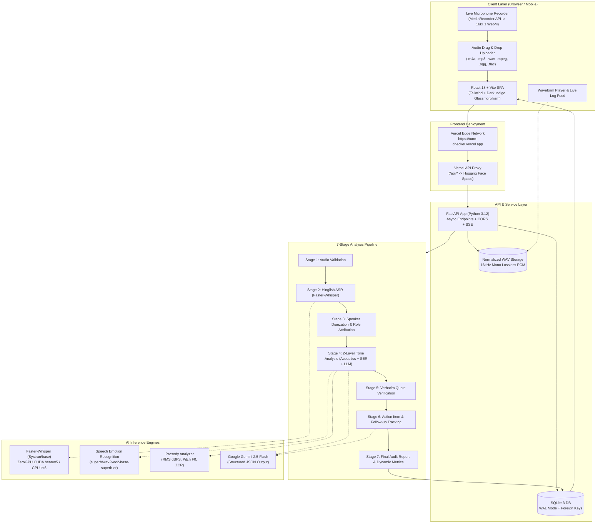
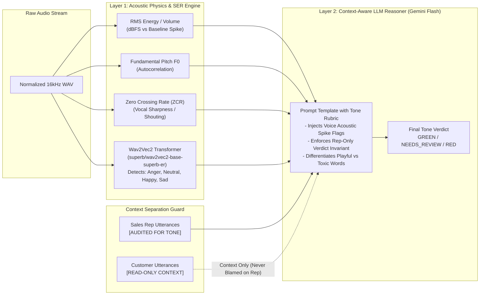
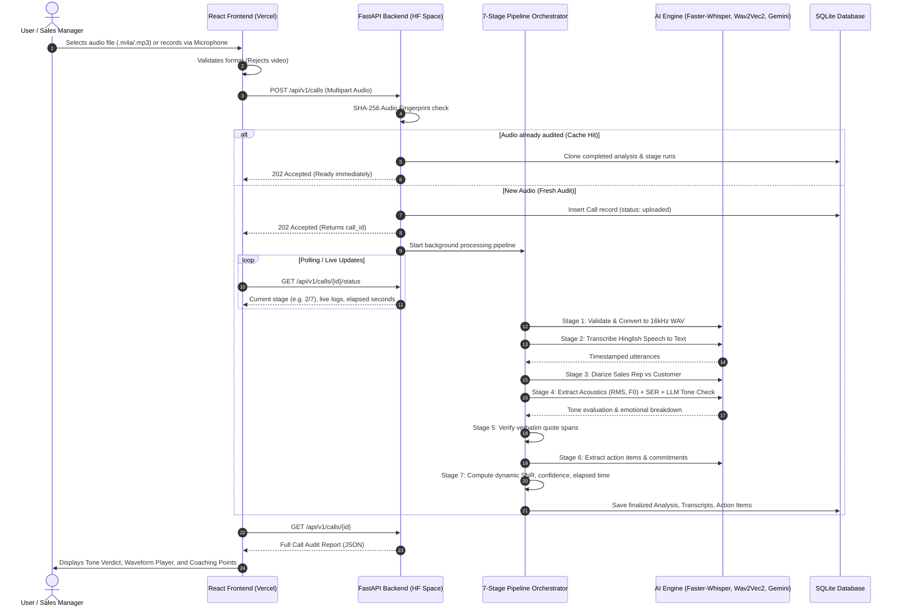

# 🎧 TuneChecker — System Architecture & Complete Working Guide

> **AI-Powered Sales Call Quality & Tone Auditor**  
> *A production-ready, zero-cost, privacy-first system that transcribes, diarizes, and audits customer sales calls with 2-Layer Tone Analysis (Acoustics + LLM) and automated commitment tracking.*

---

## 📑 Table of Contents
1. [Overview — Kya Hai?](#1-overview--kya-hai)
2. [High-Level Architecture (Graph View)](#2-high-level-architecture-graph-view)
3. [7-Stage Processing Pipeline (Kaise Kaam Karta Hai?)](#3-7-stage-processing-pipeline-kaise-kaam-karta-hai)
4. [2-Layer Tone Analysis Architecture](#4-2-layer-tone-analysis-architecture)
5. [Tech Stack Breakdown (Konsa Tool Kahan Aur Kyun Use Hua?)](#5-tech-stack-breakdown-konsa-tool-kahan-aur-kyun-use-hua)
6. [Folder & File Structure (Har File Ka Kaam)](#6-folder--file-structure-har-file-ka-kaam)
7. [End-to-End Data Flow (Sequence Diagram)](#7-end-to-end-data-flow-sequence-diagram)
8. [Core Rules & Safeguard Invariants](#8-core-rules--safeguard-invariants)
9. [Deployment & Local Setup](#9-deployment--local-setup)

---

## 1. Overview — Kya Hai?

**TuneChecker** ek automated AI Sales Quality Auditor platform hai. Jab sales representative kisi customer se baat karta hai (via phone call, WhatsApp audio, ya recording), TuneChecker us audio ko analyze karke ye batata hai:

1. **Sales Rep ka Tone kaisa tha?** (Polite, Professional, Rude, Defensive, Sarcastic, Aggressive, ya Shouting).
2. **Representative-Only Verdict Protection**: Agar customer gusse me hai ya gaali de raha hai, lekin sales rep calm aur polite raha, toh verdict **kabhi bhi RED nahi hoga**. System sirf sales representative ke behavior ko judge karta hai.
3. **Commitments & Follow-ups**: Call ke dauran rep ne kya waade kiye (e.g. *"Main kal subah 11 baje brochure bhej dunga"*, *"Manager se discount confirm karunga"*).
4. **Hinglish/Hindi/English Transcription**: Mixed Indian language conversations ko accurately Romanized Hinglish me transcribe karta hai taaki local context miss na ho.
5. **Real-Time Quality Metrics**: Audio ka Signal-to-Noise Ratio (SNR), Dynamic Speech Coverage %, ASR Confidence, aur Analysis Processing Time live compute karta hai.

---

## 2. High-Level Architecture (Graph View)



---

## 3. 7-Stage Processing Pipeline (Kaise Kaam Karta Hai?)

Har call upload hone ke baad ek sequential 7-stage state machine me process hoti hai:

```mermaid
flowchart TD
    A["Uploaded Audio / Live Mic"] --> S1["Stage 1: Audio Validation & Format Verification"]
    S1 -->|"Verify MIME, header bytes, duration (10s-30m)<br/>Lossless 16kHz mono PCM conversion"| S2["Stage 2: Speech-to-Text Transcription"]
    
    S2 -->|"ZeroGPU CUDA / CPU int8 Faster-Whisper<br/>Native Hindi decoding + Roman Hinglish transliteration<br/>Silero VAD fallback for silent dropouts"| S3["Stage 3: Speaker Diarization & Role Attribution"]
    
    S3 -->|"Cluster speech segments by voice timbre & pitch<br/>Assign roles: Sales Representative vs Customer"| S4["Stage 4: Sales Representative Tone Analysis"]
    
    S4 -->|"Layer 1: Voice Acoustics (dBFS RMS spike, Pitch F0, ZCR)<br/>Layer 1.5: wav2vec2 Speech Emotion Recognition<br/>Layer 2: LLM Context-Aware Prompting (Rep Only)"| S5["Stage 5: Verbatim Evidence Verification"]
    
    S5 -->|"Fuzzy string matching against transcript<br/>Verify start_sec / end_sec boundaries<br/>Discard hallucinations"| S6["Stage 6: Action Item & Follow-up Tracking"]
    
    S6 -->|"Extract commitments, deadlines, modalities<br/>Assign owner: Sales Rep vs Customer"| S7["Stage 7: Finalizing Call Audit Report"]
    
    S7 -->|"Compute dynamic SNR, speech coverage %, confidence<br/>Record total elapsed analysis time<br/>Save finalized Audit Report to Database"| Complete["✅ Audit Complete (Viewable on Dashboard)"]
```



### Detailed Stage Breakdown:
1. **Stage 1 (Audio Validation)**:
   - Validates file format (strictly audio: `.m4a`, `.mp3`, `.wav`, `.mpeg`, `.ogg`, `.flac`, `.webm`). Video formats (`.mp4`, `video/*`) reject hote hain.
   - FFmpeg run karke audio ko lossless `16kHz 1-channel PCM WAV` me convert karta hai (bina kisi aggressive clipping ya dynaudnorm distortion ke).
2. **Stage 2 (Speech-to-Text Transcription)**:
   - Faster-Whisper model load hota hai. Hugging Face Spaces me `@spaces.GPU` ke through CUDA `float16` beam=5 chalta hai (bohot fast), local machine pe CPU `int8`.
   - Native Hindi `language="hi"` decoding chalti hai aur Devanagari text ko clean Roman Hinglish me convert kiya jata hai (`devanagari_to_roman`).
   - Agar whisper silent gaps chor de, toh automatic Silero VAD fallback re-scan karta hai.
3. **Stage 3 (Speaker Diarization & Role Attribution)**:
   - Timestamps aur vocal pitch features ke basis par speech turns ko alag-alag speakers me group karta hai.
   - Initial greetings (*"Hello, main TuneChecker se bol raha hoon..."*) aur language patterns se classify karta hai ki **Sales Rep** kaun hai aur **Customer** kaun hai.
4. **Stage 4 (2-Layer Tone Analysis)**:
   - Layer 1 acoustic metrics calculate karta hai (volume spikes, pitch frequency, vocal sharpness) aur wav2vec2 model se emotion detect karta hai.
   - Layer 2 Gemini LLM ko Rep speech + acoustic metadata bhejta hai. Customer ka context read-only rehta hai.
5. **Stage 5 (Verbatim Evidence Verification)**:
   - LLM dwara di gayi quote ko raw transcript ke exact character span se verify kiya jata hai. Hallucinated quotes reject ho jati hain.
6. **Stage 6 (Action Item & Follow-up Tracking)**:
   - Conversation me sales rep ke dwara kiye gaye saare commitments extract hote hain (deadline, kya kaam karna hai, channel kya hoga).
7. **Stage 7 (Finalizing Call Audit Report)**:
   - Har call ke liye dynamic Signal-to-Noise Ratio (dB), Speech Coverage %, Overall Confidence %, aur Analysis Duration (seconds) compute karke database me store kiya jata hai.

---

## 4. 2-Layer Tone Analysis Architecture

Ye TuneChecker ka sabse powerful core feature hai, jo false positives ko rokte hue accurate tone classification karta hai:



### Real-World Example:
- **Scenario A**: Customer chillata hai: *"Aapki service bekaar hai, tum log pagal ho!"* Lekin Sales Rep calmly bolta hai: *"Sir, main samajh sakta hoon, main turant issue resolve karwa raha hoon."*
  - **Verdict**: **GREEN (Polite & Professional)**. System customer ke rude text ko dekhkar rep ko penalize nahi karega.
- **Scenario B**: Sales Rep gusse me aakar volume 14dB spike karta hai aur bolta hai: *"Aapko samajh nahi aata kya, chup chap suniye!"*
  - **Layer 1**: Volume spike `+15.2 dBFS`, Pitch spike `+85 Hz`, SER: `anger 92%`.
  - **Layer 2**: LLM in dono layers ko verify karke turant **RED (Aggressive / Rude)** mark karega aur coaching suggestion dega.

---

## 5. Tech Stack Breakdown (Konsa Tool Kahan Aur Kyun Use Hua?)

| Component / Library | Kahan Use Hua? | Kyun Use Hua? (Why Chosen) |
| :--- | :--- | :--- |
| **FastAPI** | Backend Web Framework (`backend/app/main.py`) | Async performance, auto OpenAPI swagger docs, Python type hints, aur lightweight design. |
| **Uvicorn** | ASGI Application Server | High-performance asynchronous web server for Python ASGI applications. |
| **SQLite3 + SQLAlchemy** | Database Layer (`backend/app/db/`) | Zero-configuration, zero-cost, local storage; WAL (Write-Ahead Logging) mode enabled for high concurrency. |
| **Faster-Whisper (CTranslate2)** | Speech-to-Text (`backend/app/pipeline/providers/stt/faster_whisper.py`) | Standard OpenAI Whisper se 4x fast hai aur CPU int8 quantization par bhi bina GPU ke chalta hai. ZeroGPU par CUDA float16 support karta hai. |
| **Transformers (`wav2vec2-base-superb-er`)** | Speech Emotion Recognition (`backend/app/pipeline/safeguards/voice_acoustics.py`) | Pre-trained acoustic transformer model jo speech ke tone aur emotion (Anger, Happiness, Neutral, Sadness) ko seedhe audio signal se detect karta hai. |
| **Librosa / SciPy / NumPy** | Acoustic Feature Extraction | RMS energy, Pitch F0 autocorrelation, aur Zero-Crossing Rate (ZCR) calculate karne ke liye taaki volume spikes detect ho sakein. |
| **Google Gemini 2.5 Flash** | LLM Reasoning Engine (`backend/app/pipeline/providers/llm/gemini_provider.py`) | Fast, structured JSON generation aur Hinglish conversational nuances ko samajhne me highly capable. |
| **FFmpeg** | Audio Preprocessing (`backend/app/audio/normalize.py`) | Any audio format ko bina quality loss ke standardized 16kHz mono PCM WAV me convert karne ke liye. |
| **React 18 + Vite** | Frontend Framework (`frontend/`) | Lightning-fast build times, clean component hierarchy, aur optimized reactivity. |
| **Lucide React** | Icons (`frontend/src/components/`) | Modern, clean, crisp SVG icons. |
| **Hugging Face Spaces (ZeroGPU)** | Backend Cloud Hosting | 16GB RAM + on-demand NVIDIA A100 GPU free of cost ($0) for AI transcription and emotion classification. |
| **Vercel** | Frontend Cloud Hosting | Global CDN, instant builds, automatic SSL, aur seamless API reverse-proxying. |

---

## 6. Folder & File Structure (Har File Ka Kaam)

```
TuneChecker/
├── backend/
│   ├── app/
│   │   ├── api/v1/                     # FastAPI Endpoints
│   │   │   ├── calls.py                # Upload, list calls, get call details, trigger analysis
│   │   │   ├── health.py               # Health check endpoint (/api/v1/health)
│   │   │   └── settings.py             # Rubric and analysis settings configuration
│   │   ├── audio/                      # Audio processing helpers
│   │   │   ├── normalize.py            # Lossless 16kHz PCM audio normalization via FFmpeg
│   │   │   └── upload_checks.py        # Validates mime-types, file headers (audio-only rejection of video)
│   │   ├── db/                         # Database schema & session
│   │   │   ├── models.py               # Call, Transcript, Analysis, StageRun, ActionItem models
│   │   │   └── session.py              # SQLite engine with WAL mode and foreign key support
│   │   ├── pipeline/                   # 7-Stage Core Orchestrator
│   │   │   ├── orchestrator.py         # Sequential stage runner with state persistence & SSE
│   │   │   ├── stages/                 # Individual stage implementations
│   │   │   │   ├── audio_validation.py # Stage 1
│   │   │   │   ├── transcription.py    # Stage 2
│   │   │   │   ├── diarization.py      # Stage 3
│   │   │   │   ├── tone_analysis.py    # Stage 4
│   │   │   │   ├── verification.py     # Stage 5
│   │   │   │   ├── action_tracking.py  # Stage 6
│   │   │   │   └── finalize_report.py  # Stage 7
│   │   │   ├── providers/              # Pluggable AI backends
│   │   │   │   ├── stt/faster_whisper.py  # Faster-Whisper ASR + Hinglish transliterator
│   │   │   │   └── llm/gemini_provider.py # Gemini 2.5 Flash client
│   │   │   └── safeguards/
│   │   │       └── voice_acoustics.py  # Layer 1 RMS, F0, ZCR & Wav2Vec2 SER logic
│   │   ├── services/
│   │   │   └── call_service.py         # Business logic, duplicate cache cloning, dynamic quality metrics
│   │   └── main.py                     # FastAPI application setup and router wiring
│   ├── tests/                          # 56 automated unit and integration tests
│   ├── requirements.txt                # Python dependencies
│   └── server_entry.py                 # Hugging Face Spaces entrypoint (Gradio + FastAPI mount)
│
├── frontend/
│   ├── src/
│   │   ├── components/
│   │   │   ├── layout/                 # Sidebar.tsx, TopBar.tsx, AppShell.tsx (Dark indigo theme)
│   │   │   ├── processing/             # Stepper.tsx (Visual 7-stage vertical rail)
│   │   │   ├── upload/                 # DropZone.tsx, FileCard.tsx, LiveMic.tsx
│   │   │   └── analysis/               # VerdictBadge.tsx, AudioQualityReportCard.tsx, ActionItems.tsx
│   │   ├── pages/
│   │   │   ├── DashboardPage.tsx       # KPI cards, Analysis duration metric, recent calls
│   │   │   ├── UploadPage.tsx          # Upload screen with audio-only dropzone & mic
│   │   │   ├── ProcessingPage.tsx      # 2-Column processing dashboard with live player & logs
│   │   │   ├── CallDetailPage.tsx      # Detailed report, tone verdicts, transcript viewer
│   │   │   ├── HistoryPage.tsx         # Full call history with responsive mobile card views
│   │   │   └── SettingsPage.tsx        # Tone sensitivity & rubric tuning
│   │   ├── styles/responsive.css       # Mobile breakpoint optimizations (overflow protection, card stacks)
│   │   └── App.tsx                     # React Router routes
│   ├── vercel.json                     # Vercel deployment & API rewrite proxy configuration
│   └── package.json                    # Frontend dependencies & scripts
│
└── SYSTEM_ARCHITECTURE.md              # Complete System Architecture & Working Guide (This File)
```

---

## 7. End-to-End Data Flow (Sequence Diagram)



---

## 8. Core Rules & Safeguard Invariants

1. **Representative-Only Invariant**:
   - Customer ke gusse ya rude words ka blame Sales Rep par kabhi nahi aayega. System tabhi RED ya NEEDS_REVIEW deta hai jab **Sales Rep khud** rude, sarcastic, unhelpful, ya aggressive ho.
2. **Audio-Only Upload Policy**:
   - Video files (`.mp4`, `video/*`) system me load nahi hoti hain taaki bandwidth aur server compute waste na ho. Sirf audio files (`.m4a`, `.mp3`, `.wav`, `.mpeg`, `.ogg`, `.flac`) aur live mic recordings (`.webm`) process hoti hain.
3. **Lossless Audio Normalization**:
   - `dynaudnorm` ya aggressive limiters use nahi kiye jaate kyunki wo background noise ko boost karke voice ko clip kar dete the. System pure lossless 16kHz mono PCM normalization use karta hai.
4. **Dynamic Transparency**:
   - Hardcoded metrics (jaise static 96.4% confidence ya static SNR) bilkul banned hain. Har call ka signal-to-noise ratio, speech coverage, aur model confidence us call ki actual recording se real-time calculate hota hai.

---

## 9. Deployment & Local Setup

### Local Run:
```bash
# 1. Backend start karna (Terminal 1)
cd backend
.venv\Scripts\activate
python -m uvicorn app.main:app --host 127.0.0.1 --port 8000 --reload

# 2. Frontend start karna (Terminal 2)
cd frontend
npm run dev
# Open http://localhost:5173
```

### Production Deployments:
- **Backend (Hugging Face Spaces ZeroGPU)**:  
  Space: `https://huggingface.co/spaces/avijit28/tunechecker-api`  
  Health Check: `https://avijit28-tunechecker-api.hf.space/api/v1/health`
- **Frontend (Vercel)**:  
  Live URL: `https://tune-checker.vercel.app/`  
  Vercel `/api/*` requests ko automatically Hugging Face Space backend par route karta hai.

---
*Created for TuneChecker by Antigravity AI — Comprehensive Architectural Reference.*
